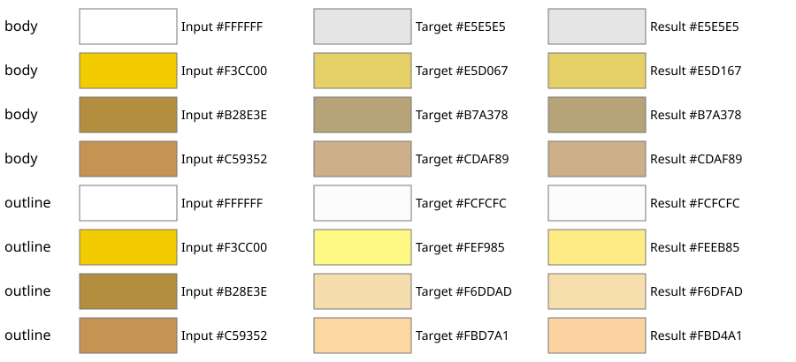
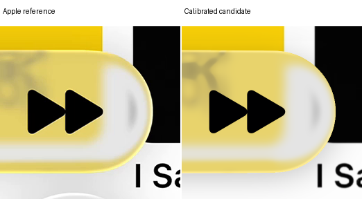
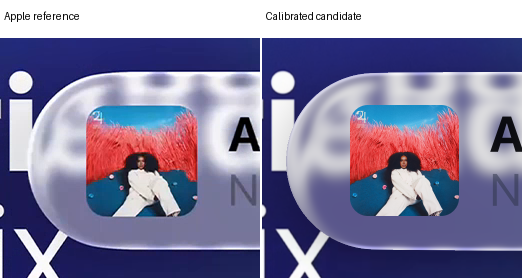
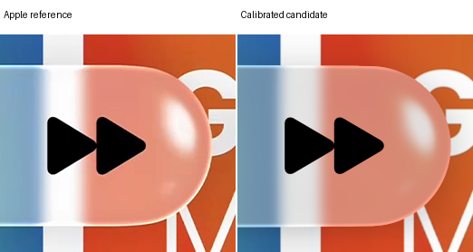

# Calibrated miniplayer colors

One candidate uses your new body and outline color anchors. Geometry, blur, shadow, artwork and the opposing diagonal outline gaps are fixed. This is held for review; the selected reconstruction is unchanged.

The body and outline map the blurred, refracted preimage directly into final display colors. Old body grading, transmission darkening and hypothetical reflected-light brightness are replaced in this candidate. Geometric displacement is unchanged. No new optical calculation or source filtering ran.

Expanded defines the shared color target. Compact uses precisely the same mapping; its color regressions are diagnostic, not a veto. The outline retains a one-pixel maximum-strength plateau and two-pixel inward fade.

Drag each divider, open the native detail crops, or use fullscreen. Coordinates are unchanged; there is no alignment correction.

[Research and verification](../research/experiments/miniplayer-anchor-color-103/README.md) · [Selected reconstruction](reconstruction.md)

## Color anchors

Saturation and HSV value match every requested anchor to numerical precision. Input hue is preserved. Consequently the yellow outline becomes #FEEB85 rather than #FEF985: its green channel differs by about 14 levels. The swatches expose this deliberate hue-preservation tradeoff.

| Role | Preimage | Requested | Hue-preserved result |
| --- | --- | --- | --- |
| body | #FFFFFF | #E5E5E5 | #E5E5E5 |
| body | #F3CC00 | #E5D067 | #E5D167 |
| body | #B28E3E | #B7A378 | #B7A378 |
| body | #C59352 | #CDAF89 | #CDAF89 |
| outline | #FFFFFF | #FCFCFC | #FCFCFC |
| outline | #F3CC00 | #FEF985 | #FEEB85 |
| outline | #B28E3E | #F6DDAD | #F6DFAD |
| outline | #C59352 | #FBD7A1 | #FBD4A1 |

White maps to #E5E5E5 in the body and #FCFCFC at full outline strength. Coverage, fade and angular gaps blend the outline endpoint with the body. This intentionally darkens compact white content relative to its reference.

## Image comparisons

| Case | Selected E | Candidate E | SSIM | Partial RMSE |
| --- | ---: | ---: | ---: | ---: |
| expanded A | 10.2239 | 10.5420 | 0.97541 | 14.4443 |
| expanded B | 5.0736 | 5.4212 | 0.98081 | 11.0521 |
| compact A | 14.8296 | 23.4810 | 0.95851 | 35.4603 |
| compact B | 14.4727 | 22.4099 | 0.95631 | 30.6654 |

Aggregate error increases on all four references. Anchor calibration is successful, but it does not establish image fidelity. There is no clipping. All original guards and local failures remain in the research record.

### Expanded A

Selected model versus candidate

Native crops: colored rims, caps and disappearing diagonals

### Expanded B

Selected model versus candidate

Native crops: colored rims, caps and disappearing diagonals

### Compact A

Selected model versus candidate

Native crops: colored rims, caps and disappearing diagonals

### Compact B

Selected model versus candidate

Native crops: colored rims, caps and disappearing diagonals

## Limits

Four warm-color anchors do not identify a unique global filter. The response uses smooth bounded interpolation, retains the prior neutral black behavior, and extrapolates the colored coefficients constantly beyond their sampled value range. Blue and other unsampled colors remain predictions. These are empirical display mappings, not measured physical radiance.
