# Final white, revised yellow and centered artwork

One candidate adjusts existing body gain to target #E6E6E6 after optical lighting. Bias, dark-tone lift and the original optical brightness pipeline remain unchanged. The finalized geometry, incident blur, shadow and angular outline gaps are fixed.

The strongest outline band is 1.5 native pixels, with its two-pixel inward fade unchanged. The yellow saturation/value target is now #FCF8AD. Input hue remains preserved, yielding approximately #FCEFAD; the nine-level green difference is explicit rather than an exact RGB-match claim.

Artwork width and height are each multiplied by 0.986 relative to the current artwork, then rounded to native pixels. Its horizontal center is unchanged, vertical placement is centered on the pill to the nearest native pixel, and corner radius remains 18 pixels.

Drag each divider or open the native crops and fullscreen. This candidate is for review; the selected reconstruction remains unchanged.

[Research and verification](../research/experiments/miniplayer-final-white-105/README.md) · [Previous revision](miniplayer-restored-grade.md) · [Selected reconstruction](reconstruction.md)

## Final-output white calibration

The frozen calibration cohort uses central expanded-B body pixels with full coverage and near-white retained input, excluding foreground, rim and held pixels. One gain solve sends pure white through those actual cached optical paths, targeting the mean final encoded value 230. No optical path, source sample or illumination parameter is fitted.

The cohort contains 27,311 pixels. Gain is 0.544238219590758. Final pure-white output spans 229.999967–230.000003, with mean 230.000000. Grading-stage white is about 238.4441; it is deliberately higher than the final target.

Actual retained near-white samples produce mean final RGB 228.780, 228.727, 228.802. Their input is not exactly pure white. The synthetic white control and actual image observations remain separate.

## Outline anchors

| Input | Requested endpoint | Hue-preserved endpoint |
| --- | --- | --- |
| #FFFFFF | #FCFCFC | #FCFCFC |
| #F3CC00 | #FCF8AD | #FCEFAD |
| #B28E3E | #F6DDAD | #F6DFAD |
| #C59352 | #FBD7A1 | #FBD4A1 |

## Comparisons

| Case | Previous revision E | New E | SSIM | Partial RMSE |
| --- | ---: | ---: | ---: | ---: |
| expanded A | 13.3909 | 11.9078 | 0.97417 | 38.9028 |
| expanded B | 9.7718 | 4.8083 | 0.98285 | 11.2407 |
| compact A | 17.5797 | 14.1668 | 0.96717 | 23.2103 |
| compact B | 18.4176 | 15.2309 | 0.96524 | 22.6370 |

Scores retain every original cohort. The finalized shape is not adjusted to improve them. Compact color regressions remain diagnostic under the shared expanded-first color requirement.

## Fixed compact white samples

These same native positions show preimage and final body values separately. They are observations of the restored pipeline, not extra calibration targets.

| Case / crop-local position | Blurred preimage | Apple | New body |
| --- | --- | --- | --- |
| Compact A (725, 65) | #FBFCFC | #FDFDFD | #E4E4E4 |
| Compact A (735, 65) | #FCFBFB | #FDFDFD | #E4E4E4 |
| Compact A (725, 185) | #F8F8F9 | #FDFDFD | #E2E2E3 |
| Compact A (735, 185) | #F8F8F8 | #FDFDFD | #E2E2E2 |
| Compact B (725, 65) | #FDFDFD | #FDFDFD | #E5E5E5 |
| Compact B (735, 65) | #FDFDFD | #FDFDFD | #E5E5E5 |
| Compact B (725, 185) | #FCFCFD | #FCFCFC | #E5E5E5 |
| Compact B (735, 185) | #FDFCFC | #FDFDFD | #E5E4E4 |

### Expanded A

Previous revision versus revision

Native crops: colored rims, caps and disappearing diagonals

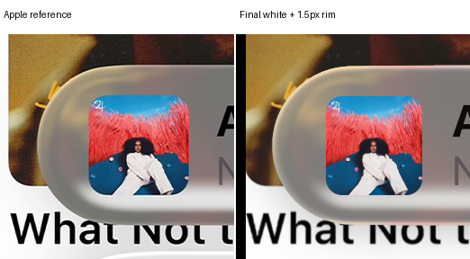

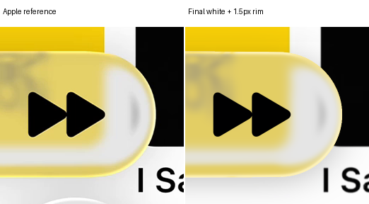

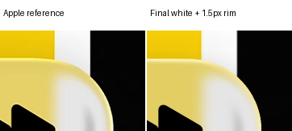

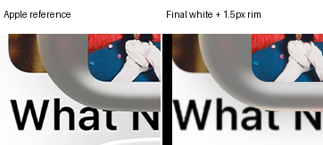

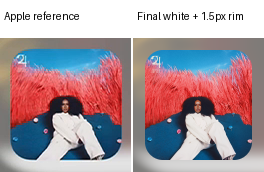

### Expanded B

Previous revision versus revision

Native crops: colored rims, caps and disappearing diagonals

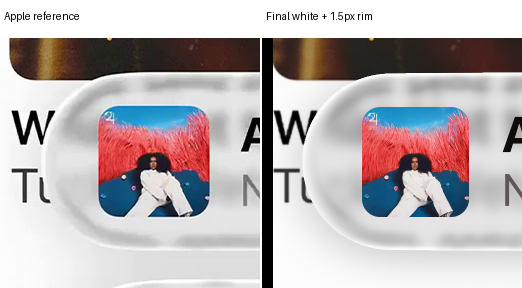

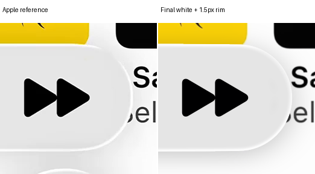

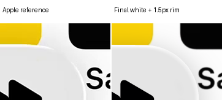

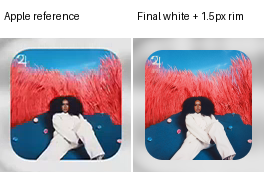

### Compact A

Previous revision versus revision

Native crops: colored rims, caps and disappearing diagonals

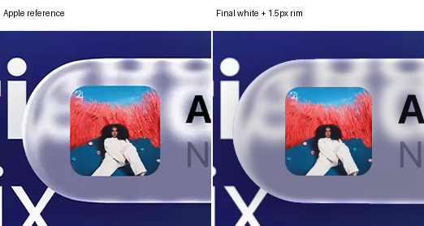

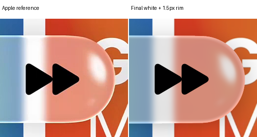

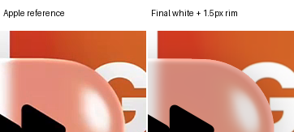

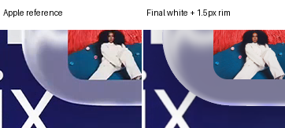

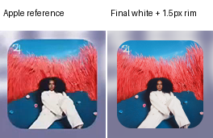

### Compact B

Previous revision versus revision

Native crops: colored rims, caps and disappearing diagonals

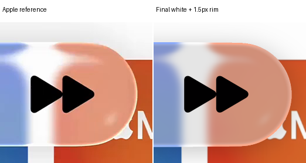

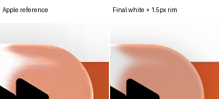

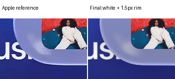

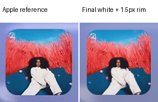

## Limits

The white calibration applies to the declared body cohort; edge lighting and mixed coverage can produce different values. The outline remains an empirical hue-preserving response. Optical scene, source-return and foreground fidelity limitations remain. The album-art change is isolated to its original and revised rectangles; other pixels remain exact.
