# Miniplayer: four complete refinement passes

This review follows the shared compact and expanded model through contour, refraction, incident blur, color, outline, exterior shadow and artwork. Dispersion is excluded. Each completed pass retains its original failures and local tradeoffs.

Drag the mask to compare identical native coordinates. Fullscreen, keyboard, touch and side-by-side controls are available. Native detail crops preserve source pixels without smoothing or alignment changes.

[Research plan](../research/experiments/miniplayer-four-pass-100/README.md) · [Feedback](../research/feedback/miniplayer-four-pass.md) · [Previous proposal](miniplayer-middle-ground.md) · [Current models](reconstruction.md)

Completed and independently replayed: **3 of four passes**. Numerical ranking and visual selection are separate; the original strict local guards remain reported.

## Pass 1

The candidate improves compact tone and all four artwork errors, but expanded body and rim errors worsen. The combined normalized score improves by approximately 1.5%; visual review keeps the candidate held. The working model is unchanged.

The rim has a two-pixel plateau and a separate inward fade. All four own replays are exact. Local failures, source uncertainty and the wider-blur tradeoff remain visible below.

| Reference | E | SSIM | Original partial RMSE | Normalized combined score |
| --- | ---: | ---: | ---: | ---: |
| expanded A | 12.9747 | 0.96655 | 63.4226 | 1.1052 |
| expanded B | 9.7445 | 0.97766 | 17.5831 | 1.3195 |
| compact A | 13.2608 | 0.96167 | 30.9172 | 0.7595 |
| compact B | 12.3132 | 0.96429 | 31.1988 | 0.7545 |

Combined score equally weights baseline-normalized glass, rim, exterior and artwork errors across references. Lower than one improves this numerical ranking. It is not a physical-material identification or a replacement for visual review.

### Expanded A

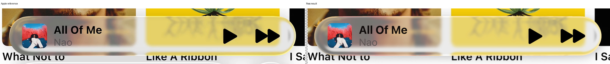

### Expanded B

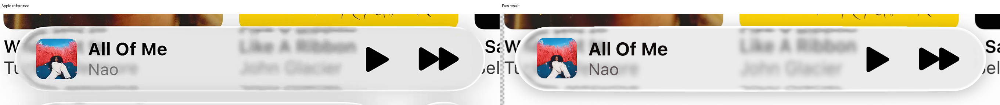

### Compact A

### Compact B

Previous result versus pass 1

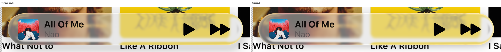

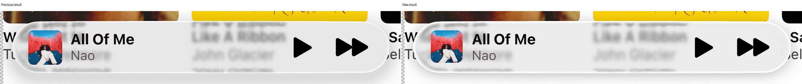

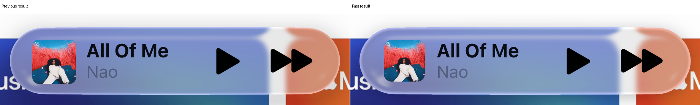

Native cap, rim and artwork details

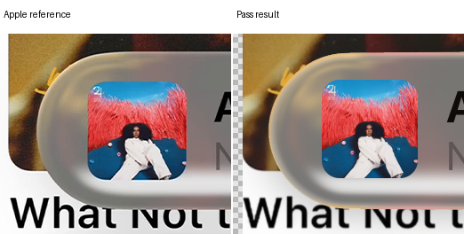

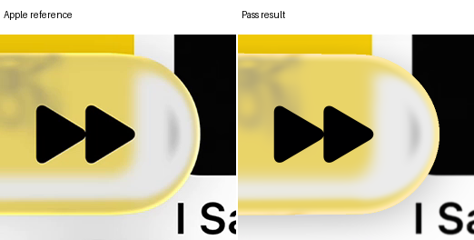

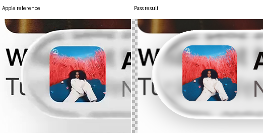

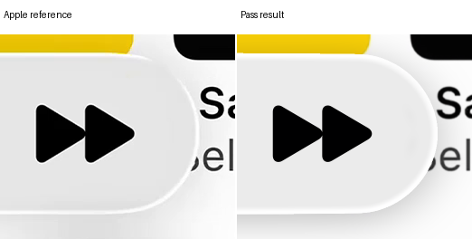

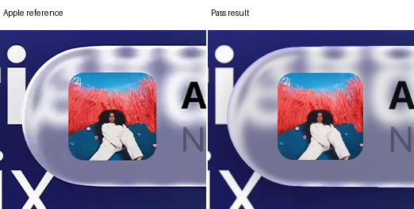

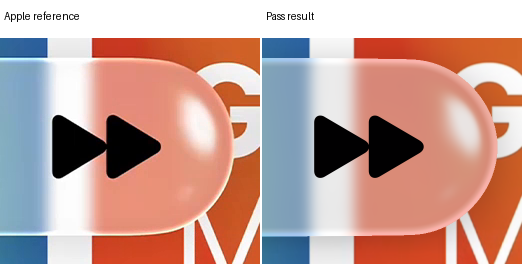

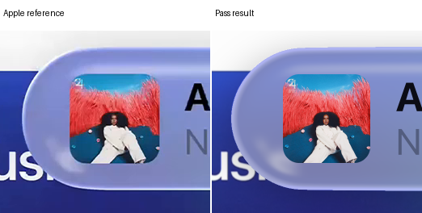

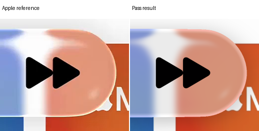

Recipe: incident sigma `6.6825`; rim plateau `2.0` pixels and fade `2.0` pixels; artwork scale `0.94`. [Exact results and stage choices](../research/experiments/miniplayer-four-pass-100/pass1/README.md).

## Pass 2

This candidate is rejected. The gentler geometry and preserved white endpoint help, but the new rim becomes too orange on yellow and adds an unwanted colored compact contour. Its combined normalized score is 1.03739, worse than the starting proposal.

All four own replays and metrics are exact. The smaller shoulder correction, artwork scale and reduced shadow opacity remain useful inputs to the next pass; the failed rim response is not adopted.

| Reference | E | SSIM | Original partial RMSE | Normalized combined score |
| --- | ---: | ---: | ---: | ---: |
| expanded A | 15.8728 | 0.96477 | 50.0708 | 1.2339 |
| expanded B | 6.2848 | 0.98251 | 15.8126 | 0.9822 |
| compact A | 17.0931 | 0.96541 | 46.1564 | 0.8812 |
| compact B | 20.5850 | 0.96265 | 37.3809 | 1.0522 |

Combined score equally weights baseline-normalized glass, rim, exterior and artwork errors across references. Lower than one improves this numerical ranking. It is not a physical-material identification or a replacement for visual review.

### Expanded A

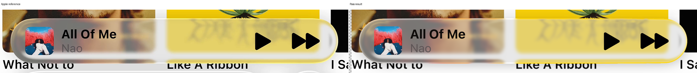

### Expanded B

### Compact A

### Compact B

Previous result versus pass 2

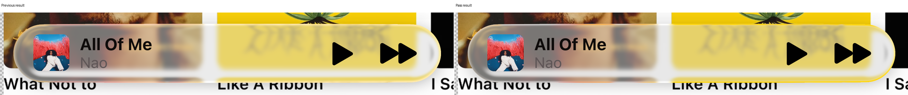

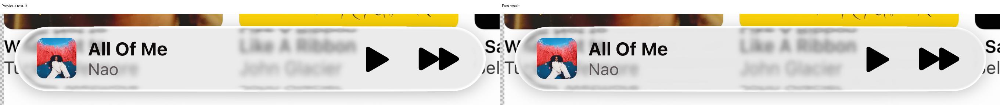

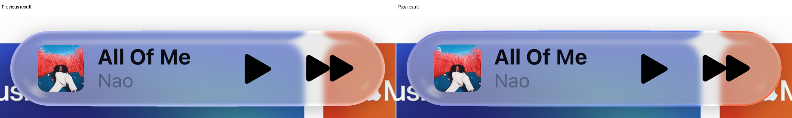

Native cap, rim and artwork details

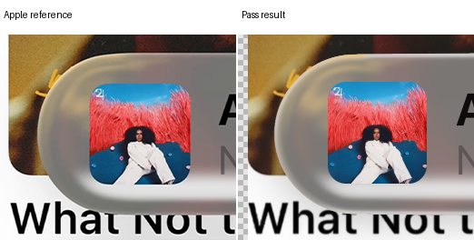

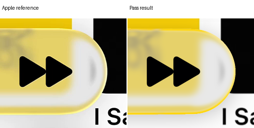

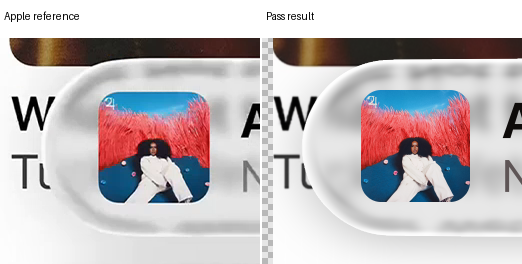

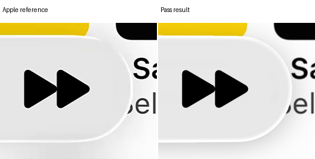

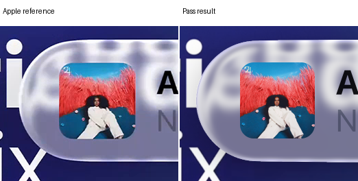

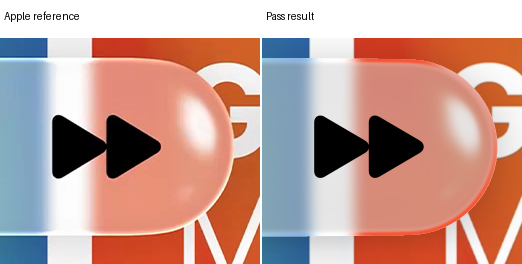

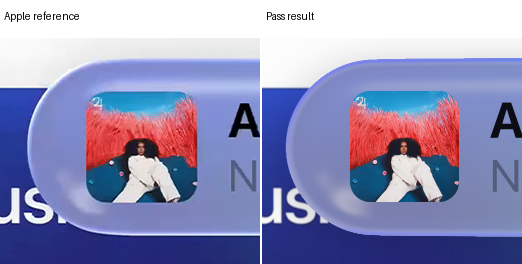

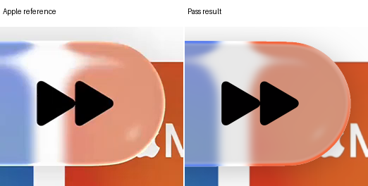

Recipe: incident sigma `6.37875`; rim plateau `2.0` pixels and fade `2.0` pixels; artwork scale `0.95`. [Exact results and stage choices](../research/experiments/miniplayer-four-pass-100/pass2/README.md).

## Pass 3

This is the strongest candidate so far, with a combined normalized score of 0.91290. The softer response restores yellow without the orange contour of pass two. Compact tone and artwork improve; expanded and partial-boundary regressions remain.

All four independent output and metric replays are exact. This is a provisional visual candidate, not full fidelity acceptance. The fourth pass tests nearby geometry, plateau width and shadow falloff before final selection.

| Reference | E | SSIM | Original partial RMSE | Normalized combined score |
| --- | ---: | ---: | ---: | ---: |
| expanded A | 12.3182 | 0.96793 | 53.9024 | 1.0436 |
| expanded B | 6.9609 | 0.97969 | 16.4711 | 1.0404 |
| compact A | 13.4937 | 0.96510 | 23.1769 | 0.7643 |
| compact B | 13.4321 | 0.96300 | 23.4438 | 0.8033 |

Combined score equally weights baseline-normalized glass, rim, exterior and artwork errors across references. Lower than one improves this numerical ranking. It is not a physical-material identification or a replacement for visual review.

### Expanded A

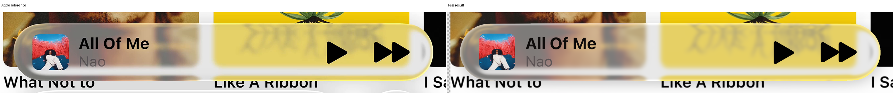

### Expanded B

### Compact A

### Compact B

Previous result versus pass 3

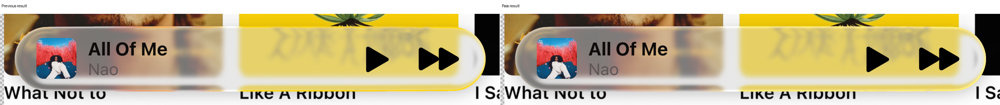

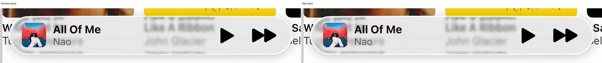

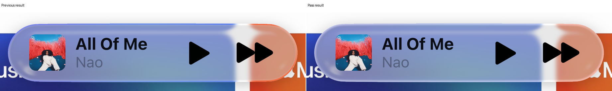

Native cap, rim and artwork details

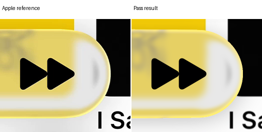

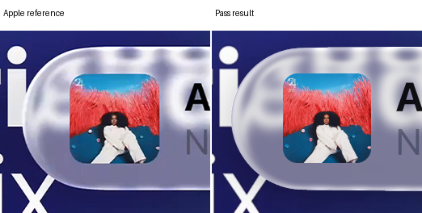

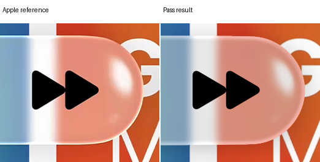

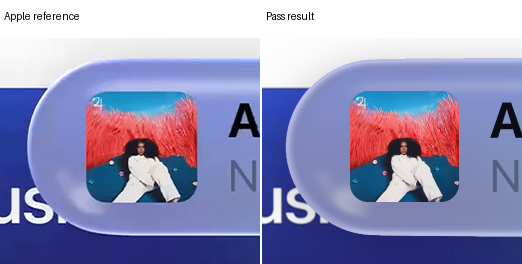

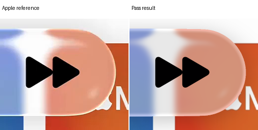

Recipe: incident sigma `6.37875`; rim plateau `2.0` pixels and fade `2.0` pixels; artwork scale `0.95`. [Exact results and stage choices](../research/experiments/miniplayer-four-pass-100/pass3/README.md).

## Interpretation

Artwork uses the original asset with a shared centered scale, upward offset and absolute corner radius. Its score includes the exposed backing in the unchanged original guard box. It does not improve the glass score by changing that mask.

The outline uses incident-blurred refraction before the body grade. Chroma and peak strength remain distinct. Shadow darkens only uncovered contributions; it is excluded from lens transport. Shared optical parameters still differ only by member length.

All source mosaics are conditional evidence. Reflected scene assumptions and unassigned later power remain unresolved. A better appearance does not uniquely identify the original renderer.
