# Miniplayer HSV outline options

Five options share the finalized pill geometry, incident blur, optical paths, shadow and artwork. Only outline saturation differs: 60%, 70%, 80%, 90% or 100% of the blurred preimage saturation. No option has been selected.

Jump to [60%](#60-preimage-saturation), [70%](#70-preimage-saturation), [80%](#80-preimage-saturation), [90%](#90-preimage-saturation) or [100%](#100-preimage-saturation).

At maximum filter strength, hue is preserved and HSV value is 253 out of 255. White becomes #FDFDFD. The maximum-strength plateau is one native pixel, 1.5 times its previous thickness. The two-pixel inward fade and opposing diagonal gaps remain unchanged.

The body grade also maps white to #FDFDFD before optical transmission and reflected light. Final body pixels need not equal that value. The saved white-patch measurements distinguish these stages. Display clipping, if present, is reported explicitly.

Drag each divider for Apple/result or current/result comparisons. Fullscreen exposes native pixels; detail crops preserve identical coordinates without realignment. All saturation options use the same shape even where the reference contour differs.

[Research and white patches](../research/experiments/miniplayer-hsv-options-102/README.md) · [Previous three passes](miniplayer-three-pass.md) · [Selected reconstruction](reconstruction.md)

## Compact white checks

The strict exact-white cohort is empty. Fixed samples through the visible compact white stripe show the remaining issue: Apple is about 252–253, while this test body is about 240–243 after optical attenuation. The grade endpoint passes, but final body white is still too dark.

| Reference / crop-local pixel | Blurred preimage | Apple | Current output | New body |
| --- | --- | --- | --- | --- |
| compact-a (725, 65) | #FBFCFC | #FDFDFD | #E7E7E7 | #F2F2F2 |
| compact-a (735, 65) | #FCFBFB | #FDFDFD | #E7E7E6 | #F2F2F2 |
| compact-a (725, 185) | #F8F8F9 | #FDFDFD | #E5E5E5 | #F0F0F0 |
| compact-a (735, 185) | #F8F8F8 | #FDFDFD | #E5E5E5 | #F0F0F0 |
| compact-b (725, 65) | #FDFDFD | #FDFDFD | #E8E8E8 | #F3F3F3 |
| compact-b (735, 65) | #FDFDFD | #FDFDFD | #E8E8E8 | #F3F3F3 |
| compact-b (725, 185) | #FCFCFD | #FCFCFC | #E7E7E7 | #F2F3F3 |
| compact-b (735, 185) | #FDFCFC | #FDFDFD | #E7E7E7 | #F3F2F2 |

## 60% preimage saturation

| Reference | E | SSIM | Original partial RMSE | Clipped body channels before display |
| --- | ---: | ---: | ---: | ---: |
| expanded A | 14.8222 | 0.97454 | 40.9614 | 4530 |
| expanded B | 12.6781 | 0.98088 | 20.8197 | 37002 |
| compact A | 10.9016 | 0.97028 | 27.0537 | 811 |
| compact B | 12.7302 | 0.96822 | 23.6956 | 905 |

Scores are diagnostic. The finalized geometry is not retuned to improve outline scores.

### Expanded A — 60%

Current model versus this option

Native zooms: caps, upper/lower rim and disappearing diagonals

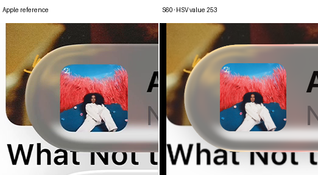

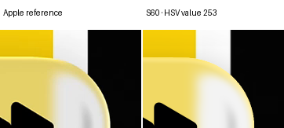

### Expanded B — 60%

Current model versus this option

Native zooms: caps, upper/lower rim and disappearing diagonals

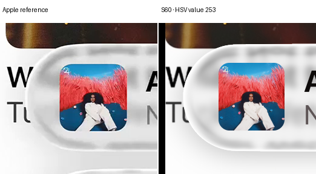

### Compact A — 60%

Current model versus this option

Native zooms: caps, upper/lower rim and disappearing diagonals

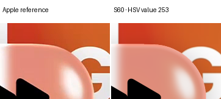

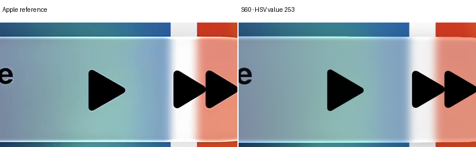

### Compact B — 60%

Current model versus this option

Native zooms: caps, upper/lower rim and disappearing diagonals

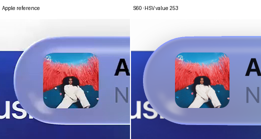

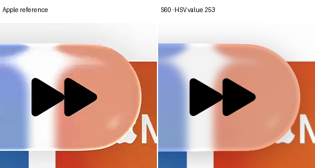

## 70% preimage saturation

| Reference | E | SSIM | Original partial RMSE | Clipped body channels before display |
| --- | ---: | ---: | ---: | ---: |
| expanded A | 15.0225 | 0.97385 | 40.8338 | 4530 |
| expanded B | 12.6778 | 0.98087 | 20.8197 | 37002 |
| compact A | 12.0049 | 0.96984 | 31.5105 | 811 |
| compact B | 14.3152 | 0.96729 | 26.9035 | 905 |

Scores are diagnostic. The finalized geometry is not retuned to improve outline scores.

### Expanded A — 70%

Current model versus this option

Native zooms: caps, upper/lower rim and disappearing diagonals

### Expanded B — 70%

Current model versus this option

Native zooms: caps, upper/lower rim and disappearing diagonals

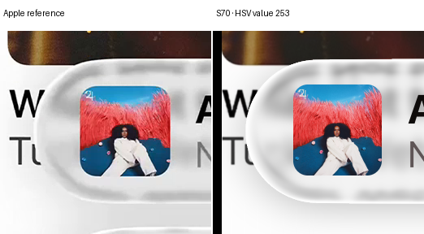

### Compact A — 70%

Current model versus this option

Native zooms: caps, upper/lower rim and disappearing diagonals

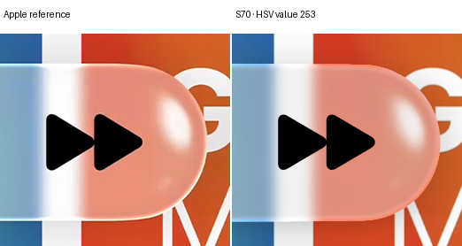

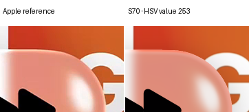

### Compact B — 70%

Current model versus this option

Native zooms: caps, upper/lower rim and disappearing diagonals

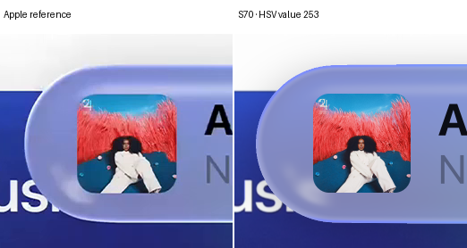

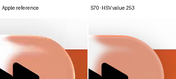

## 80% preimage saturation

| Reference | E | SSIM | Original partial RMSE | Clipped body channels before display |
| --- | ---: | ---: | ---: | ---: |
| expanded A | 15.5120 | 0.97291 | 40.7101 | 4530 |
| expanded B | 12.6775 | 0.98087 | 20.8197 | 37002 |
| compact A | 13.2381 | 0.96930 | 36.5762 | 811 |
| compact B | 16.0559 | 0.96613 | 31.0284 | 905 |

Scores are diagnostic. The finalized geometry is not retuned to improve outline scores.

### Expanded A — 80%

Current model versus this option

Native zooms: caps, upper/lower rim and disappearing diagonals

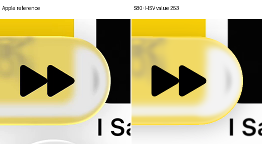

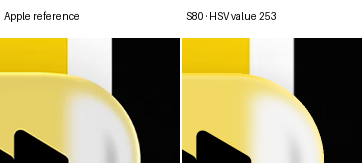

### Expanded B — 80%

Current model versus this option

Native zooms: caps, upper/lower rim and disappearing diagonals

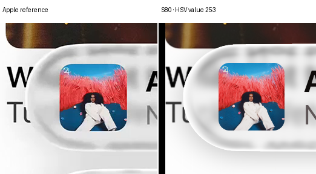

### Compact A — 80%

Current model versus this option

Native zooms: caps, upper/lower rim and disappearing diagonals

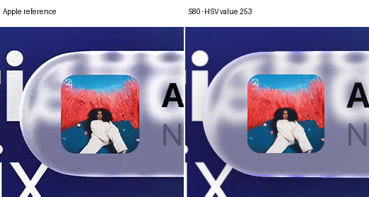

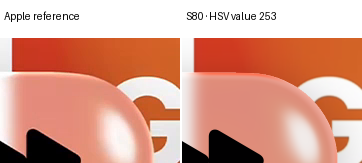

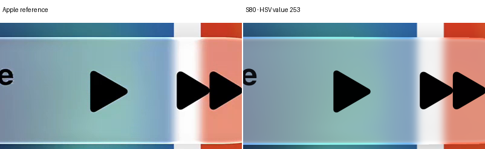

### Compact B — 80%

Current model versus this option

Native zooms: caps, upper/lower rim and disappearing diagonals

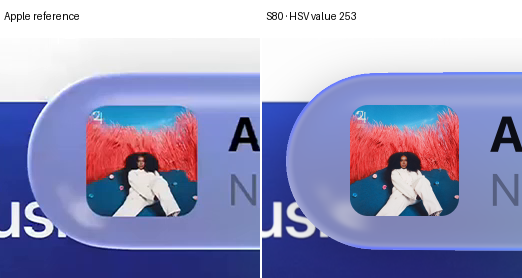

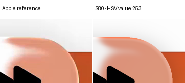

## 90% preimage saturation

| Reference | E | SSIM | Original partial RMSE | Clipped body channels before display |
| --- | ---: | ---: | ---: | ---: |
| expanded A | 16.2646 | 0.97178 | 40.5902 | 4530 |
| expanded B | 12.6772 | 0.98087 | 20.8196 | 37002 |
| compact A | 14.5683 | 0.96867 | 42.0313 | 811 |
| compact B | 17.9070 | 0.96475 | 35.7543 | 905 |

Scores are diagnostic. The finalized geometry is not retuned to improve outline scores.

### Expanded A — 90%

Current model versus this option

Native zooms: caps, upper/lower rim and disappearing diagonals

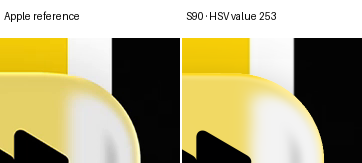

### Expanded B — 90%

Current model versus this option

Native zooms: caps, upper/lower rim and disappearing diagonals

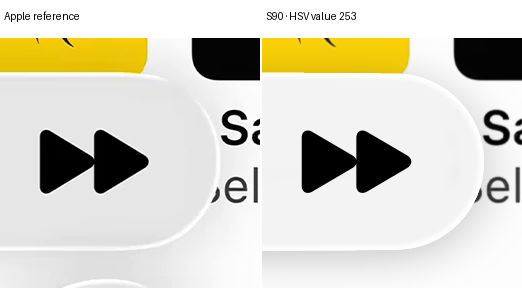

### Compact A — 90%

Current model versus this option

Native zooms: caps, upper/lower rim and disappearing diagonals

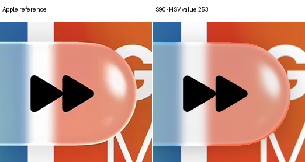

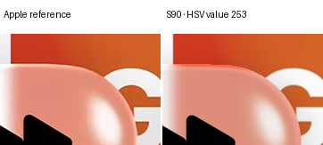

### Compact B — 90%

Current model versus this option

Native zooms: caps, upper/lower rim and disappearing diagonals

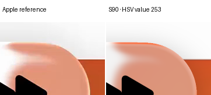

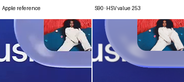

## 100% preimage saturation

| Reference | E | SSIM | Original partial RMSE | Clipped body channels before display |
| --- | ---: | ---: | ---: | ---: |
| expanded A | 17.2458 | 0.97054 | 40.4742 | 4530 |
| expanded B | 12.6769 | 0.98087 | 20.8196 | 37002 |
| compact A | 15.9712 | 0.96796 | 47.7425 | 811 |
| compact B | 19.8375 | 0.96320 | 40.8733 | 905 |

Scores are diagnostic. The finalized geometry is not retuned to improve outline scores.

### Expanded A — 100%

Current model versus this option

Native zooms: caps, upper/lower rim and disappearing diagonals

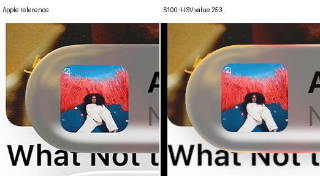

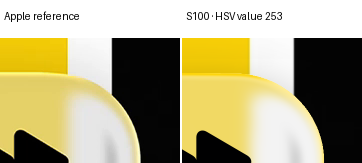

### Expanded B — 100%

Current model versus this option

Native zooms: caps, upper/lower rim and disappearing diagonals

### Compact A — 100%

Current model versus this option

Native zooms: caps, upper/lower rim and disappearing diagonals

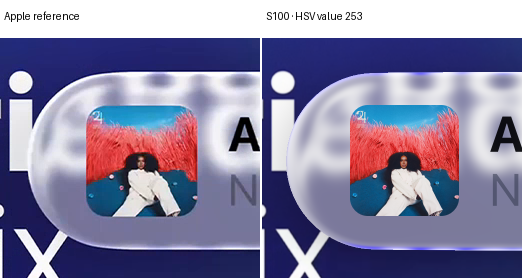

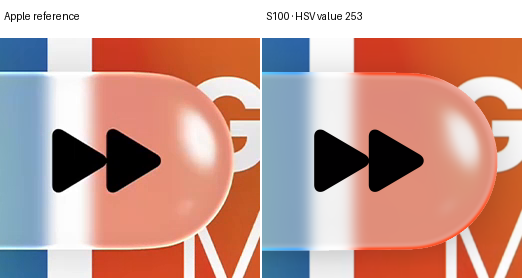

### Compact B — 100%

Current model versus this option

Native zooms: caps, upper/lower rim and disappearing diagonals

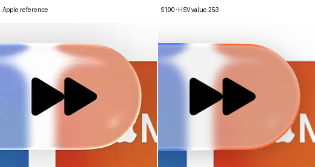

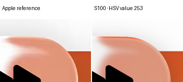

## Reading the comparisons

Equal HSV value is not equal luminance. A saturated yellow and white can share the same largest RGB channel while having different measured lightness. Saturation percentages are relative to each blurred preimage color, not absolute saturation settings.

Pixel coverage and angular fading blend the endpoint with the completed body. A boundary pixel therefore need not reach value 253. The right upper-right and left lower-left gaps retain zero overlay contribution; existing refracted brightness remains visible.

The source mosaics and reflected scene remain conditional. These are display options for visual review, not physical identification or full-fidelity acceptance.
