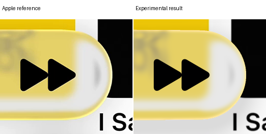
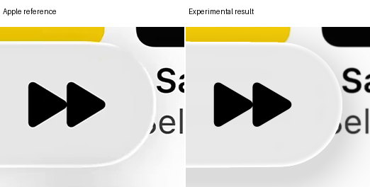
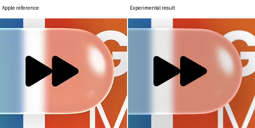
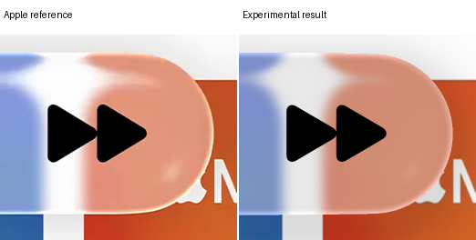

# Miniplayer middle ground: colored plateau and directional shadow

Incident blur remains included. Two intermediate shapes reduce the previous excessive join smoothing. The rim now draws color from the blurred refraction before grading, with a short peak plateau and a brightness safeguard. The broad shadow shifts downward and becomes darker. These are experimental results; original boundary and foreground failures remain.

Drag each slider to compare identical native pixels. Fullscreen, side-by-side, touch and keyboard controls are available. All separate settings and negatives follow the final proposal.

[Research report](../research/experiments/miniplayer-middle-ground-99/README.md) · [Recorded feedback](../research/feedback/miniplayer-middle-ground.md) · [Previous proposal](miniplayer-feedback-review.md) · [Selected models](reconstruction.md)

## Current experimental proposal

The displayed endpoint uses peak exposure three and a shared minimum brightening of `0.24`. It preserves more yellow than the previous nearly white rim. Compact dark-color artifacts from the full raw-color test are suppressed. Correct edge color, returned-feature placement and full family fidelity remain unresolved.

| Reference | Previous proposal E | Current E |
| --- | ---: | ---: |
| Expanded A | 11.1280 | 9.5068 |
| Expanded B | 5.6279 | 5.4896 |
| Compact A | 16.0236 | 16.4327 |
| Compact B | 16.7582 | 16.3892 |

Three aggregate errors improve against the previous proposal; compact A worsens. All four original partial-boundary guards still fail. This is not a replacement accepted solely by the aggregate score.

### Expanded A

### Expanded B

### Compact A

### Compact B

Previous proposal versus current proposal

## Native edge details

The crops keep native pixels, without smoothing or realignment. The upper yellow edge retains more chroma; the lower edge remains too pale and insufficiently green at the fixed sample. The brighter source response is a display hypothesis, not recovered physical radiance.

## Intermediate shape

Top joins move down and bottom joins up, with outermost tips fixed. Inset is measured at the former straight-to-cap join location; it is not a fitted silhouette measurement. Compact and expanded still share the same model, differing only in major length.

| Shape | Expanded inset | Compact inset |
| --- | ---: | ---: |
| Earlier smooth shape | 0.680 px | 0.665 px |
| Intermediate 0.75 | 1.346 px | 1.304 px |
| Intermediate 1.25, used below | 1.776 px | 1.714 px |
| Previous stronger shape | 2.407 px | 2.308 px |

The second intermediate has the lower equal-reference mean error and was used for material tests. That choice uses evaluation evidence and is not a held-out result. Both intermediate geometry-only comparisons are retained below.

## Color and plateau

The maximum-strength plateau spans `0.6` native pixel before a smooth inward fade. The source guide includes the same incident blur and refraction as the body, but excludes its neutral grade and added scene light. Original foreground handling remains unchanged.

A full transfer initially made the compact rim dark and oversaturated. The follow-up keeps that source color subject to a minimum linear-luminance brightening. It adds only enough neutral contribution to meet that floor. Pure white stays white; the black control retains a light-gray endpoint. No per-control color parameters are introduced.

| Fixed expanded-A sample | Reference RGB | Current RGB |
| --- | --- | --- |
| Upper, native (1400, 325) | 248, 224, 116 | 243.4, 216.7, 133.8 |
| Lower, native (1400, 501) | 255, 252, 122 | 253.9, 229.6, 165.1 |

The reported `#F3E360` and `#FAEF84` observations have no supplied coordinates, so they are not assigned to these pixels or used as fit targets. The fixed samples show remaining green/blue errors, especially below.

## Downward shadow

The shadow uses the actual intermediate outline shifted downward by eighteen pixels, width `32`, power `1.5` and strength `34/255`. It affects only uncovered subrays. No refraction, blur, lens sample or fully covered pixel is changed by this stage.

| Unit-white model check | Output | Reported reference cue |
| --- | --- | --- |
| Immediately below | `#DDDDDD` | `#DDDDDD` |
| Immediately above | `#E9E9E9` | `#E8E8E8` |
| 20.5 px above | `#F6F6F6` | Approximately `#F4F4F4` near crop top |

These are ideal white-input checks, not registered image measurements or a recovered light source. Both fourteen- and eighteen-pixel offsets are retained. The conditional source mosaics still limit unique shadow identification.

## Every separate observation

All geometry variants use incident sigma `6.075`. Material variants reuse one supported geometry and cached blurred samples. No narrower blur, new source, target-specific grade, mask change or foreground adjustment is hidden in these comparisons.

Lighter intermediate geometry

Stronger intermediate geometry

Intermediate shape with the previous material recipe

Only stronger shadow, shifted14 pixels down

Only stronger shadow, shifted18 pixels down

Color-preserving endpoint using graded input

Blurred pre-grade source color, no plateau

Blurred pre-grade source color with plateau

Full source-color transfer plus downward shadow: negative

Brightness safeguard0.12, lower peak

Brightness safeguard0.24, lower peak

## Verification and limits

Both intermediate native families pass source support before RGB. The final brighter-peak outputs replay pixel-exactly with exact scores. Plateau integration required the declared order32 refinement. Earlier verifier failures and repeated setup accounting are preserved in the report; no completed scientific candidate or quadrature field was rerun to hide a failure.

The selected reconstruction remains unchanged. The proposal answers the requested comparisons, but does not resolve all boundary, foreground, interior or returned-feature mismatches.
