# Eased outline thickness

Color B at 120% is the chosen review baseline. This candidate replaces its short middle taper with a long smooth thickness transition. The color response, completed body, shape, artwork, blur, shadow and diagonal gaps stay fixed.

From left to right, the existing thin width holds through 7.614% of the full pill width. A cubic smoothstep reaches 120% at 91.966%. A short linear transition reaches 145% at 94.365%, then holds through the right tip. Both plateau and inward fade scale together.

The slight left brightness reduction eases separately: its existing maximum holds through 7.614%, then smoothly reaches zero at the exact center. It reduces only positive HSV value lift by at most one percent; hue and saturation retain Color B.

The entire right endcap is not constant width: the exact supplied horizontal coordinates govern its transition. At the right tip the plateau is 1.74 native pixels and fade scale is 2.32. The existing thin-left values remain approximately 0.686 and 0.914 pixels.

Each slider compares Apple with the candidate. Expand the previous-choice comparison to compare Color B at 120% directly. Zoomed crops preserve native pixels. No new aggregate score or fidelity acceptance is claimed.

[Verification](../research/experiments/miniplayer-outline-eased-width-113/README.md) · [Previous options](miniplayer-outline-range.md)

### Expanded A

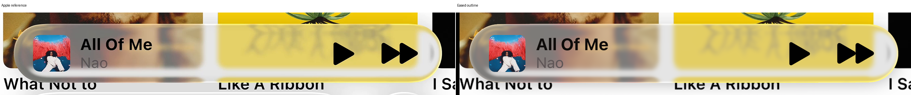

Chosen Color B 120% versus revision

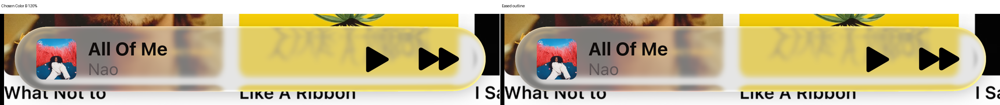

Native crops: colored rims, caps and disappearing diagonals

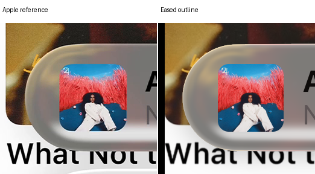

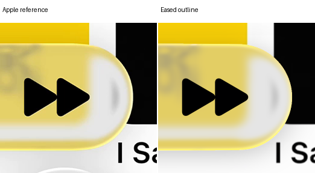

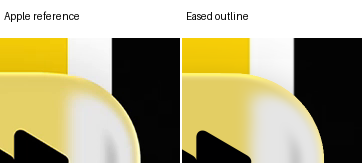

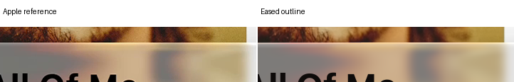

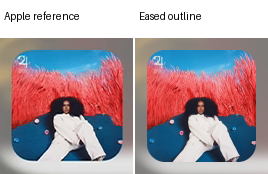

### Expanded B

Chosen Color B 120% versus revision

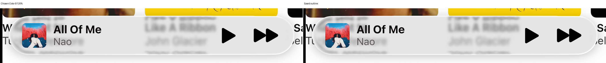

Native crops: colored rims, caps and disappearing diagonals

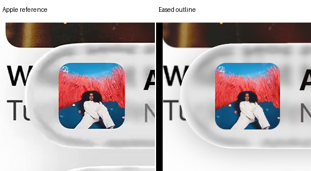

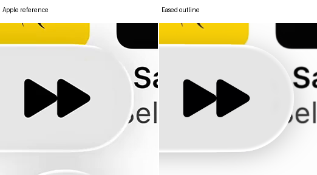

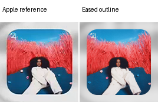

### Compact A

Chosen Color B 120% versus revision

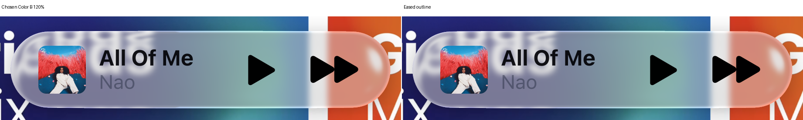

Native crops: colored rims, caps and disappearing diagonals

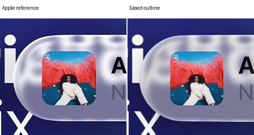

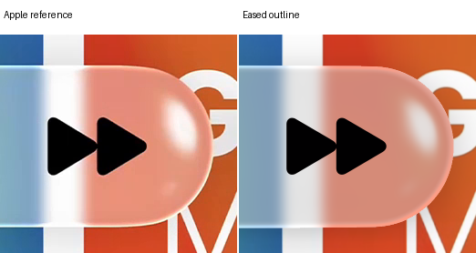

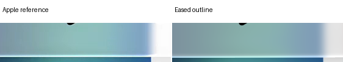

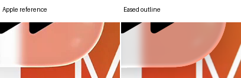

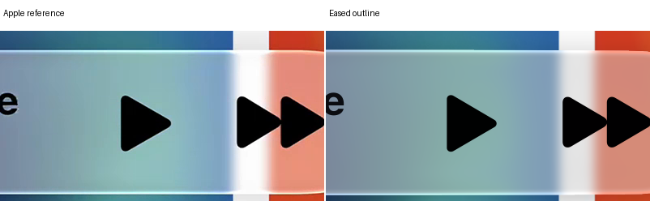

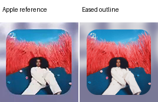

### Compact B

Chosen Color B 120% versus revision

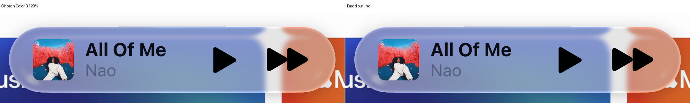

Native crops: colored rims, caps and disappearing diagonals

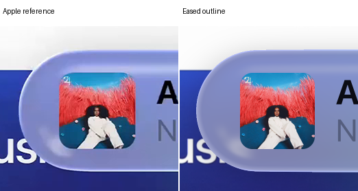

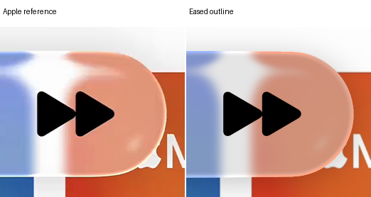

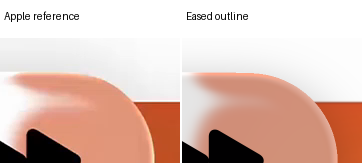

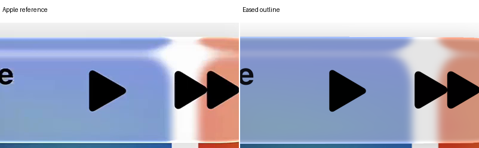

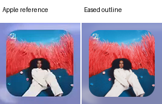

## Verification

Four chosen-baseline identities and four independent composition replays pass. The new area integration uses orders 16/32 and restricted 64/96 refinement. Source guides are finite everywhere the outline contributes. Unchanged body pixels remain exact. No optical rays, source filtering or fitting ran.
