# Choose an outline color step

Choose Current or Steps 1–5 in the dropdown. Every comparison and zoomed crop switches together while the divider keeps its position. Apple stays on the left; the chosen rendering appears on the right. Additional comparisons keep the current rendering on the left.

<label for="outline-step">Outline option</label>
<select id="outline-step" data-outline-options="outline-options-sources.json" aria-describedby="outline-step-status"><option value="0">Current — revision 110</option><option value="1">Step 1</option><option value="2">Step 2</option><option value="3">Step 3</option><option value="4">Step 4</option><option value="5">Step 5</option></select>

Current — revision 110

Each further step multiplies saturation by 0.99 and hue-shift strength by 0.95, then adds 0.002 to HSV value. Value is bounded at one. Thickness, spatial taper, artwork and lens rendering stay fixed. No option is selected for adoption.

| Option | Saturation versus current | Hue shift versus current | Extra HSV value |
| --- | ---: | ---: | ---: |
| Current | 100% | 100% | 0 |
| Step 1 | 99.000% | 95.000% | 0.002 |
| Step 2 | 98.010% | 90.250% | 0.004 |
| Step 3 | 97.030% | 85.737% | 0.006 |
| Step 4 | 96.060% | 81.451% | 0.008 |
| Step 5 | 95.099% | 77.378% | 0.010 |

[Verification](../research/experiments/miniplayer-outline-options-111/README.md) · [Current version](miniplayer-outline-value.md)

## Expanded A

Compare with the current version

Zoomed outline, caps and transition crops

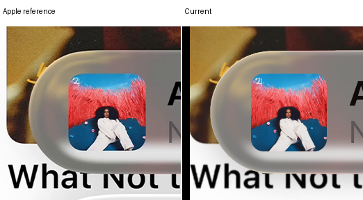

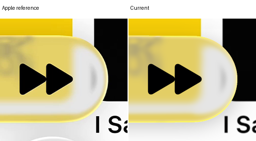

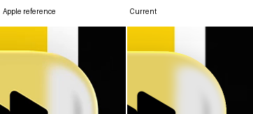

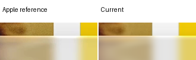

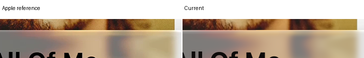

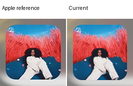

## Expanded B

Compare with the current version

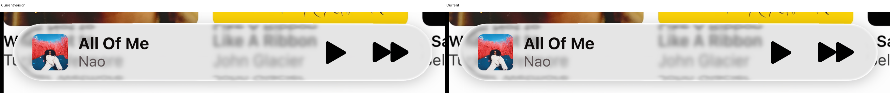

Zoomed outline, caps and transition crops

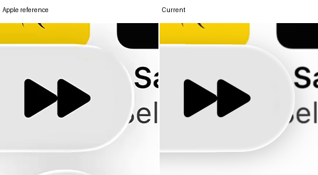

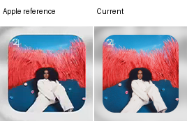

## Compact A

Compare with the current version

Zoomed outline, caps and transition crops

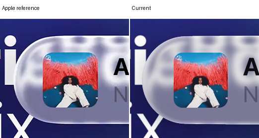

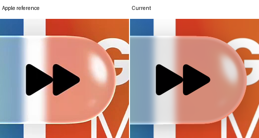

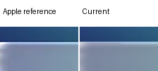

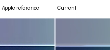

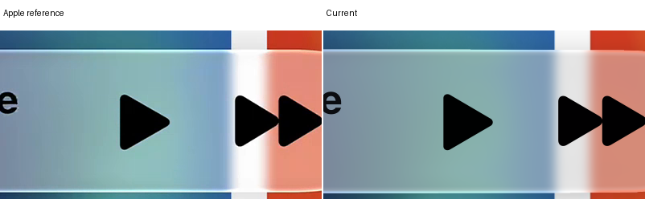

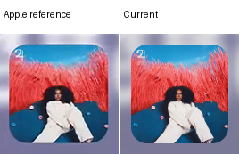

## Compact B

Compare with the current version

Zoomed outline, caps and transition crops

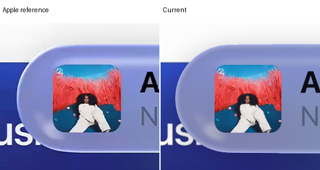

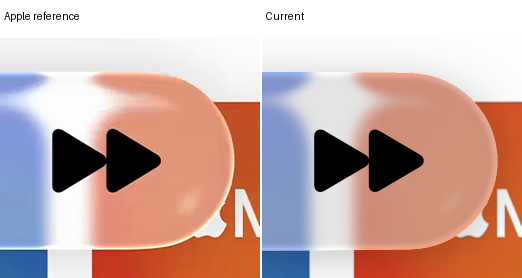

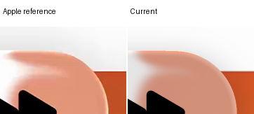

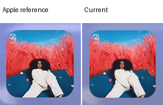

## Verification

All twenty candidates retain the current body and original outside-outline pixels. Four baseline identities are exact; twenty independent scalar HSV replays pass within 1e-7. Values reaching the declared ceiling are recorded. No new optical work, quadrature, filtering, fitting or scores were produced.
