# Choose outline color and right-side thickness

Use two dropdowns to choose color and non-left outline thickness. Every full comparison and zoomed crop switches together while its divider keeps position. Apple stays on the left. Additional comparisons keep Color A at 100% thickness on the left.

<label for="outline-color">Color</label>
<select id="outline-color" data-outline-range="outline-range-sources.json" aria-describedby="outline-range-status"><option value="0">Color A — previous Step 5</option><option value="1">Color B</option><option value="2">Color C</option><option value="3">Color D</option><option value="4">Color E</option><option value="5">Color F</option><option value="6">Color G</option><option value="7">Color H</option><option value="8">Color I</option><option value="9">Color J</option><option value="10">Color K</option></select>
<label for="outline-thickness">Non-left thickness</label>
<select id="outline-thickness" aria-describedby="outline-range-status"><option value="0">100%</option><option value="1">120%</option><option value="2">140%</option><option value="3">160%</option><option value="4">180%</option></select>

Color A · 100%

Color A is the previous series' Step 5. Each following color multiplies saturation by 0.9509900499 and hue-shift strength by 0.88689046875, adding 0.010 to HSV value. The hue reduction is half of the originally proposed larger increment. HSV value is bounded at one, so brighter options can reach the ceiling.

Thickness increases affect the region to the right of the 43.36%–44.58% transition, including top, bottom and right endcap. The thin left region remains fixed. The transition blends into the chosen width, scaling plateau and fade together. Existing diagonal gaps remain unchanged.

Geometry, body, artwork, incident blur and shadow remain fixed. Color B at 120% was chosen as the baseline for the next outline revision.

| Thickness | Non-left plateau | Non-left fade scale |
| --- | ---: | ---: |
| 100% | 1.20 px | 1.60 px |
| 120% | 1.44 px | 1.92 px |
| 140% | 1.68 px | 2.24 px |
| 160% | 1.92 px | 2.56 px |
| 180% | 2.16 px | 2.88 px |

| Color | Saturation versus A | Hue shift versus A | Extra HSV value |
| --- | ---: | ---: | ---: |
| A | 100.000% | 100.000% | 0.000 |
| B | 95.099% | 88.689% | 0.010 |
| C | 90.438% | 78.657% | 0.020 |
| D | 86.006% | 69.761% | 0.030 |
| E | 81.791% | 61.870% | 0.040 |
| F | 77.782% | 54.872% | 0.050 |
| G | 73.970% | 48.665% | 0.060 |
| H | 70.345% | 43.161% | 0.070 |
| I | 66.897% | 38.279% | 0.080 |
| J | 63.619% | 33.949% | 0.090 |
| K | 60.501% | 30.109% | 0.100 |

[Verification](../research/experiments/miniplayer-outline-range-112/README.md) · [Previous series](miniplayer-outline-options.md)

## Expanded A

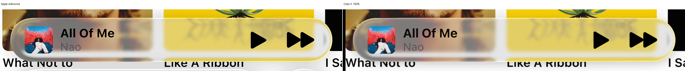

Compare with Color A at 100%

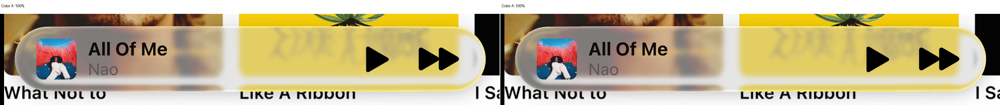

Zoomed outline, caps and transition crops

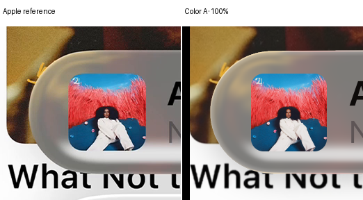

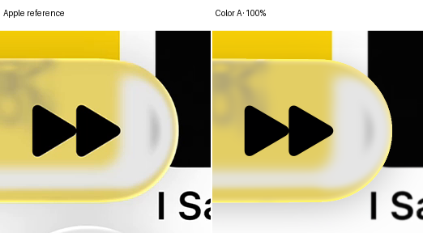

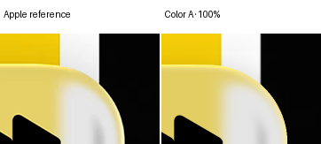

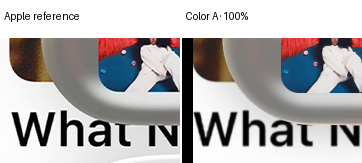

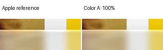

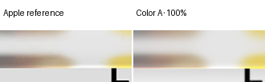

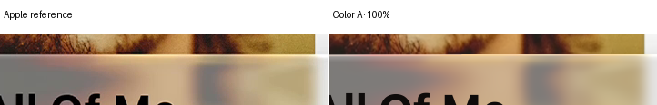

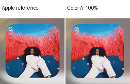

## Expanded B

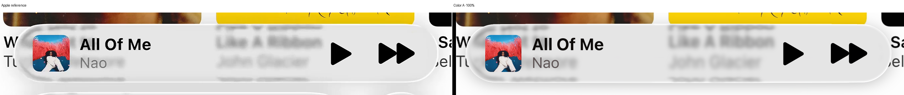

Compare with Color A at 100%

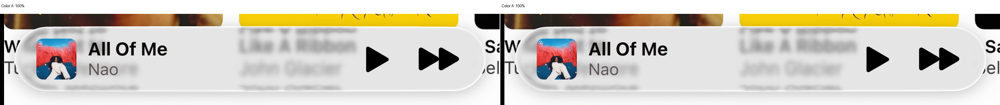

Zoomed outline, caps and transition crops

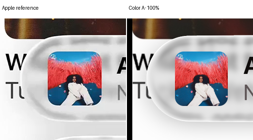

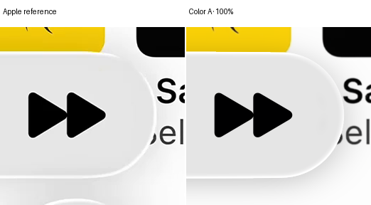

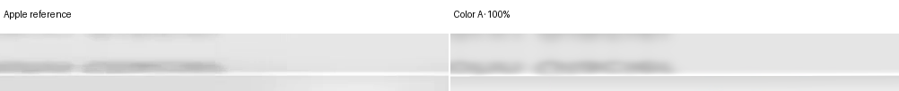

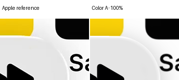

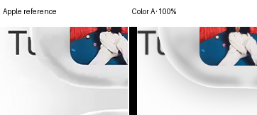

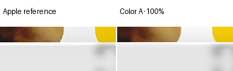

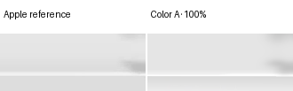

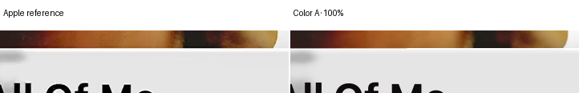

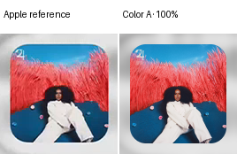

## Compact A

Compare with Color A at 100%

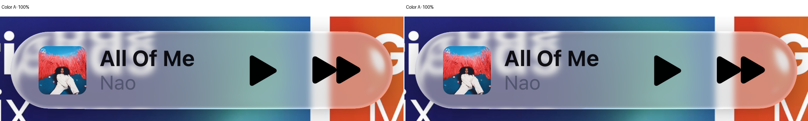

Zoomed outline, caps and transition crops

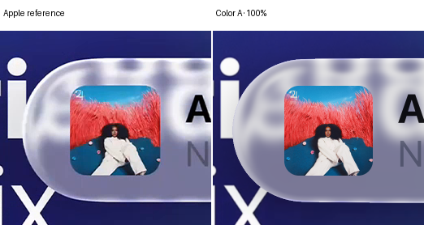

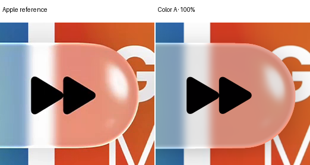

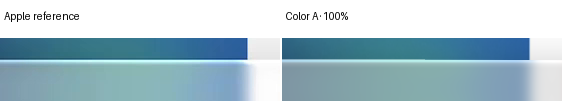

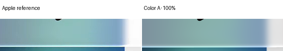

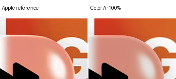

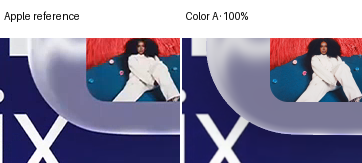

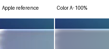

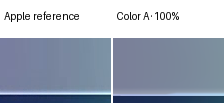

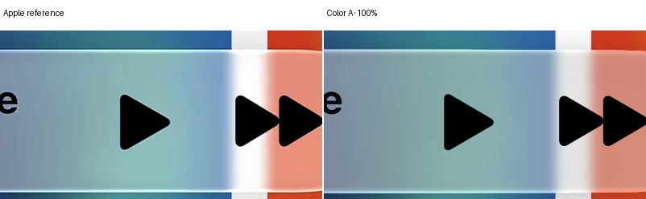

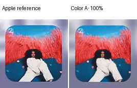

## Compact B

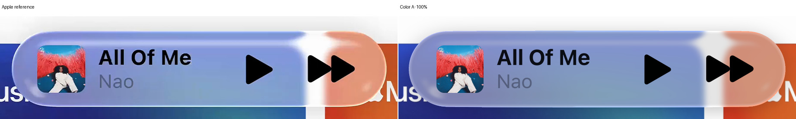

Compare with Color A at 100%

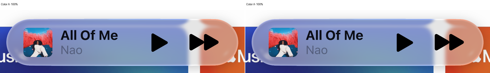

Zoomed outline, caps and transition crops

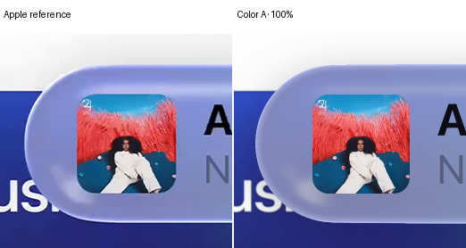

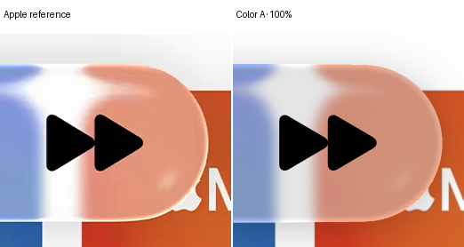

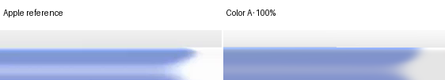

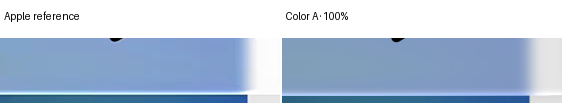

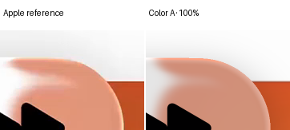

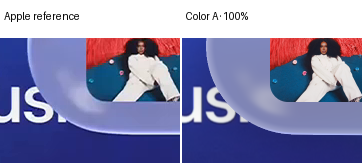

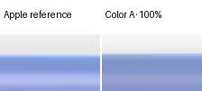

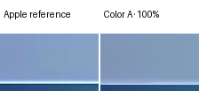

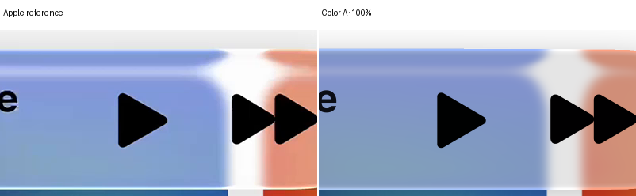

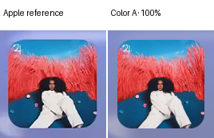

## Verification

The 55 combinations retain the completed body and artwork. Four base identities are exact, and 220 independent scalar HSV/composition replays pass within 1e-7. New widths use positive full-pixel area weights with successive-order refinement. No new optical transport, source filtering, fitting or aggregate score claims occur.
