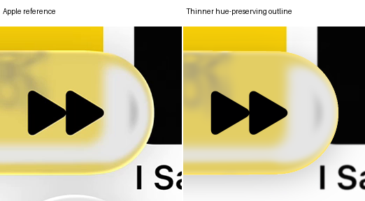
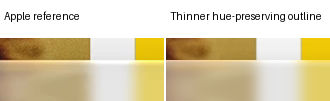
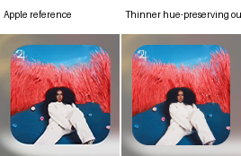
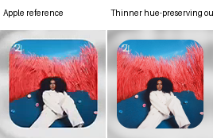
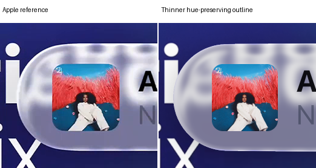
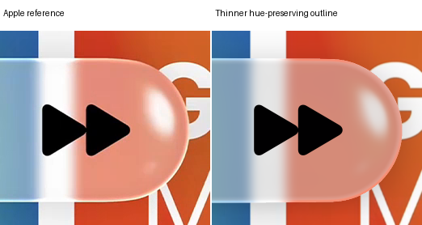
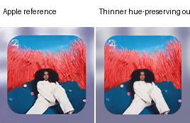
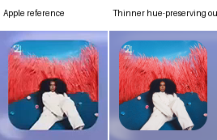

# Thinner hue-preserving outline

The yellow hue correction is removed. Saturation and value retain revision 106's calibrated response, while every outline endpoint preserves its input hue. The enlarged artwork and completed lens body remain unchanged. At full strength, tentative input #EBCE48 now gives approximately #F6E286, preserving its hue while retaining the calibrated saturation and value. White remains #FCFCFC.

The outline plateau and inward fade are both multiplied by 0.8. A second thickness multiplier rises linearly from 4/7 at 43.359684% of the pill width to one at 44.584980%. It stays thinner to the left and thicker to the right. Expanded and compact use the same proportional rule.

[Research and verification](../research/experiments/miniplayer-outline-taper-107/README.md) · [Previous revision](miniplayer-yellow-match.md) · [Selected reconstruction](reconstruction.md)

## Thickness and brightness

| Region | Plateau | Fade scale | Positive value increase |
| --- | ---: | ---: | ---: |
| Left of 43.359684% | 0.685714 px | 0.914286 px | 99% |
| Transition | Linear | Linear | Linear |
| Right of 44.584980% | 1.2 px | 1.6 px | 100% |

The one-percent reduction applies only to the positive HSV value increase, not to the entire color or saturation. Its size is a provisional interpretation of the requested slight brightness change. Endpoint hue and saturation are preserved during this reduction. The original opposing angular gaps remain zero.

Thickness and brightness moments use actual pixel area. Orders 16 and 32 identify pixels needing refinement; those pixels use orders 64 and 96. All pixels remain scored. The original tolerance is unchanged. Original geometry, shadow, optical transport and incident blur remain frozen.

## Image comparisons

| Case | Previous E | Revised E | SSIM | Partial RMSE |
| --- | ---: | ---: | ---: | ---: |
| expanded A | 11.7337 | 10.1653 | 0.97536 | 38.3208 |
| expanded B | 4.8070 | 4.7655 | 0.98210 | 11.3834 |
| compact A | 14.9937 | 16.3208 | 0.96548 | 29.7011 |
| compact B | 15.6359 | 16.5640 | 0.96372 | 25.0957 |

All local and aggregate changes are retained below. All original scoring cohorts remain unchanged. These comparisons are held for review, without a full-family fidelity claim.

### Expanded A

Previous revision versus revision

Native crops: colored rims, caps and disappearing diagonals

### Expanded B

Previous revision versus revision

Native crops: colored rims, caps and disappearing diagonals

### Compact A

Previous revision versus revision

Native crops: colored rims, caps and disappearing diagonals

### Compact B

Previous revision versus revision

Native crops: colored rims, caps and disappearing diagonals

## Verification

The completed body and artwork are pixel-exact to revision 106. Four original baseline identities and four independent color/composition replays pass. All original masks and local guards remain. No clipping, optical rays, source sampling or incident filtering was introduced.
