# Slightly brighter outline with the thinner outline

Relative to revision 109, outline saturation is reduced by one percent and hue-shift strength by five percent. HSV value increases by 0.002, with a unit ceiling. The existing slight spatial brightness taper is retained. These are deliberately small changes.

Revision 107's thinner-left outline, 80% base width, slight brightness taper, angular gaps, body grading and artwork are unchanged. Saved outline integration is reused exactly. No geometry, optical sampling, filtering, quadrature or fitting was repeated.

[Verification](../research/experiments/miniplayer-outline-value-110/README.md) · [Previous revision](miniplayer-outline-balance.md) · [Selected reconstruction](reconstruction.md)

Four prior-image identities pass. Independent scalar HSV replay agrees within 1e-7. New aggregate scores were not computed for this small color adjustment; older scores are not presented as new measurements.

### Expanded A

Previous revision versus revision

Native crops: colored rims, caps and disappearing diagonals

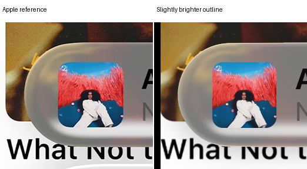

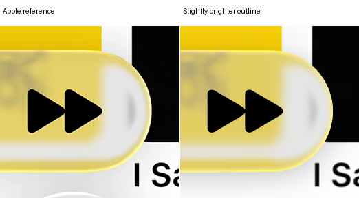

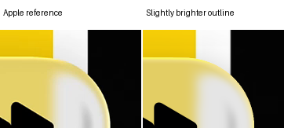

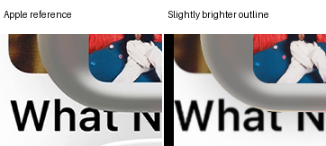

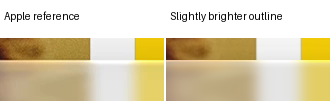

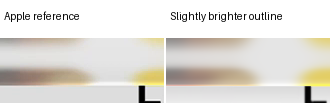

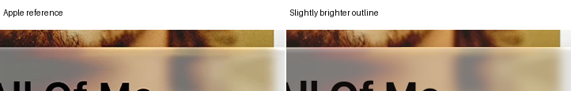

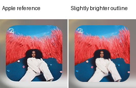

### Expanded B

Previous revision versus revision

Native crops: colored rims, caps and disappearing diagonals

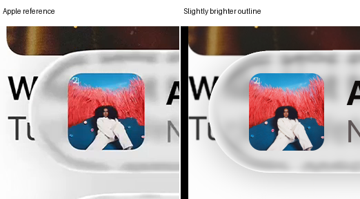

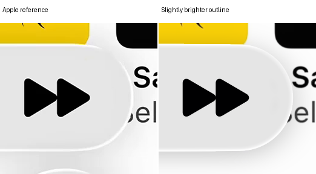

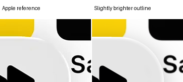

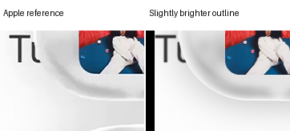

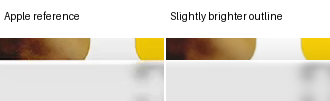

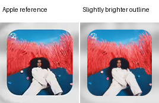

### Compact A

Previous revision versus revision

Native crops: colored rims, caps and disappearing diagonals

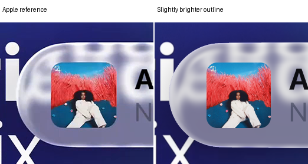

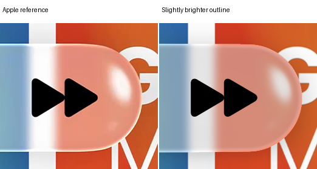

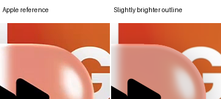

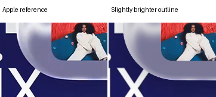

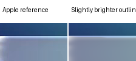

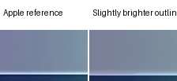

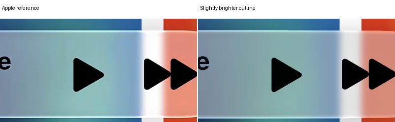

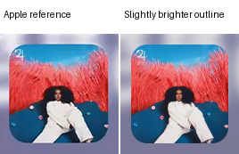

### Compact B

Previous revision versus revision

Native crops: colored rims, caps and disappearing diagonals

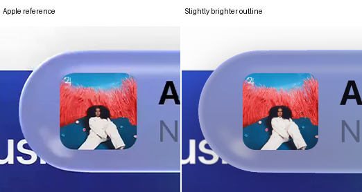

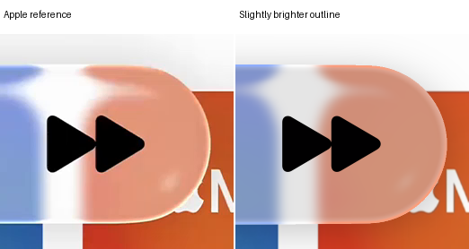

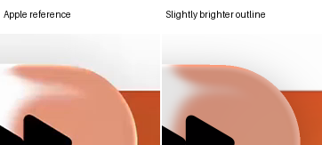

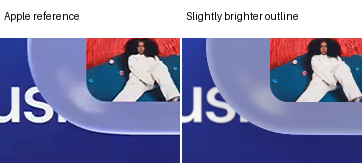

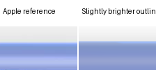

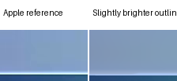

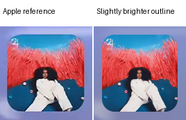

## Verification

The completed body and artwork are pixel-exact to revision 106. Four original baseline identities and four independent color/composition replays pass. All original masks and local guards remain. No clipping, optical rays, source sampling or incident filtering was introduced.
