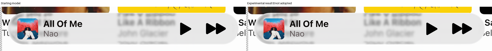
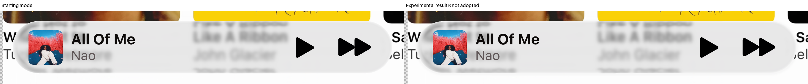

# Miniplayer: smooth shape, shadow and color-aware rim

Latest: [inward joins, broad shadow and color-filter comparisons](miniplayer-feedback-review.md). The complete experimental pair remains unaccepted; original boundary and foreground failures are preserved.

The complete refinement sequence is finished and independently replayed by the primary researcher. The combined proposal makes the compact rim clearer and keeps edge color, but expanded A becomes too bright. **No proposal passes every original family guard.** The selected model remains unchanged.

Drag the divider to compare identical native coordinates. Touch, keyboard arrows, side-by-side mode and fullscreen are available. The first comparisons show the final experimental combination; every separate stage and tested setting follows.

[Full report and verification](../research/experiments/miniplayer-complete-refinement-94/README.md) · [Previous five outline passes](outline-review.md) · [Selected reconstructions](reconstruction.md)

## Combined development result

The shared contour has smooth curvature and slightly convex long sides. The exterior-only shadow uses strength 0.1. The color-aware inner fade uses width 2.6 pixels and a bounded lift with gentle desaturation. Compact and expanded differ only in major length.

| Reference | Starting E | Combined E | Frozen boundary RMSE: start → combined |
| --- | ---: | ---: | ---: |
| Expanded A | 7.8835 | 11.8101 | 40.3268 → 62.3036 |
| Expanded B | 6.1494 | 5.0034 | 26.0804 → 35.2868 |
| Compact A | 20.5319 | 14.7042 | 23.8132 → 21.9686 |
| Compact B | 19.6819 | 15.6437 | 21.0766 → 22.8641 |

Lower errors are better. Improvements in one reference do not waive another reference’s failure.

### Expanded A

### Expanded B

### Compact A

### Compact B

Starting model versus combined result

**Expanded A.**

**Expanded B.**

**Compact A.**

**Compact B.**

## Separate stages and every setting

Each group includes the Apple reference and the starting-model comparison. Shadow and highlight proposals use the new smooth geometry, so they are not isolated changes to the old body. Their separate component-relative guards are retained in the linked reports.

Smooth geometry only

[Method, limits and original guards](../research/experiments/miniplayer-complete-refinement-94/geometry-run-02/README.md)

Setting geometry: all four references

**Expanded A.** E: 7.9566. Failed original guards: glass, held, interior, E, SSIM, partial, jupiter.jpg, title.svg, artist.svg, play.svg, forward.svg.

**Expanded B.** E: 5.9386. Failed original guards: interior, partial, jupiter.jpg, title.svg, artist.svg, play.svg.

**Compact A.** E: 20.2544. Failed original guards: interior, partial, title.svg, play.svg.

**Compact B.** E: 19.5653. Failed original guards: interior, SSIM, partial, jupiter.jpg, title.svg, play.svg, forward.svg.

Exterior-only shadow

[Method, limits and original guards](../research/experiments/miniplayer-complete-refinement-94/shadow/README.md)

Setting s0.025: all four references

**Expanded A.** E: 7.9408. Failed original guards: glass, held, interior, E, SSIM, partial, jupiter.jpg, title.svg, artist.svg, play.svg, forward.svg.

**Expanded B.** E: 5.9310. Failed original guards: interior, partial, jupiter.jpg, title.svg, artist.svg, play.svg.

**Compact A.** E: 20.2547. Failed original guards: interior, partial, title.svg, play.svg.

**Compact B.** E: 19.5656. Failed original guards: interior, SSIM, partial, jupiter.jpg, title.svg, play.svg, forward.svg.

Setting s0.05: all four references

**Expanded A.** E: 7.9265. Failed original guards: glass, held, interior, E, SSIM, partial, jupiter.jpg, title.svg, artist.svg, play.svg, forward.svg.

**Expanded B.** E: 5.9261. Failed original guards: interior, partial, jupiter.jpg, title.svg, artist.svg, play.svg.

**Compact A.** E: 20.2550. Failed original guards: interior, partial, title.svg, play.svg.

**Compact B.** E: 19.5659. Failed original guards: interior, SSIM, partial, jupiter.jpg, title.svg, play.svg, forward.svg.

Setting s0.1: all four references

**Expanded A.** E: 7.9030. Failed original guards: glass, held, interior, E, SSIM, partial, jupiter.jpg, title.svg, artist.svg, play.svg, forward.svg.

**Expanded B.** E: 5.9243. Failed original guards: interior, partial, jupiter.jpg, title.svg, artist.svg, play.svg.

**Compact A.** E: 20.2558. Failed original guards: interior, partial, title.svg, play.svg.

**Compact B.** E: 19.5665. Failed original guards: interior, SSIM, partial, jupiter.jpg, title.svg, play.svg, forward.svg.

Color-aware highlight

[Method, limits and original guards](../research/experiments/miniplayer-complete-refinement-94/highlight/README.md)

Setting h0: all four references

**Expanded A.** E: 11.4354. Failed original guards: glass, rim, held, interior, E, SSIM, partial, jupiter.jpg, title.svg, artist.svg, play.svg, forward.svg.

**Expanded B.** E: 5.0223. Failed original guards: interior, partial, jupiter.jpg, title.svg, artist.svg, play.svg.

**Compact A.** E: 15.1614. Failed original guards: interior, partial, title.svg, play.svg.

**Compact B.** E: 16.3739. Failed original guards: interior, partial, jupiter.jpg, title.svg, play.svg, forward.svg.

Setting h1: all four references

**Expanded A.** E: 11.5481. Failed original guards: glass, rim, held, interior, E, SSIM, partial, jupiter.jpg, title.svg, artist.svg, play.svg, forward.svg.

**Expanded B.** E: 5.0225. Failed original guards: interior, partial, jupiter.jpg, title.svg, artist.svg, play.svg.

**Compact A.** E: 14.9580. Failed original guards: interior, title.svg, play.svg.

**Compact B.** E: 16.0486. Failed original guards: interior, partial, jupiter.jpg, title.svg, play.svg, forward.svg.

Setting h2: all four references

**Expanded A.** E: 11.8537. Failed original guards: glass, rim, held, interior, E, SSIM, partial, jupiter.jpg, title.svg, artist.svg, play.svg, forward.svg.

**Expanded B.** E: 5.0227. Failed original guards: interior, partial, jupiter.jpg, title.svg, artist.svg, play.svg.

**Compact A.** E: 14.7034. Failed original guards: interior, title.svg, play.svg.

**Compact B.** E: 15.6431. Failed original guards: interior, partial, jupiter.jpg, title.svg, play.svg, forward.svg.

## What remains wrong

Expanded A’s left and lower edge becomes too bright. Compact returns, especially the left cap and upper lettering, remain misplaced. The new outline does not repair those source-feature errors. Its nominal width and angular fade remain hypotheses, not measured shader parameters.

The shadow improves separation from bright exterior backgrounds, but neither the shadow alone nor the full combination passes every original guard. The contour keeps the measured extrema; it is not an accepted pose or size correction.

All four baseline images reproduce exactly. Twenty-eight material candidates replay within one float32 rounding step, and every stored score and guard reproduces exactly. Positive-area checks and two-order outline integration pass. These checks establish implementation consistency, not Apple fidelity or a uniquely identified material.
