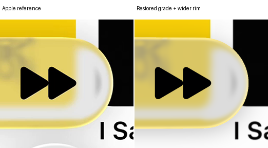
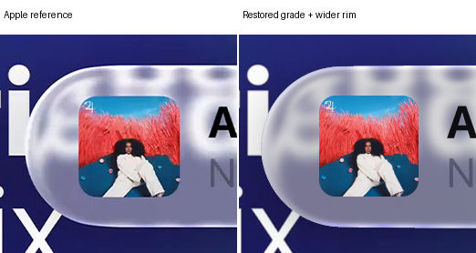
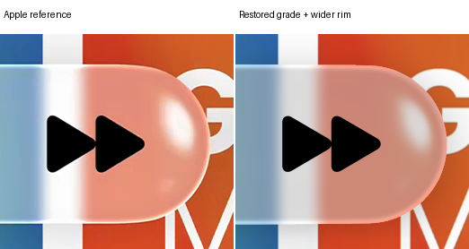
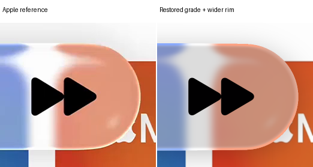
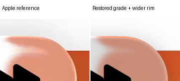

# Restored lens grading and thicker colored rim

One review candidate restores the previous body grading and optical brightness composition. Only its existing gain changes, so grading-stage white becomes #E5E5E5. Bias and dark-tone lift are unchanged. Refraction geometry, incident blur, shadow and foreground are fixed.

The improved outline color mapping from the last candidate is retained exactly. Its maximum-strength plateau doubles from one to two native pixels. The two-pixel inward fade and opposing diagonal gaps remain unchanged. This does not double the complete outline width.

Final body white varies with optical transmission and reflected light. With normal-incidence transmission alone, grading-stage 229 becomes about 221. This is the restored position-dependent pipeline, not the direct final-color map from the last test.

The selected reconstruction remains unchanged pending review. Drag the comparisons or open native crops and fullscreen.

[Research and verification](../research/experiments/miniplayer-restored-grade-104/README.md) · [Previous calibrated candidate](miniplayer-anchor-colors.md) · [Selected reconstruction](reconstruction.md)

## Controls changed

| Control | Previous candidate | This candidate |
| --- | --- | --- |
| Body response | New anchor map | Previous gain/bias plus dark-tone lift |
| Body gain | Not applicable | 0.507202380341388 |
| Body bias | Not applicable | 0.39083683534488656, restored |
| Dark-tone lift | Not applicable | 0.08, restored |
| Optical brightness | Replaced | Original primary power and direct reflection restored |
| Outline endpoint | Calibrated color map | Identical |
| Strongest outline thickness | 1 native pixel | 2 native pixels |
| Inward fade | 2 native pixels | Identical |

## Comparisons

| Case | Previous candidate E | New E | SSIM | Partial RMSE |
| --- | ---: | ---: | ---: | ---: |
| expanded A | 10.5420 | 13.3909 | 0.97017 | 37.7264 |
| expanded B | 5.4212 | 9.7718 | 0.98070 | 8.5147 |
| compact A | 23.4810 | 17.5797 | 0.96290 | 26.1327 |
| compact B | 22.4099 | 18.4176 | 0.96141 | 24.0640 |

Scores retain every original cohort. The finalized shape is not adjusted to improve them. Compact color regressions remain diagnostic under the shared expanded-first color requirement.

## Fixed compact white samples

These same native positions show preimage and final body values separately. They are observations of the restored pipeline, not extra calibration targets.

| Case / crop-local position | Blurred preimage | Apple | New body |
| --- | --- | --- | --- |
| Compact A (725, 65) | #FBFCFC | #FDFDFD | #DBDBDB |
| Compact A (735, 65) | #FCFBFB | #FDFDFD | #DBDBDB |
| Compact A (725, 185) | #F8F8F9 | #FDFDFD | #DADADA |
| Compact A (735, 185) | #F8F8F8 | #FDFDFD | #DAD9D9 |
| Compact B (725, 65) | #FDFDFD | #FDFDFD | #DCDCDC |
| Compact B (735, 65) | #FDFDFD | #FDFDFD | #DCDCDC |
| Compact B (725, 185) | #FCFCFD | #FCFCFC | #DCDCDC |
| Compact B (735, 185) | #FDFCFC | #FDFDFD | #DCDBDB |

### Expanded A

Previous calibrated candidate versus revision

Native crops: colored rims, caps and disappearing diagonals

### Expanded B

Previous calibrated candidate versus revision

Native crops: colored rims, caps and disappearing diagonals

### Compact A

Previous calibrated candidate versus revision

Native crops: colored rims, caps and disappearing diagonals

### Compact B

Previous calibrated candidate versus revision

Native crops: colored rims, caps and disappearing diagonals

## Limits

The outline still preserves preimage hue. Its yellow anchor is approximately #FEEB85 rather than the sampled #FEF985. Coverage and angular fading blend that endpoint with the body. The restored reflected scene remains hypothetical, and neither this display adjustment nor a better score establishes full optical fidelity.
