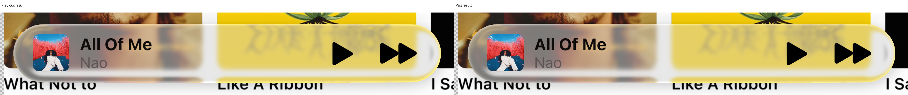
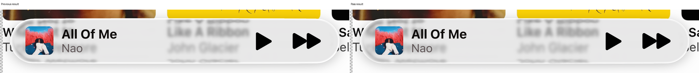
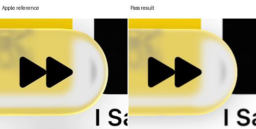
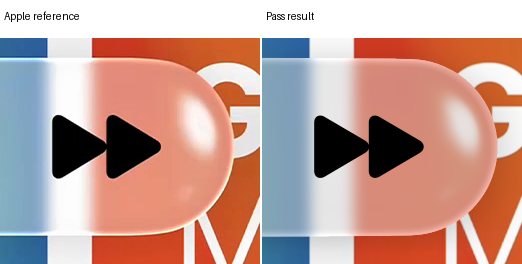
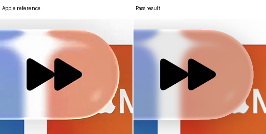
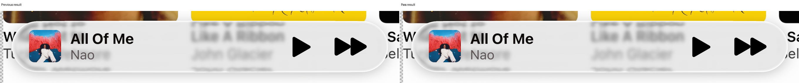
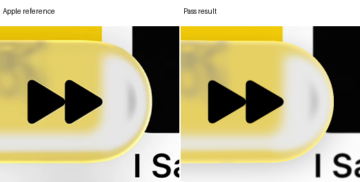

# Miniplayer: three complete refinement passes

Expanded references lead outline decisions; compact receives the identical model. The overlay reaches zero around the right upper-right and left lower-left diagonal cap regions. Earlier results retain their disclosed half-pixel registration error.

This review follows the shared compact and expanded model through contour, refraction, incident blur, color, outline, exterior shadow and artwork. Dispersion is excluded. Each completed pass retains its original failures and local tradeoffs.

Drag the mask to compare identical native coordinates. Fullscreen, keyboard, touch and side-by-side controls are available. Native detail crops preserve source pixels without smoothing or alignment changes.

[Research plan](../research/experiments/miniplayer-three-pass-101/README.md) · [Feedback](../research/feedback/miniplayer-three-pass.md) · [Previous four passes](miniplayer-four-pass.md) · [Current models](reconstruction.md)

Completed and independently replayed: **3 of three passes**. Numerical ranking and visual selection are separate; the original strict local guards remain reported.

**Working selection: pass 2.** Its expanded match is the strongest of these three passes. Compact aggregate errors worsen against the previous working version. Stronger outline endpoints remain visible as rejected contrasts; no brightness fix or full-family acceptance is claimed. [Final review](../research/experiments/miniplayer-three-pass-101/FINAL-REVIEW.md).

## Pass 1

The narrower plateau and gentler contour improve both expanded aggregate errors, while compact errors worsen against the previous selection. Stronger uniform edge exposure over-brightens neutral regions; the expanded rim ranking retains the baseline endpoint. All fixed endpoint contrasts remain available below.

Independent arithmetic agrees within one float32 step. Pre-foreground arrays, aggregate error and original guard decisions agree; some detailed metrics differ in their last bits. Source-coordinate checks and zero overlay in both diagonal gaps pass. The improved shadow and artwork settings remain unchanged.

| Reference | E | SSIM | Original partial RMSE | Normalized combined score |
| --- | ---: | ---: | ---: | ---: |
| expanded A | 10.4927 | 0.97461 | 43.3327 | 0.9425 |
| expanded B | 5.3039 | 0.98244 | 13.9233 | 0.8842 |
| compact A | 14.4979 | 0.96716 | 21.8595 | 0.7991 |
| compact B | 14.2202 | 0.96596 | 21.5530 | 0.8260 |

Combined score equally weights baseline-normalized glass, rim, exterior and artwork errors across references. Lower than one improves this numerical ranking. It is not a physical-material identification or a replacement for visual review.

### Expanded A

### Expanded B

### Compact A

### Compact B

Previous result versus pass 1

Native cap, rim and artwork details

Three fixed outline brightness/color contrasts

Recipe: incident sigma `6.6825`; rim plateau `0.6666666666666666` pixels and fade `2.0` pixels; artwork scale `0.95`. [Exact results and stage choices](../research/experiments/miniplayer-three-pass-101/pass1/README.md).

## Pass 2

The gentler contour improves expanded errors further, but compact remains worse than the previous working selection. Color-dependent extra exposure avoids lifting neutral edges; its stronger yellow contrasts still lose the whole-rim ranking. They remain visible below rather than being discarded.

All four own replays and reported metrics are exact. The original clock survived a storage interruption: retained path chunks were reused, and the lost batch was counted separately. Both source gates and the exact opposing zero-overlay regions pass. Shadow and artwork retain their previous settings.

| Reference | E | SSIM | Original partial RMSE | Normalized combined score |
| --- | ---: | ---: | ---: | ---: |
| expanded A | 10.2239 | 0.97597 | 38.8751 | 0.9283 |
| expanded B | 5.0736 | 0.98250 | 12.8492 | 0.8638 |
| compact A | 14.8296 | 0.96668 | 21.8088 | 0.8125 |
| compact B | 14.4727 | 0.96546 | 21.2235 | 0.8362 |

Combined score equally weights baseline-normalized glass, rim, exterior and artwork errors across references. Lower than one improves this numerical ranking. It is not a physical-material identification or a replacement for visual review.

### Expanded A

### Expanded B

### Compact A

### Compact B

Previous result versus pass 2

Native cap, rim and artwork details

Three fixed outline brightness/color contrasts

Recipe: incident sigma `6.6825`; rim plateau `0.6666666666666666` pixels and fade `2.0` pixels; artwork scale `0.95`. [Exact results and stage choices](../research/experiments/miniplayer-three-pass-101/pass2/README.md).

## Pass 3

The midpoint contour gives intermediate errors. Fixed expanded peak regions still prefer the baseline endpoint over two brighter, more saturated contrasts. All three endpoints remain available below. No new brightness solution is claimed.

Both completed arrays and all reported metrics replay exactly for each reference. Opposing angular gaps contribute exactly zero overlay. Body grade and shadow remain unchanged. Artwork scales 0.945 and 0.95 produce identical integer dimensions here, so their numerical tie is not a visible improvement.

| Reference | E | SSIM | Original partial RMSE | Normalized combined score |
| --- | ---: | ---: | ---: | ---: |
| expanded A | 10.3381 | 0.97536 | 40.5572 | 0.9343 |
| expanded B | 5.1658 | 0.98254 | 13.5649 | 0.8719 |
| compact A | 14.6573 | 0.96702 | 21.8270 | 0.8059 |
| compact B | 14.3415 | 0.96580 | 21.3867 | 0.8312 |

Combined score equally weights baseline-normalized glass, rim, exterior and artwork errors across references. Lower than one improves this numerical ranking. It is not a physical-material identification or a replacement for visual review.

### Expanded A

### Expanded B

### Compact A

### Compact B

Previous result versus pass 3

Native cap, rim and artwork details

Three fixed outline brightness/color contrasts

Recipe: incident sigma `6.6825`; rim plateau `0.6666666666666666` pixels and fade `2.0` pixels; artwork scale `0.945`. [Exact results and stage choices](../research/experiments/miniplayer-three-pass-101/pass3/README.md).

## Interpretation

Artwork uses the original asset with a shared centered scale, upward offset and absolute corner radius. Its score includes the exposed backing in the unchanged original guard box. It does not improve the glass score by changing that mask.

The outline uses incident-blurred refraction before the body grade. Chroma and peak strength remain distinct. Shadow darkens only uncovered contributions; it is excluded from lens transport. Shared optical parameters still differ only by member length.

All source mosaics are conditional evidence. Reflected scene assumptions and unassigned later power remain unresolved. A better appearance does not uniquely identify the original renderer.
