# More saturated yellow and larger artwork

One candidate maps the proposed preimage #EBCE48 exactly to #F6F586 at full outline strength. It retains the previous body grade, final-white calibration, optical lighting, geometry, incident blur, shadow, 1.5-pixel plateau, two-pixel fade and opposing diagonal gaps.

Artwork width and height are multiplied by 1.0183 relative to revision 105, then rounded to native pixels. Both artwork centers and radius 18 remain unchanged. The selected reconstruction is unchanged pending review.

[Research and verification](../research/experiments/miniplayer-yellow-match-106/README.md) · [Previous revision](miniplayer-final-white.md) · [Selected reconstruction](reconstruction.md)

## Supplied color comparison

| Color | HSV hue | HSV saturation | HSV value | Linear-light luminance |
| --- | ---: | ---: | ---: | ---: |
| Input #EBCE48 | 49.325° | 69.362% | 92.157% | 0.622727 |
| Reported current #F7EDB4 | 51.045° | 27.126% | 96.863% | 0.836378 |
| Requested #F6F586 | 59.464° | 45.528% | 96.471% | 0.866189 |

The requested color is about 68% more saturated than the reported current output. Its maximum channel decreases by one, while linear-light luminance increases about 3.6%. The channel change is −1 red, +8 green and −46 blue. Increasing brightness alone would not reproduce it.

Exact mapping from the proposed input requires a 10.139° hue shift toward yellow. This revision adds an explicit smooth warm-hue correction. It preserves neutral colors and leaves hue unchanged outside its fixed 30° half-width. The earlier brown anchors retain zero hue correction. This is a color-dependent response, not a painted spatial correction.

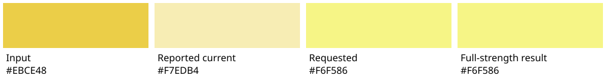

The preimage correspondence is tentative user-supplied evidence. Exact anchor matching does not prove that every reference rim pixel has that incident color. Coverage, angular strength and inward fade still blend the endpoint with the completed body.

## Image comparisons

| Case | Previous E | Revised E | SSIM | Partial RMSE |
| --- | ---: | ---: | ---: | ---: |
| expanded A | 11.9078 | 11.7337 | 0.97409 | 38.9028 |
| expanded B | 4.8083 | 4.8070 | 0.98284 | 11.2408 |
| compact A | 14.1668 | 14.9937 | 0.96691 | 29.7657 |
| compact B | 15.2309 | 15.6359 | 0.96511 | 25.1375 |

Expanded aggregate errors improve slightly; compact errors increase. All original scoring cohorts remain unchanged. These comparisons are held for review, without a full-family fidelity claim.

### Expanded A

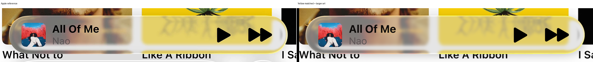

Previous revision versus revision

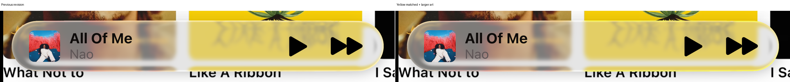

Native crops: colored rims, caps and disappearing diagonals

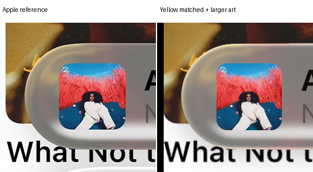

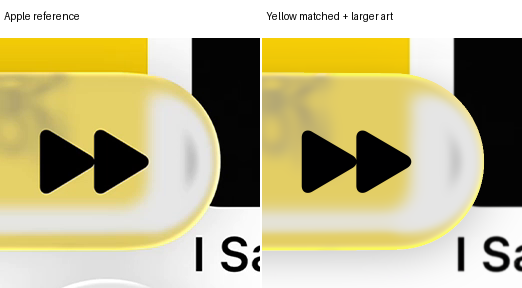

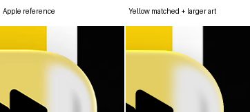

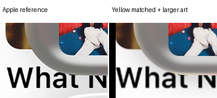

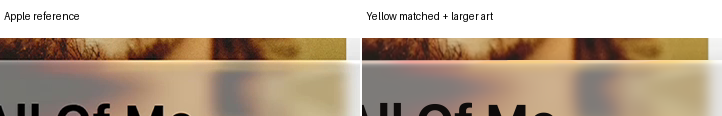

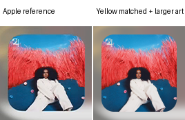

### Expanded B

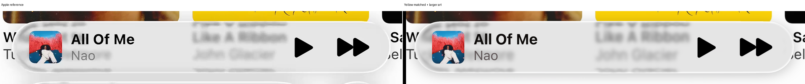

Previous revision versus revision

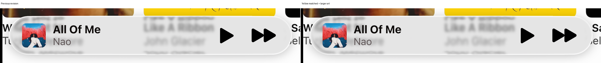

Native crops: colored rims, caps and disappearing diagonals

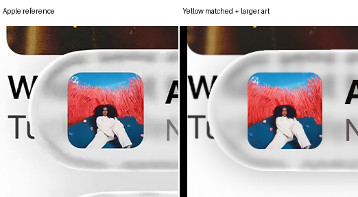

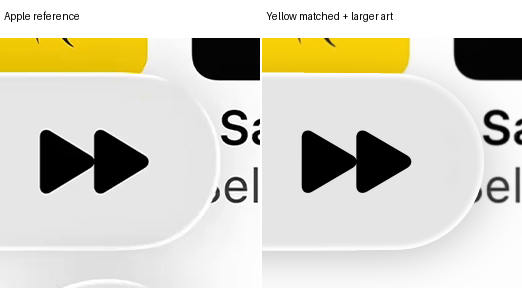

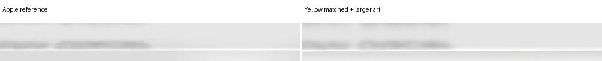

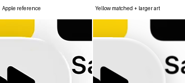

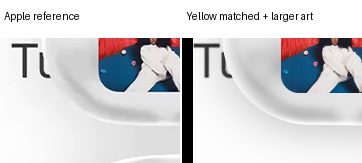

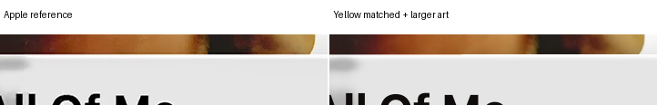

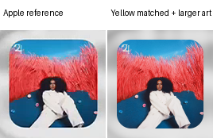

### Compact A

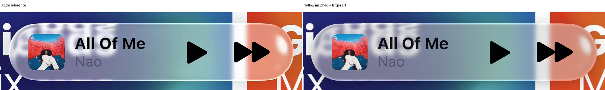

Previous revision versus revision

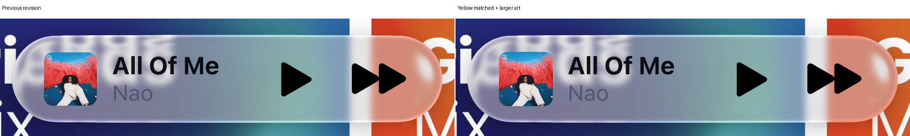

Native crops: colored rims, caps and disappearing diagonals

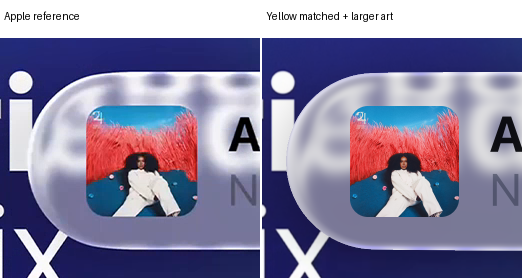

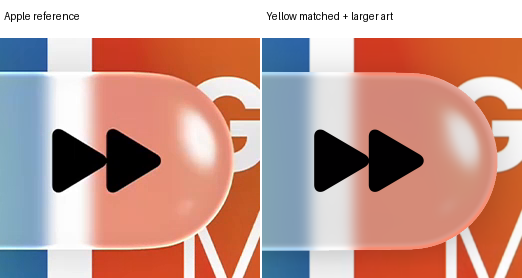

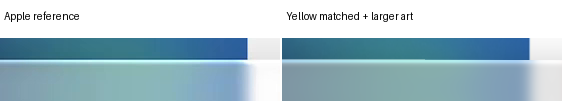

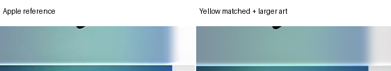

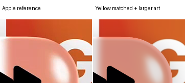

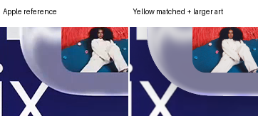

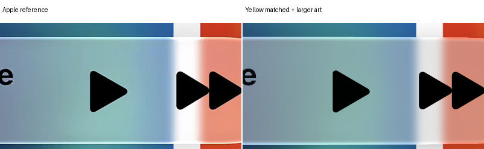

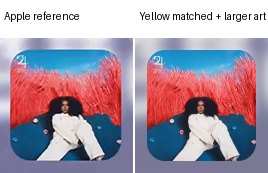

### Compact B

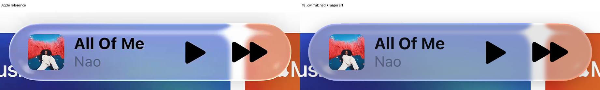

Previous revision versus revision

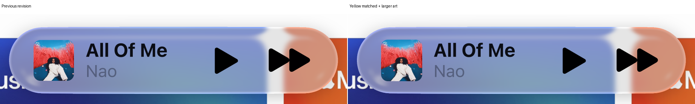

Native crops: colored rims, caps and disappearing diagonals

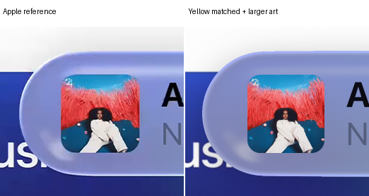

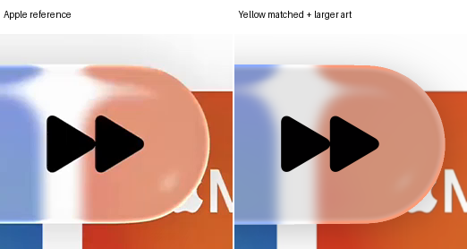

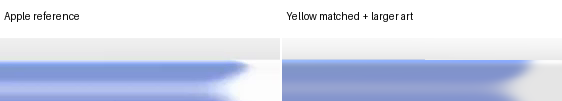

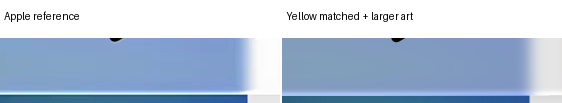

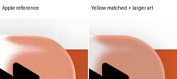

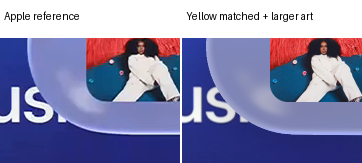

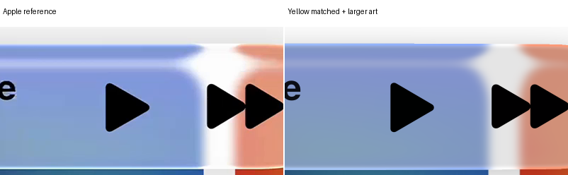

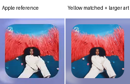

## Artwork placement

| Member | Previous size | Requested size | Raster size | Horizontal center | Vertical center |
| --- | --- | --- | --- | --- | --- |
| expanded | 107 × 110 | 108.9581 × 112.0130 | 109 × 112 | Unchanged | Unchanged |
| compact | 107 × 109 | 108.9581 × 110.9947 | 109 × 111 | Unchanged | Unchanged |

Body pixels outside the artwork rectangles are exact. The optical samples, body grading and outline geometry were reused without rerendering optics or incident blur. Four baseline identities and four independent candidate replays are pixel-exact. No clipping occurred.
