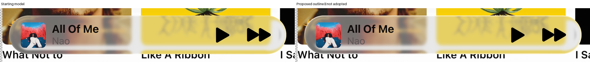
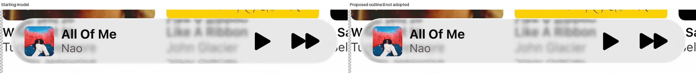
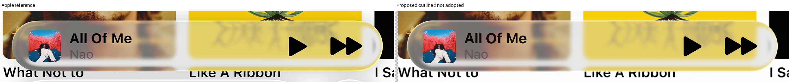
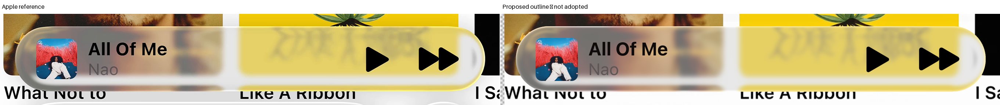
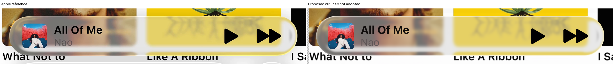
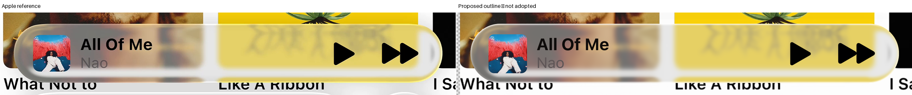
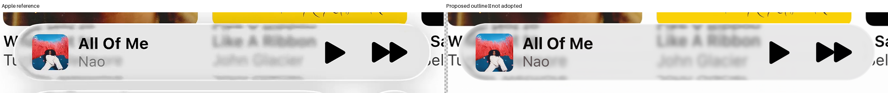

# Miniplayer outline: five-pass comparison

Five outline passes are complete. **No candidate passed every original family guard**, so the starting model remains the incumbent. The proposals below show useful local changes and their regressions, rather than an accepted replacement.

**Drag the divider** to compare aligned pixels. Use **Side by side** or **Fullscreen** for a larger view. The handle also supports touch, arrow keys, Home and End. Reference and result have identical native crop coordinates; no image alignment was changed for presentation.

Compact and expanded use one outline law. Refraction, source blur, foreground and original masks stayed fixed. The sizing audit found no coherent correction supported across the references; local edge placement remains uncertain by roughly one to two pixels.

[Registration audit](../research/experiments/agent-miniplayer-registration-54/README.md) · [Full study and method](../research/experiments/miniplayer-outline-series-91/README.md)

## Final development proposal

This is pass-05 setting 2, the lowest shared training-loss proposal carried forward. It is **not accepted**. These first sliders compare the Apple reference with that proposal; the next group isolates the change from the starting model.

| Reference | Starting body E | Proposal E | Original boundary RMSE: start → proposal |
| --- | ---: | ---: | ---: |
| Expanded A | 7.8835 | 11.3411 | 40.3268 → 43.2675 |
| Expanded B | 6.1494 | 5.2721 | 26.0804 → 24.3682 |
| Compact A | 20.5319 | 15.6828 | 23.8132 → 21.9030 |
| Compact B | 19.6819 | 15.7396 | 21.0766 → 26.3374 |

For a more color-preserving tradeoff, open [pass 5, setting 0](#pass-5-setting-0). It improves both compact partial-edge scores but still fails expanded A and compact exterior checks.

### Expanded A

### Expanded B

### Compact A

### Compact B

Starting model versus final proposal

## All five passes

Each pass includes every tested setting and all four references. The incumbent is retained whenever any original guard fails. The training-selected proposal can change independently, so its images are labeled proposals throughout.

Pass 1: Width and common strength — incumbent retained

[Full record, fixed crops and all original guards](../research/experiments/miniplayer-outline-series-91/pass-01/README.md)

| Setting | Response | Width (px) | Strength | Expanded A / B E | Compact A / B E |
| --- | --- | ---: | ---: | --- | --- |
| 0 | white | 1.950 | 1.0000 | 10.6240 / 5.7877 | 17.8710 / 17.3920 |
| 1 | white | 2.275 | 0.9574 | 11.1932 / 5.5978 | 16.9357 / 16.6274 |
| 2 | white | 2.600 | 0.8850 | 11.4641 / 5.4140 | 16.2252 / 16.0576 |

Setting 0: four reference/result sliders

**Expanded A.** Failed original guards: glass, rim, held, E, partial.

**Expanded B.** Failed original guards: none.

**Compact A.** Failed original guards: partial, exterior.

**Compact B.** Failed original guards: partial, exterior.

Setting 1: four reference/result sliders

**Expanded A.** Failed original guards: glass, rim, held, E, partial.

**Expanded B.** Failed original guards: none.

**Compact A.** Failed original guards: partial, exterior.

**Compact B.** Failed original guards: partial, exterior.

Setting 2: four reference/result sliders

**Expanded A.** Failed original guards: glass, rim, held, E, partial.

**Expanded B.** Failed original guards: none.

**Compact A.** Failed original guards: partial, exterior.

**Compact B.** Failed original guards: partial, exterior.

Pass 2: White versus color-preserving brightness response — incumbent retained

[Full record, fixed crops and all original guards](../research/experiments/miniplayer-outline-series-91/pass-02/README.md)

| Setting | Response | Width (px) | Strength | Expanded A / B E | Compact A / B E |
| --- | --- | ---: | ---: | --- | --- |
| 0 | encoded_lift | 2.600 | 1.0000 | 10.0017 / 5.4295 | 17.0042 / 17.4879 |
| 1 | linear_lift | 2.600 | 1.0000 | 10.0203 / 5.4295 | 16.9799 / 17.4564 |

Setting 0: four reference/result sliders

**Expanded A.** Failed original guards: glass, rim, held, E, SSIM, partial.

**Expanded B.** Failed original guards: none.

**Compact A.** Failed original guards: exterior.

**Compact B.** Failed original guards: exterior.

Setting 1: four reference/result sliders

**Expanded A.** Failed original guards: glass, rim, held, E, SSIM, partial.

**Expanded B.** Failed original guards: none.

**Compact A.** Failed original guards: exterior.

**Compact B.** Failed original guards: exterior.

Pass 3: Earlier and later cap fade landmarks — incumbent retained

[Full record, fixed crops and all original guards](../research/experiments/miniplayer-outline-series-91/pass-03/README.md)

| Setting | Response | Width (px) | Strength | Expanded A / B E | Compact A / B E |
| --- | --- | ---: | ---: | --- | --- |
| 0 | white | 2.600 | 0.8910 | 11.5192 / 5.4067 | 16.2752 / 16.1137 |
| 1 | white | 2.600 | 0.8695 | 11.3965 / 5.4299 | 16.2780 / 16.0945 |

Setting 0: four reference/result sliders

**Expanded A.** Failed original guards: glass, rim, held, E, partial.

**Expanded B.** Failed original guards: none.

**Compact A.** Failed original guards: exterior.

**Compact B.** Failed original guards: partial, exterior.

Setting 1: four reference/result sliders

**Expanded A.** Failed original guards: glass, rim, held, E, partial.

**Expanded B.** Failed original guards: none.

**Compact A.** Failed original guards: partial, exterior.

**Compact B.** Failed original guards: partial, exterior.

Pass 4: Shape of the smooth inward falloff — incumbent retained

[Full record, fixed crops and all original guards](../research/experiments/miniplayer-outline-series-91/pass-04/README.md)

| Setting | Response | Width (px) | Strength | Expanded A / B E | Compact A / B E |
| --- | --- | ---: | ---: | --- | --- |
| 0 | white | 2.600 | 0.9477 | 11.8425 / 5.2703 | 15.6473 / 15.5922 |
| 1 | white | 2.600 | 0.7812 | 10.9301 / 5.5748 | 16.9011 / 16.6275 |

Setting 0: four reference/result sliders

**Expanded A.** Failed original guards: glass, rim, held, E, SSIM, partial.

**Expanded B.** Failed original guards: none.

**Compact A.** Failed original guards: partial, exterior.

**Compact B.** Failed original guards: partial, exterior.

Setting 1: four reference/result sliders

**Expanded A.** Failed original guards: glass, rim, held, E, partial.

**Expanded B.** Failed original guards: none.

**Compact A.** Failed original guards: exterior.

**Compact B.** Failed original guards: partial, exterior.

Pass 5: Combined soft fade and color-preserving white blend — incumbent retained

[Full record, fixed crops and all original guards](../research/experiments/miniplayer-outline-series-91/pass-05/README.md)

| Setting | Response | Width (px) | Strength | Expanded A / B E | Compact A / B E |
| --- | --- | ---: | ---: | --- | --- |
| 0 | mixed_lift / 25% white | 2.600 | 1.0000 | 10.1053 / 5.2717 | 16.2992 / 16.6412 |
| 1 | mixed_lift / 50% white | 2.600 | 1.0000 | 10.5956 / 5.2719 | 15.9611 / 16.1320 |
| 2 | mixed_lift / 75% white | 2.600 | 1.0000 | 11.3411 / 5.2721 | 15.6828 / 15.7396 |

Setting 0: four reference/result sliders

**Expanded A.** Failed original guards: glass, rim, held, E, SSIM, partial.

**Expanded B.** Failed original guards: none.

**Compact A.** Failed original guards: exterior.

**Compact B.** Failed original guards: exterior.

Setting 1: four reference/result sliders

**Expanded A.** Failed original guards: glass, rim, held, E, SSIM, partial.

**Expanded B.** Failed original guards: none.

**Compact A.** Failed original guards: exterior.

**Compact B.** Failed original guards: partial, exterior.

Setting 2: four reference/result sliders

**Expanded A.** Failed original guards: glass, rim, held, E, SSIM, partial.

**Expanded B.** Failed original guards: none.

**Compact A.** Failed original guards: exterior.

**Compact B.** Failed original guards: partial, exterior.

## What to inspect

Compare the width of the inward fade, the right upper-cap weakening and the rotated left lower-cap weakening. Check whether the color-preserving alternatives retain useful color or appear too saturated. Please identify the member, reference and setting when giving feedback.

The strongest unresolved conflict is expanded A: brighter wide outlines worsen its original body and partial-edge errors. Compact and expanded B can improve while that reference regresses. Original boundary and exterior failures are retained, even when the aggregate score is lower.

These are display-effect hypotheses, not a reconstruction of an undocumented radiance slider or proof of Apple’s shader. Existing body/source-return defects and registration uncertainty remain visible.
