# Apple reference recreations

Open a study to load its comparisons. **Wipe** shows Apple on the left and the reconstruction on the right; **Side by side** shows both panels. **Fullscreen** enlarges any image. The divider resets to the center when a view reopens. Motion captures load only when their dropdown is opened.

**Geometric models are the primary reconstructions.** They appear first below, with their unresolved defects. Earlier empirical fits and motion are archived within each study. Controls awaiting geometry are marked pending. These offline results are separate from the live lab.

[Current model registry](../reconstruction/current-models.json) · [Primary-model policy](../research/decisions/primary-geometric-models.md) · [Shared geometric optics](geometric-optics.md). Wipe compares the Apple reference with the selected geometric version; an older fit is not the default.

[Geometric specification](geometric-optics.md) · [Primary parameters](../reconstruction/current-models.json) · [Scores](#scores) · [Reproduce](#reproduce) · [Material roles](#material-roles) · [Guide](README.md)

Primary geometric versions: [Play button](#clear-playback-control) · [Toolbar](#archive-and-plus-toolbar) · [Expanded miniplayer](#expanded-mini-player) · [Compact miniplayer](#compact-mini-player) · [Navigation](#navigation-control).

[Playback](#clear-playback-control) · [Toolbar](#archive-and-plus-toolbar) · [Slider](#active-slider) · [Light/dark](#light-and-dark-surfaces) · [Apple Music](#apple-music-studies) · [Switch](#active-switch)

## Clear playback control

**Primary: G05 geometric model with selected ordinary softness.** Refraction comes from the explicit surface and its normals. The body uses unit transmission; the icon retains its labeled historical color/coverage nuisance.

Reference: [Apple, Meet Liquid Glass, 3:10](https://developer.apple.com/videos/play/wwdc2025/219/?time=190).

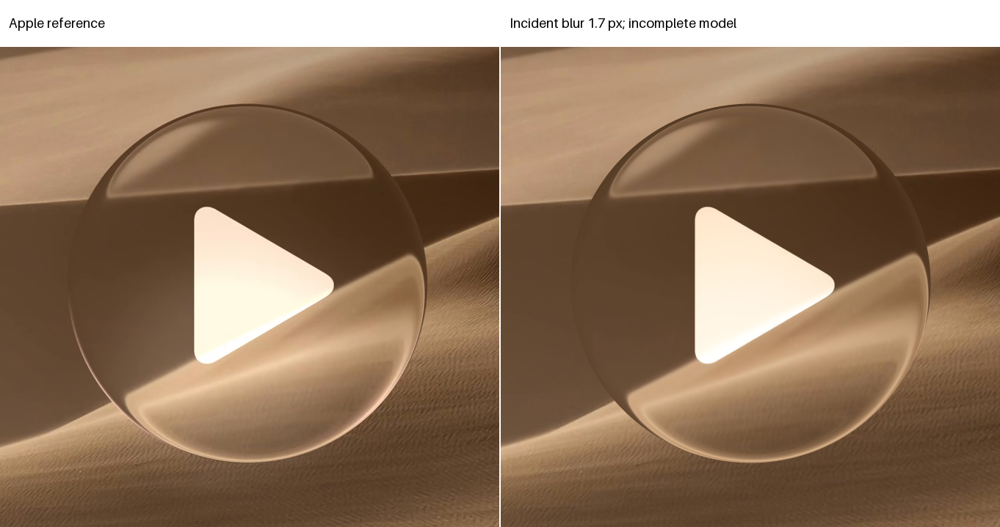

The thin bright rim, lower-left illumination and some dune crossings remain wrong. The latest source-blur test sharpens compressed edges but regresses the original image guards; it remains an experiment rather than the selected material state.

[Latest blur/outline study](../research/experiments/clear-play-02/README.md) · [Selected parameters and corrected scores](../reconstruction/studies/geometric-playback/pipeline-01.json) · [Actual surface](../reconstruction/studies/geometric-playback/g05-surface.json). The full native crop is preserved; this figure formats saved arrays with no new optical render.

<details data-historical>
<summary>Archived empirical reconstruction and motion</summary>

Apple, [Meet Liquid Glass, 3:10](https://developer.apple.com/videos/play/wwdc2025/219/?time=190); uncovered photograph at 3:00. The selected radial map has a quiet center, stronger rim refraction and slight filtering after refraction. The play symbol's calculated color is blurred internally before sharp triangular coverage is applied.

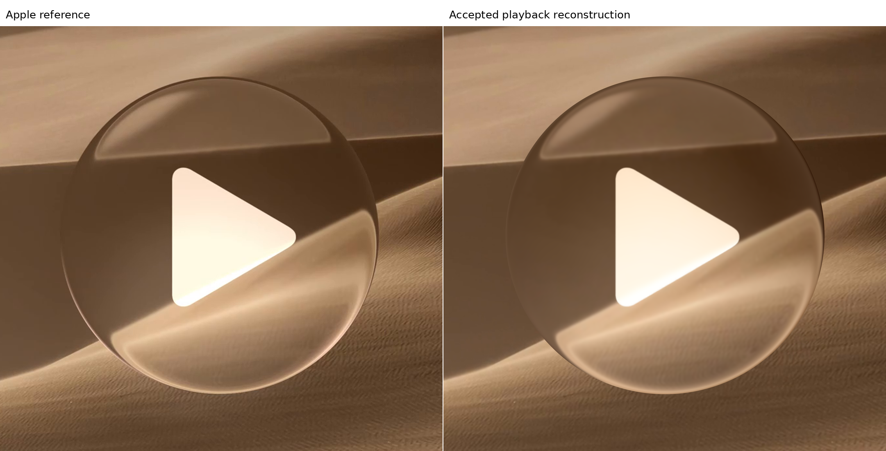

- **Most polished:** width multiplier 4.5; gain 1; source/glass/icon blur σ respectively `0.5/490`, `1.6/490`, `3/490` times the shorter dimension. Dark saturation 0.2; highlight taper 0.48.
- All lengths, including lighting, scale with the element.
- [Complete equations and operation order](recreation-models.md#playback-radial-map-and-smooth-inner-transition). This is an empirical refraction map, not an identified Apple solid.
- The reference-derived triangle silhouette is reused; its **color is independently calculated**. It has no stroked outline. The response is photograph-specific, not a universal contrast algorithm.
- Short round, **3/3 verified passes**: shared material exposure ×1.005; post-refraction blur 1.6 native-reference pixels; highlight taper .48; radial edge-displacement amplitude ×1.001.

Weighted RMS error decreases **9.10758 → 9.07967 → 9.06493 → 9.06475**. Current glass/icon errors are **8.04005/3.21105**; neither regresses in any pass. The third gain is small (0.002%). [Final recipe](../reconstruction/studies/playback/review-round/pass-03.json) · [Independent replay/domain/visual checks](../reconstruction/studies/playback/review-round/pass-03-verification.json).
- The current compact comparison is1080px per side with a64px caption, over the full680×655 native control crop.
- The reconstruction uses the same accepted lossless4× body/icon render; the Apple panel is resized once from the frozen native reference.
- The entire lens body remains in view; registered clean photograph is used outside it and no photographed shadow is copied. Exterior shadow modeling remains incomplete.
- The older full-frame comparison below is historical; motion uses the final short-round recipe.

<details>
<summary>Full-resolution playback comparison</summary>

[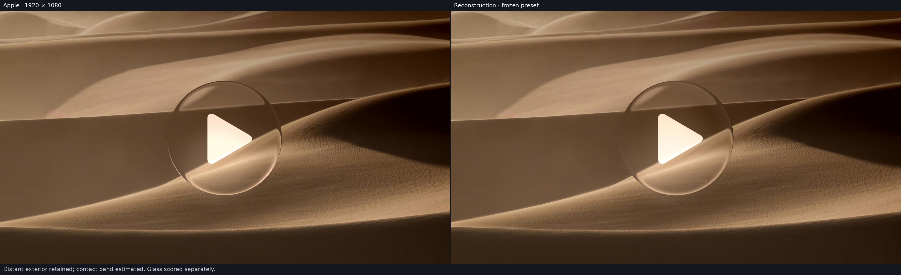](assets/match-media-full.png)

Each half retains 1920 × 1080 pixels.

</details>

<details>
<summary>Motion preview — full-size GIF and video</summary>

<video controls preload="none" playsinline width="1080" height="608" aria-label="Settled playback control motion"><source src="assets/playback-settled.mp4" type="video/mp4"><a href="assets/playback-settled.mp4">Open video</a></video>

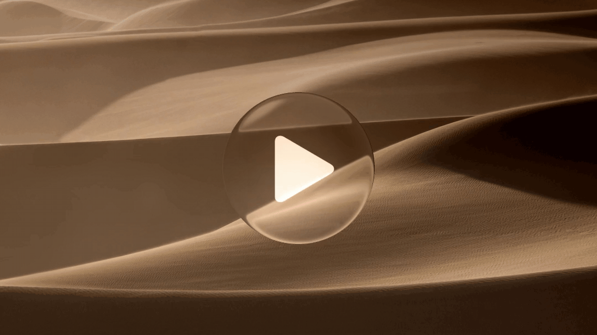

[Video](assets/playback-settled.mp4). GIF: 3,072,914 bytes,1080×608; both exports contain 90frames at 15fps, exactly 6 seconds. They retain the [final short-round recipe](../reconstruction/studies/playback/review-round/pass-03.json), original motion path and registered clean-source exterior, with no copied target context/shadow. Motion retains its original2×2 integration; native4×4 scoring/material are unchanged. The compact still reuses lossless final frames; no optical model was refitted or counted again.

[Media hashes, source support and format verification](../reconstruction/studies/playback/review-round/motion.json).

These are offline renders, not device-performance measurements or a matched Apple motion clip.

Reproduce the current motion format from the reconstruction directory using the frozen input PNGs and accepted record:

```sh
python motion.py INPUTS OUTPUT --record studies/playback/review-round/pass-03.json --frames 90 --fps 15 --width 1080
```

Width/fps defaults remain1920/30. The export keeps the original path and2×2 motion integration; native4×4 still scoring is unchanged. GIFs use Bayer128 first, preserve the selected GIF rate (at most15fps) during palette-only size fallback, and use centisecond delays totaling exactly 6 seconds for this command.

</details>

</details>

## Next-track control

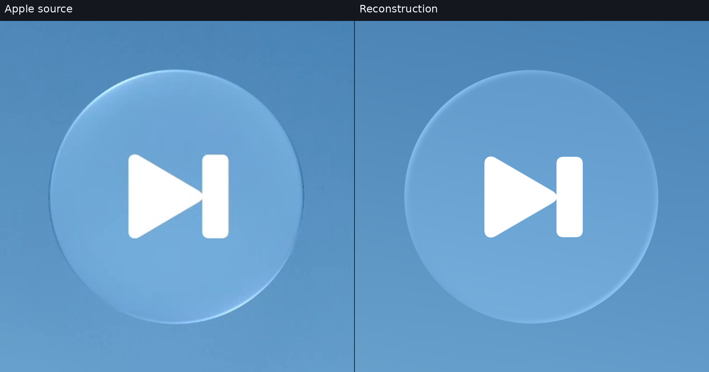

- **Historical preview: E8.027**, after the [shared rim round](#shared-rim-response-next-and-bag).
- **Initial3/3 material passes:** additive values b=.025→.05→.075 shared across RGB, gain1. E **25.734→19.689→13.942→9.076**; glass/rim **25.114/27.126→8.156/10.924**.
- Every original held, interior, SSIM, icon and near/full exterior guard improves; no clipping in the audited native samples. [Recipe and scores](../reconstruction/studies/flower-next/round/pass-03.json) · [Independent replay](../reconstruction/studies/flower-next/round/pass-03-verification.json).
- The circular map and normalized source/output kernels reuse the selected playback model. The former icon-specific color grade is removed; the pinned solid forward-end glyph stays white.
- [Frozen case](../reconstruction/studies/flower-next/case.json) · [Baseline](../reconstruction/studies/flower-next/baseline.json) · [Vector](../reconstruction/studies/flower-next/foreground/forward.end.fill-pinned.svg).
- Sky RGB beneath the circle is an affine estimate from uncovered controls, with no independently observed hidden pixels. A visible stalk is excluded from those controls.
- Source coverage proves definedness, not optical accuracy. This smooth background does not identify the ray map or blur; missing edge highlights and glyph differences remain visible. No paired-background claim.

<details>
<summary>1080px motion and source-support details</summary>

<video controls preload="none" playsinline poster="assets/flower-next-current.png" src="assets/flower-next-motion.mp4"></video>


- Six seconds,90 frames;1080×1073 content with one bottom padding row in the MP4. GIF6.69MB.
- The estimated sky moves vertically beneath the fixed lens; each pose samples, grades and filters the source again. This is illustrative motion, not an Apple recording.
- The still evaluates the field and solid vector at1268×1260, then downsamples to1080px per side.

All visible-alpha/output-kernel queries, finite source-kernel support and bilinear neighborhoods remain in the original defined source domain, including the stalk exclusion. An independent radial bound agrees. Defined source RGB remains estimated.
- [Primary media review](../reconstruction/studies/neutral-circle-rim/next-primary-export.json) · [Source-support record](../reconstruction/studies/neutral-circle-rim/next-source-support.json). Native scores are unchanged by this export.

</details>

## Archive and plus toolbar

**Primary: harmonic crowned geometric back.** This raw unit-transmission baseline uses the shared surface-derived tracing and no added optical blur, fitted light or generated shadow.

Reference: [Apple, Meet Liquid Glass, 11:50](https://developer.apple.com/videos/play/wwdc2025/219/?time=710).

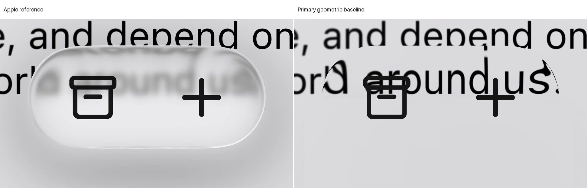

The visible cap/body, tone, d-stroke curvature and underside remain incomplete. Hidden paper is estimated. Closed-surface alternatives have mathematical checks but no newer supported full image.

[Surface, source scope and measurements](../reconstruction/studies/geometric-playback/toolbar-harmonic.json) · [Geometric comparison and sections](geometric-optics.md#a-back-surface-with-two-curvatures).

<details data-historical>
<summary>Archived empirical reconstruction and motion</summary>

Apple, [Meet Liquid Glass, 11:50](https://developer.apple.com/videos/play/wwdc2025/219/?time=710); uncovered text at 12:00. Review revision 3 adds a shared intensity curve and common material adjustment; shape and refraction are unchanged. Weighted RMS error decreases **1.17%** from revision 2, with glass, exterior and both foreground checks passing.

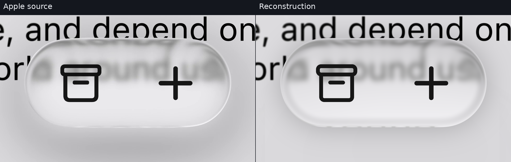

- One clean background feeds the lens and exterior; the hidden paper region is estimated. A generated neutral Gaussian shadow replaces the earlier copied exterior context.
- Its width reaches the chosen bound, so the shadow tail remains provisional.
- The plus uses an original SF Symbols vector. The archive is a symmetric rounded outline trace, an approximation to the original symbol.
- Both are independently rendered; no screenshot glyph pixels are pasted. Glass scoring still excludes their fixed boxes, and foreground errors are reported separately.
- [Model and equations](recreation-models.md#toolbar-normal-displacement-and-tangential-compression) · [Recipe](../reconstruction/studies/archive-plus/review-round/pass-03.json) · [Independent replay](../reconstruction/studies/archive-plus/review-round/pass-03-verification.json) · [Native scores](../reconstruction/studies/archive-plus/review-round/pass-03-scores.json).
- The final `d` stroke remains too straight, and underside reflections/lighting still differ. This empirical image field is not an identified physical lens or Apple shader.
- No second observed background is verified yet.

<details>
<summary>Upper rim and refracted lettering</summary>

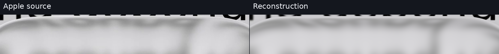

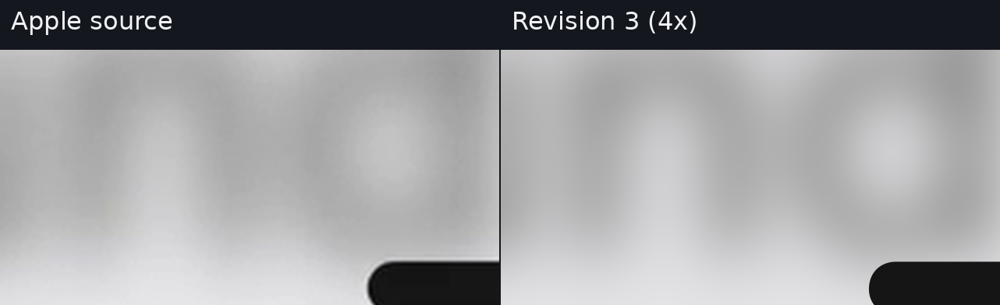


The main comparison and wide rim/underside crops are1080px per side, resized from the accepted lossless4× render; their Apple halves come directly from the native reference. The narrower letter crop retains its original4× presentation. This is a [format-only update](../reconstruction/studies/archive-plus/review-round/format.json), with native scores and crop boundaries unchanged.

The upper-rim crop now extends downward by half its original height; the letter-refraction crop starts at its bottom edge. With these boundaries, visible-composite RMSE within the glass mask decreases from 7.403 to 7.303 in the upper rim and from 3.368 to 3.096 around the `d`.

The underside worsens from **5.062 to 5.471**; its reflections remain too distinct. The [reframed diagnostics](../reconstruction/studies/archive-plus/review-round/pass-03-crops-reframed.json) and [original boundaries/scores](../reconstruction/studies/archive-plus/review-round/pass-03-crops.json) remain advisory and do not imply every region improved.

</details>

</details>

## Safari circular controls

Apple, [Meet Liquid Glass, 5:00](https://developer.apple.com/videos/play/wwdc2025/219/?time=300). Search and plus controls occupy differently shaded parts of the same gray panel. **Plus exterior round: 3/3 verified passes. The shared material transfer still fails. **

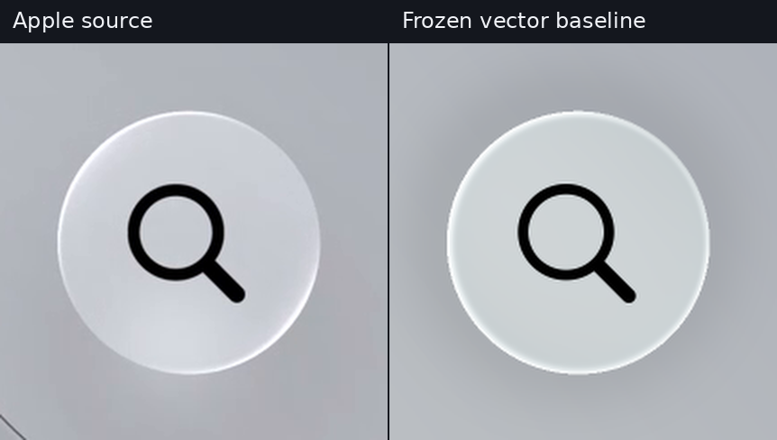

- The magnifier uses an independently rendered pinned vector path, with fixed black fill and placement.
- Its foreground RMSE improves **27.923 → 27.145** relative to the earlier clean geometric trace; this is an input correction, not optical progress. Exact Safari symbol weight is unverified.
- Its affine background is estimated from uncovered upper/right controls. Held RGB error is **1.124** levels; independent left/lower checks are **4.648/9.477**. Hidden input is modeled, not observed.
- Native baseline E **7.69160**, glass/rim **7.27181/8.59170**.

<details>
<summary>Darker-background transfer — failed, not a verified pair</summary>

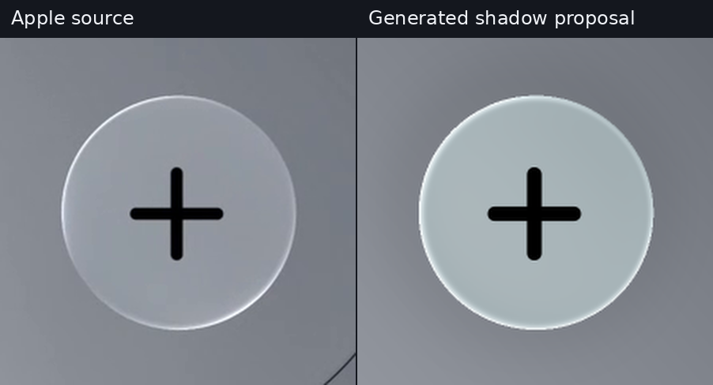

The plus uses the same dimensionless ray/material/shadow parameters, a separate solid plus vector and independently measured pose. Ordinary source/output kernel widths scale only by the radius ratio **74.224/72.894**. No material is fitted to this second image.

The transfer is visibly too bright and cyan: E **23.87081**, glass/rim **23.71619/24.22775**. The final [generated-shadow pass](../reconstruction/studies/safari-circles/plus-round/pass-03-verification.json) reduces near/full exterior RMSE **5.809/5.357 → 4.674/4.829** with every scored optical/icon pixel unchanged; this is exterior-only progress on the plus single observation. The search image is an additional unchanged-material guard, not a paired-optics stage.

Its near/full exterior checks improve, but the third step slightly worsens its far-only advisory aggregate (6.42472 → 6.42805); parent-boundary and pointwise errors remain. The magnifier has no qualifying material pass after eight rejected native trials. This retained failure limits claims that the inherited material generalizes; the two scores are not comparable estimates of achievable fidelity.

The plus background is another affine estimate (held **0.705**, independent right/lower **1.525/5.622** levels). It omits the curved parent-panel edge visible in the crop. Neither background establishes a refraction or dispersion map from such low-frequency content.

</details>

<details>
<summary>Full-resolution plus comparison</summary>

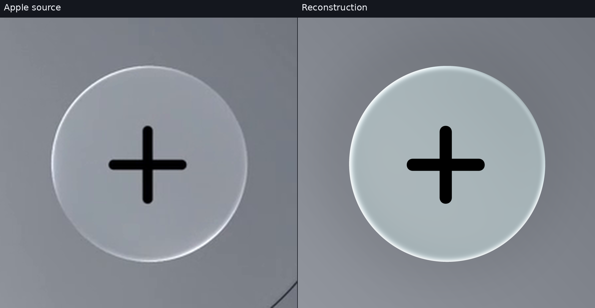

The reconstruction is evaluated at 1800×1760 with two samples per output axis, then resized to 1080px per side. Apple is resized directly from its native reference crop. [Sampling, format and source-domain record](../reconstruction/studies/safari-circles/plus-round/format.json). These presentation samples do not replace native scoring.

</details>

<details>
<summary>Illustrative plus motion — video and GIF</summary>

<video controls preload="none" playsinline width="1080" height="720" aria-label="Safari plus model translation"><source src="assets/safari-plus-motion.mp4" type="video/mp4"><a href="assets/safari-plus-motion.mp4">Open video</a></video>

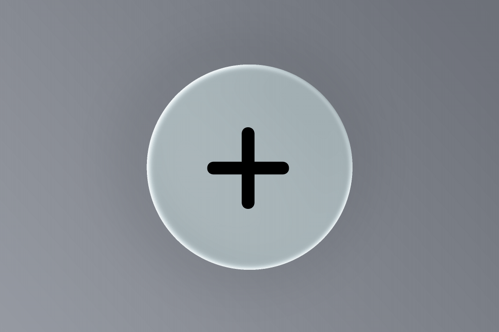

Both contain 90frames at 15fps, exactly 6 seconds; GIF: 6,185,889 bytes. Rays, ordinary source/output filtering, vector coverage and generated shadow are evaluated at the moving poses, with two samples per output axis. Only identical pose/material results are cached. The omitted parent outline and incorrect body color remain explicit.

This is illustrative motion, not an Apple recording or Android benchmark. [Media hashes and conservative finite-kernel source enclosure](../reconstruction/studies/safari-circles/plus-round/motion.json).

</details>

[Equations](recreation-models.md#safari-circular-controls-conditional-material-transfer) · [Fixed recipes and fingerprints](../reconstruction/studies/safari-circles/baseline-transfer.json) · [Native replay](../reconstruction/safari_transfer.py). Inputs remain private. Native sampling is Study2×2; previews are resized from those saved native arrays. This study is separate from the more polished clear playback control and does not replace it.

<details>
<summary>Rejected shared-circle material transfer</summary>

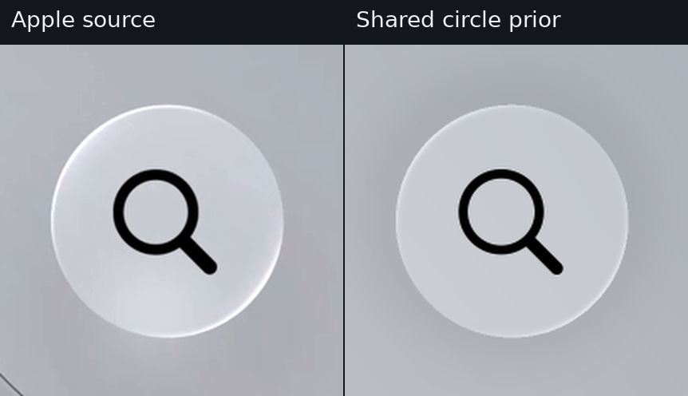

The shared NEXT/bag model fails this search observation: E7.692→9.705. SSIM and icon error improve, but glass, rim, held, interior and exterior guards regress. Source support and unclipped output pass; the current search image stays unchanged. One native proposal, no fitting or source change.

This limits transfer of the material, rather than proving a different optical geometry. [Native measurements and recipe](../reconstruction/studies/safari-circles/common-rim-transfer-rejected.json).

</details>

## Safari bag control

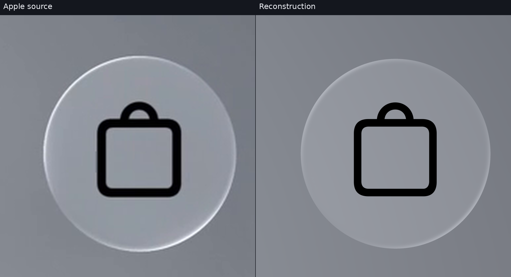

- **Historical preview: E5.778**, after the [shared rim round](#shared-rim-response-next-and-bag).
- **Initial3/3 material passes:** common RGB bias b=.075, gain1. E **24.479→18.262→12.209→6.775**, with every original glass, rim, held, interior, icon, SSIM and near/full exterior check improving. No clipped audited samples.
- [Recipe and scores](../reconstruction/studies/safari-bag/round/pass-03.json) · [Independent replay](../reconstruction/studies/safari-bag/round/pass-03-verification.json).
- This reuses the selected playback map and normalized kernels as a prior, with a pinned solid bag outline.
- A quadratic estimate from uncovered controls supplies hidden panel RGB; no hidden pixels were independently observed.
- Held and independent upper controls support that source family, while the lower-control error2.273levels and pose residualp95≈2px remain uncertainties. [Case](../reconstruction/studies/safari-bag/case.json) · [Source controls](../reconstruction/studies/safari-bag/source-controls.json).

Missing rim highlights and glyph-weight differences remain visible. The smooth estimated background cannot identify refraction or blur. This is a single-background material study, using the [shared neutral response](recreation-models.md#neutral-additive-playback-response), without a paired-optics claim.

<details>
<summary>1080px motion and export details</summary>


[MP4](assets/safari-bag-motion.mp4) · [Export record](../reconstruction/studies/neutral-circle-rim/bag-export.json) · [Source support](../reconstruction/studies/neutral-circle-rim/bag-source-support.json) · [Primary review](../reconstruction/studies/neutral-circle-rim/bag-primary-export.json).

The field is evaluated at1560×1600 before downsampling to1080×1108. One native pixel is trimmed from each presentation edge; native scores retain the original crop. The source moves±4native pixels vertically for6seconds; this is illustrative motion over the estimated panel, not an Apple video match. GIF2.75MB.

</details>


### Shared rim response: NEXT and bag

- **3/3 verified shared passes:** one neutral boundary-normal response improves NEXT E9.076→8.861→8.373→8.027 and bag6.775→6.588→6.163→5.778, preserving every original check on both controls. Fixed source/geometry/kernels; no copied shadow or residual correction.
- [Recipe, scores and verification](../reconstruction/studies/neutral-circle-rim/pass-03.json) · [Equation](recreation-models.md#shared-neutral-rim-response). This is cross-control material evidence, not paired optical calibration.

## Safari tab-count pill

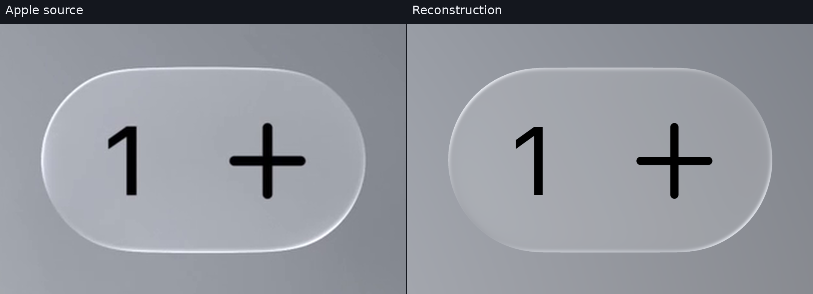

- **Historical preview: rim round3/3**, E15.638→14.823→13.302→11.973. The same normal-dependent neutral response used on the circles preserves every original check; no clipping or source/map/filter change. [Recipe and verification](../reconstruction/studies/safari-tab-pill/rim-round/pass-03.json).
- **Initial3/3 material passes:** the shared neutral white-mixture response uses τ=.95→.90→.85. E **29.117→24.325→19.764→15.638**, with every original glass, rim, held, interior, SSIM, individual-icon and near/full exterior check improving.
- [Recipe](../reconstruction/studies/safari-tab-pill/round/pass-03.json) · [Scores](../reconstruction/studies/safari-tab-pill/round/pass-03-scores.json) · [Independent replay](../reconstruction/studies/safari-tab-pill/round/pass-03-verification.json).
- A quadratic RGB field fitted only to uncovered controls improved held error .805→.697 and independent lower error4.298→1.999 levels. Hidden RGB remains modeled, not observed.

The crowned footprint uses the existing .1-softness prior and an independently measured pose; this smooth source cannot identify refraction or blur. Missing angular highlights remain visible. [Case](../reconstruction/studies/safari-tab-pill/case.json) · [Source controls](../reconstruction/studies/safari-tab-pill/source-controls.json).
- Numeral1 uses the original SF Pro Text Regular outline at uniform aspect.

The plus uses a pinned solid SF-export outline; its input-only replacement improved ink overlap .783→.995 before the material epoch was frozen. Exact UI weight is unproven. [Input record](../reconstruction/studies/safari-tab-pill/baseline.json) · [Neutral response model](recreation-models.md#neutral-material-response).

<details>
<summary>1080px motion and export details</summary>

<video controls preload="none" playsinline poster="assets/safari-tab-pill-current.png" src="assets/safari-tab-pill-motion.mp4"></video>


- Four seconds,60frames,1080×360; GIF0.46MB. Lens, solid glyphs and sampling coordinates translate together over the polynomial source estimate. Parent-panel boundaries and reference shadows are omitted.
- The still evaluates1260×840 at two subpixels per output axis, then downsamples to1080×720 per side.
- Every emitted rectangular-crop query is checked at the HQ grid and each unique motion pose, including partial edge samples.
- There are no ordinary source/output filters in this prior; no blur or refraction calibration is claimed.
- [Motion record](../reconstruction/studies/safari-tab-pill/rim-round/final-media.json) · [HQ record](../reconstruction/studies/safari-tab-pill/rim-round/final-hq.json). Native pass scores remain unchanged.

[Current rim export verification](../reconstruction/studies/safari-tab-pill/rim-round/final-primary-verification.json) · [Native export control](../reconstruction/studies/safari-tab-pill/rim-round/final-native-control.json).

</details>

## Mail three-action toolbar

Apple, [Meet Liquid Glass,1:40](https://developer.apple.com/videos/play/wwdc2025/219/?time=100). This preliminary study isolates a neutral material response over a smooth estimated panel; it does not identify the lens from that background.

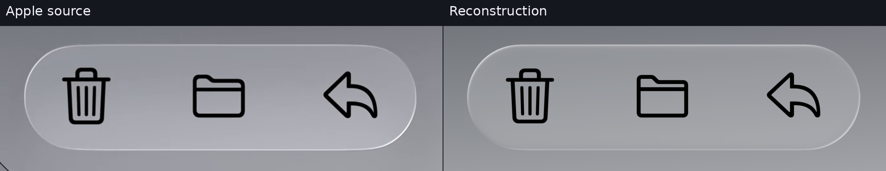

- **Historical preview: rim round3/3**, E11.683→11.099→10.121→9.459; every original guard holds, no clipping or source/map change. [Recipe and verification](../reconstruction/studies/mail-toolbar/rim-round/pass-03.json).

**Initial3/3 material passes:** transmission τ1→.95→.90→.85, with one value shared across RGB. E **26.249→20.982→16.002→11.683**, glass/rim **25.298/28.345→10.252/14.483**. Every icon, glass/interior/held region, near/full exterior and SSIM check passes. [Recipe](../reconstruction/studies/mail-toolbar/round/pass-03.json) · [Scores](../reconstruction/studies/mail-toolbar/round/pass-03-scores.json) · [Independent replay](../reconstruction/studies/mail-toolbar/round/pass-03-verification.json).
- The affine incident field is estimated only from uncovered controls. Held error2.132 levels; independent upper/lower1.905/2.235. A quadratic failed the predefined independent-lower improvement test and is not used.
- Hidden RGB is modeled, not recovered.
- The continuous crown uses the existing shared footprint with softness.1 as a prior. Image contour evidence cannot distinguish its softness reliably; it is not an identified Apple solid.
- The fixed empirical ray prior is unchanged during material trials. Ordinary blur is fixed at0 because this source cannot constrain it, not because Apple blur was disproven.
- Trash/reply reuse pinned solid SF-export outlines. Folder is a clean connected-rail trace after the available vectors failed to match that detail.
- Its input correction is separate from material progress; exact original weights remain unproven. All three glyph boxes are guarded individually. [Frozen case](../reconstruction/studies/mail-toolbar/case.json).
- Reflections/highlights, body tone, foreground geometry and parent-panel context remain incomplete. This component study is separate from the most-polished clear playback control.

[Current rim equation and replay](recreation-models.md#shared-neutral-rim-response) · [Replay helper](../reconstruction/neutral_rim.py) · [Initial neutral response](recreation-models.md#neutral-material-response).

<details>
<summary>1080px motion and export details</summary>

<video controls preload="none" playsinline poster="assets/mail-toolbar-current.png" src="assets/mail-toolbar-motion.mp4"></video>

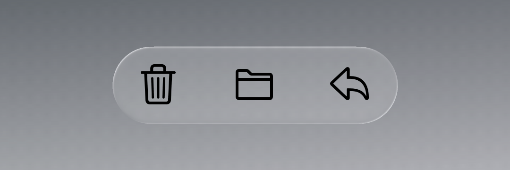

- Four seconds, 60 frames, 1080×360; GIF 0.87MB. This is an illustrative translation over the estimated affine panel, without the parent panel boundary.
- Each pose reevaluates the fixed field and solid glyphs; no reference shadow is retained.

The still evaluates 1360×450 at two subpixels per output axis and downsamples to1080px per side. The Apple crop is resized directly from its native source. Native pass scores remain unchanged.
- Every emitted rectangular-crop query, including partial edge pixels, stays in the frozen defined source domain. Hidden RGB remains modeled, not observed. [Motion record](../reconstruction/studies/mail-toolbar/rim-round/final-media.json) · [HQ record](../reconstruction/studies/mail-toolbar/rim-round/final-hq.json).

[Primary export verification](../reconstruction/studies/mail-toolbar/rim-round/final-primary-verification.json) · [Native export control](../reconstruction/studies/mail-toolbar/rim-round/final-native-control.json).

</details>

## Active slider

Apple, [Build a UIKit app with the new design, 18:12](https://developer.apple.com/videos/play/wwdc2025/284/?time=1092); resting page at 18:10.5. The thumb uses a measured polynomial-oval outline and channel-separated tensor refraction. **No Gaussian blur is applied. **

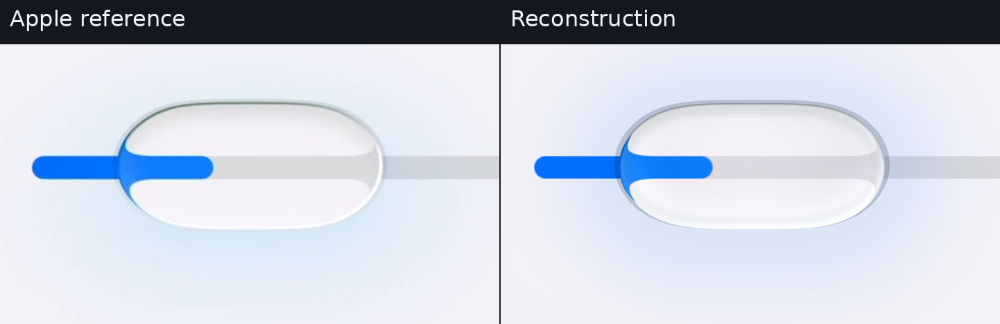

- [Equations](recreation-models.md#active-slider-oval-outline-and-channel-separated-map); exact coefficients in the `slider` recipe. This retains the stronger empirical map; the closed-body trial remains experimental.
- The recovered track has a 20-pixel reference height; its hidden blue endpoint is estimated. The upper dark ridge constrains the outline, with 54 fitted and 27 withheld columns.
- Bottom/right symmetry remains assumed.
- Colored rim detail supports testing channel-separated lookups, but does not prove dispersion: lighting, adaptive processing and video chroma subsampling are confounds.
- Current exterior round: **3/3**, single-background reconstruction. A generated neutral contact follows the measured width/height ratios; a broad tinted halo uses the exposed track accent.
- Original optics and every native optical score are unchanged. Near-exterior RMSE falls 19.299789 → 11.701439 and full-visible exterior 9.391866 → 6.010572, including held blocks.
- The replacement of copied context itself gets no credit. [Recipe](../reconstruction/studies/slider-exterior/review-round/pass-03.json) · [Independent replay/domain check](../reconstruction/studies/slider-exterior/review-round/pass-03-verification.json).
- A gray-track minimum-state reference gives a withheld nine-patch halo-profile error of 11.109 → 3.542.
- Its shape/track also deform under edge compression; this is component transfer evidence, **not a verified second-background optical benchmark**. Halo hue and blue-track stretching onset remain unresolved.
- Final reconstruction is evaluated at1080px wide with4×4 samples per output pixel; the Apple reference is resized once from its native crop. Native scoring stays unchanged.
- The generated contact band remains too pronounced; this provisional exterior is not a finished optical match.

<details>
<summary>1080px-per-side slider comparison</summary>

[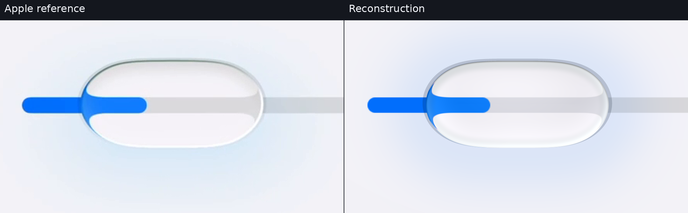](assets/match-slider-full.png)

</details>

<details>
<summary>Final slider motion — video and GIF</summary>

<video controls preload="none" playsinline width="1080" height="608" aria-label="Generated slider lens motion"><source src="assets/slider-final.mp4" type="video/mp4"><a href="assets/slider-final.mp4">Open video</a></video>

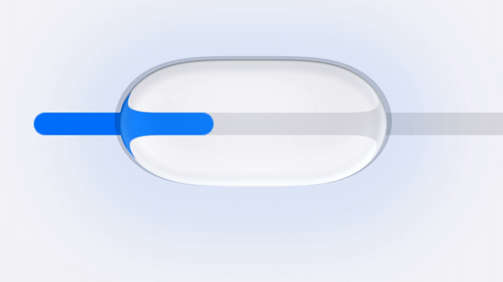

1080px wide,90frames at 15fps,6 seconds; GIF9,887,212bytes. Geometry/material are fixed; source sampling, contact and halo follow each position. The track fill stays fixed. One bottom row pads the607px raster for video encoding. This is illustrative motion, not captured Apple interaction or Android performance. [Media/source verification](../reconstruction/studies/slider-exterior/review-round/motion.json) · [Cache equivalence](../reconstruction/studies/slider-exterior/review-round/cache-equivalence.json).

</details>

## Light and dark surfaces

Apple, [legibility demonstration, 15:15–15:20](https://developer.apple.com/videos/play/wwdc2025/219/?time=915). Each appearance has an independent material recipe over the same shape. [Equations](recreation-models.md#uniform-light-and-dark-surfaces).

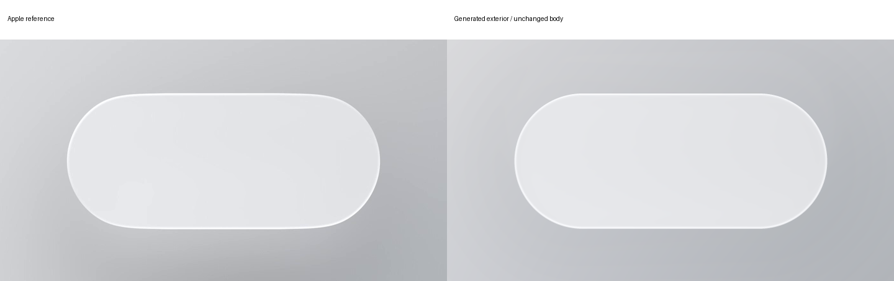

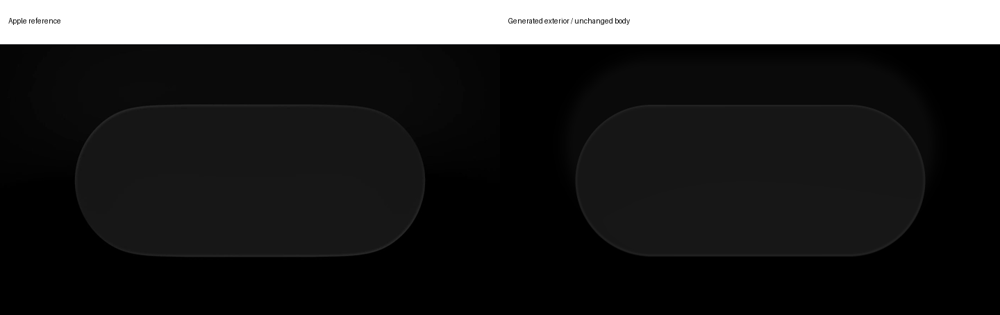

These test tone, broad lighting and rim. Nearly uniform backdrops cannot identify refraction: high similarity here does not validate an optical model. Neither recipe uses Gaussian blur.

Current round: **3/3 verified reconstruction passes**, exterior-only, with all original optical scores unchanged. One common generated shadow/glow law, with shared original-offset multiplier s=1.2 and fixed four opacity/width coefficients, improves frozen near-exterior RMSE light 6.082354 → 3.794838 / dark 6.752748 → 2.057697 and full-visible exterior 6.613297 → 4.565302 / 5.963654 → 3.712516.

Comparisons use the frozen source PNGs and original4×4 body coverage; no copied reference context/shadow. Removing the previous display context earns no credit. Sources remain estimated/unobserved; upper far-light regressions, the .7L shadow-width bound and unresolved broad dark glow remain explicit. [Recipe](../reconstruction/studies/light-dark/review-round/pass-03.json) · [Independent verification](../reconstruction/studies/light-dark/review-round/pass-03-verification.json).

<details>
<summary>1080px-per-side light and dark comparisons</summary>

[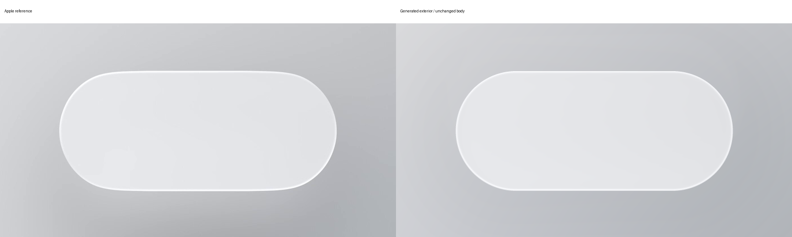](assets/match-regular-light-full.png)

[](assets/match-regular-dark-full.png)

</details>

<details>
<summary>Generated light/dark motion from the final reconstruction</summary>

The generated control moves horizontally over the frozen source estimates: 1080px wide, 90frames at 15fps,6 seconds. Both GIFs are below10MB. Every frame reevaluates the original4×4 body sampling/coverage and the shared generated exterior; no reference residual or copied context. Near-uniform sources do not validate refraction or identify lighting.

This is illustrative generated motion, not captured Apple animation. [Motion/source verification](../reconstruction/studies/light-dark/review-round/motion.json).

[Light video](assets/regular-light-final.mp4) · [Dark video](assets/regular-dark-final.mp4)

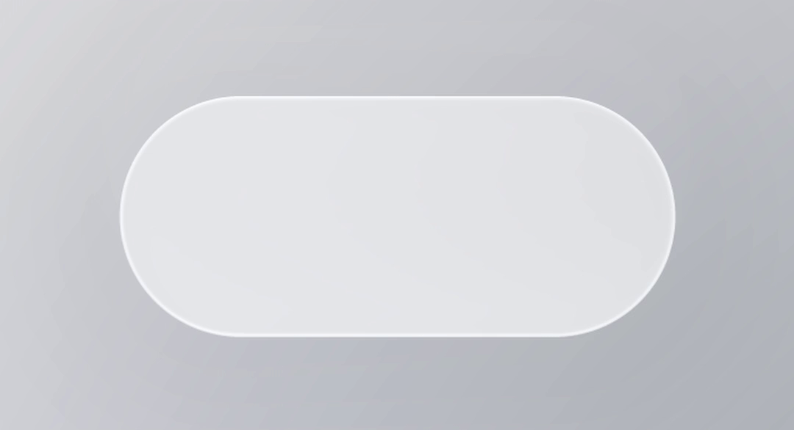

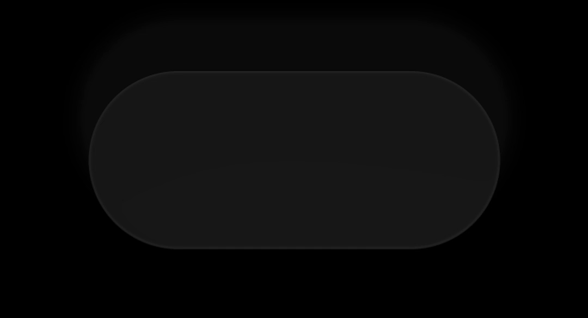

</details>

## Apple Music studies

References come from [Apple's original Music video](https://www.apple.com/newsroom/videos/2025/autoplay/06/apple-introduces-a-delightful-and-elegant-new-software-design/apple-wwdc25-liquid-glass-apple-music-dynamic-tab-bars/large_2x.mp4). Each study shares optics/material across two observed backgrounds. Current reconstruction exports are **1080px wide per side**; native scoring remains fixed to the reference resolution. The Apple halves retain the original video's detail. Use **Fullscreen** to inspect the full-size pair.

### Expanded mini-player

Expanded and compact now use [one canonical glass model](../reconstruction/families/music-mini-player.json); only major length differs. The shared configuration replays both existing expanded references pixel-exactly.

**Primary: positive spline-height geometric model with shared neutral contrast.** Both references use the same actual surface profile, incident softness and common response. The bright rim, some background returns and cap shading remain incomplete.

References: [Apple Music clip](https://www.apple.com/newsroom/videos/2025/autoplay/06/apple-introduces-a-delightful-and-elegant-new-software-design/apple-wwdc25-liquid-glass-apple-music-dynamic-tab-bars/large_2x.mp4), frames at 0 and 6.033 seconds.

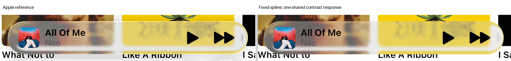


Paired E improves from H1's 45.424 / 18.220 to 12.908 / 8.576. All original paired body, SSIM, artwork and glyph guards pass, including independent float64 residual checks. Both partial-boundary advisory errors improve. Incident blur stays 6.75 native pixels. This is a verified combined increment, not a completed pipeline or uniquely identified Apple material.

[Selected state and limits](../research/experiments/expanded-contrast-guard-02/primary-decision.json) · [Bounded experiment and exact replay](../research/experiments/expanded-contrast-guard-02/README.md) · [Independent review](../research/experiments/agent-expanded-contrast-peer-09/README.md).

**Latest outline experiment: held, not selected.** Actual curved front/back surfaces now produce an outer highlight. The reconstructed physical back preserves useful refraction while a hypothetical common studio light improves body and foreground guards on all four references. Expanded A’s original 16-pixel boundary guard still fails. The selected images above remain unchanged.

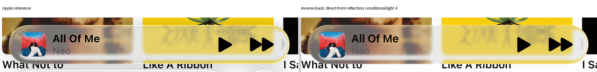

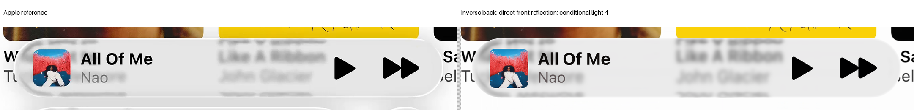

[Latest inverse-back forward test](../research/experiments/miniplayer-inverse-forward-18/README.md) · [Earlier structured review and held color step](../research/experiments/miniplayer-pass-review-16/README.md) · [Three hypotheses and fixed-crop regressions](../research/experiments/miniplayer-outline-review-10/README.md) · [Same-geometry cached section](../research/experiments/miniplayer-outline-review-10/expanded-actual-section.svg). Lighting is an explicit unobserved assumption; later reflected radiance remains unresolved.

Checkerboard marks unavailable unscored exterior. The original registered inputs and foreground remain fixed; no target backdrop, mask removal or new shadow is used. Earlier H1 and spline-response failures remain below.

<details data-historical>
<summary>Earlier H1 primary, retained unchanged</summary>

H1 used a harmonic rounded-rectangle back and the prior common response. Its incident-filtered E was 45.424 / 18.220. The complete source and scoring records remain unchanged.

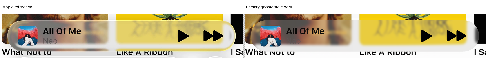

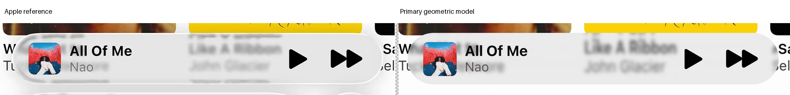

[Original selection](../research/experiments/expanded-geometry-02/selection.json).

</details>

<details data-historical>
<summary>Earlier spline with prior response: foreground guards failed</summary>

A positive spline back reduces paired E to 25.289 / 11.045 with all body metrics improving. Original artwork/title/transport guards still fail, so this is an experimental candidate, not an accepted replacement. Source, masks, blur and colour stay fixed.

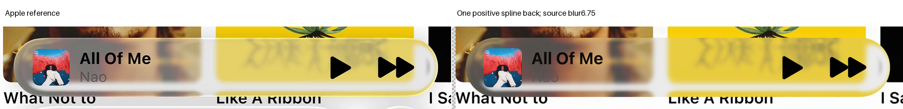

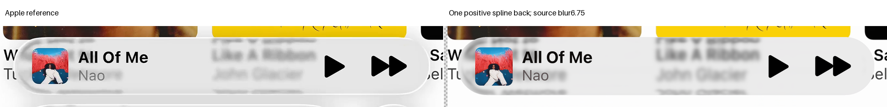

[Results, source proof and same-geometry rays](../research/experiments/expanded-spline-observation-01/README.md).

</details>

<details data-historical>
<summary>Archived empirical reconstruction and motion</summary>

Historical round: **3/3** verified passes. A shared outer-normal/material update changes native E A5.388053→5.388045/B3.118163→3.116864. Both glass errors improve and all ten glyph/artwork guards hold; fixed exterior error is unchanged. All original emitted and scored subrays pass the finite3sigma recovered-source check. [Archived recipe](../reconstruction/studies/music-mini-expanded-vector/review-round/pass-03.json) · [Independent verification](../reconstruction/studies/music-mini-expanded-vector/review-round/pass-03-verification.json).

The crown-only variants failed the frozen guards and are not adopted; existing footprint limitations remain. Final motion uses this third-pass recipe: 1080px wide, 90 frames at 15fps. Both full-size 256-color GIFs are below10MB (A7.0MB/B4.0MB). [Motion verification](../reconstruction/studies/music-mini-expanded-vector/review-round/motion.json). The sampled moving source checks pass; this is illustrative backdrop motion, not captured Apple animation or device-performance evidence.


Frame A: 0 seconds. Frame B: 6.033 seconds. Cover art is a separate high-resolution image; symbols and labels use vector geometry. Recovered background strips and registration limits are recorded with the measurements.

[](assets/study-music-mini-expanded-vector-paired-a.png)

[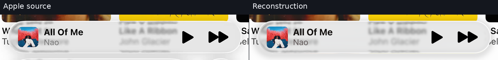](assets/study-music-mini-expanded-vector-paired-b.png)

- [Shared recipe](../reconstruction/studies/music-mini-expanded-vector/paired/accepted.json) · [Verification](../reconstruction/studies/music-mini-expanded-vector/paired/verification.json) · [A diagnostics](../reconstruction/studies/music-mini-expanded-vector/paired/a/diagnostics.json) · [B diagnostics](../reconstruction/studies/music-mini-expanded-vector/paired/b/diagnostics.json).
<details>
<summary>Motion — background A</summary>

<video controls preload="none" playsinline width="1080" height="200" aria-label="Expanded mini-player, background A motion"><source src="assets/study-music-mini-expanded-vector-paired-a.mp4" type="video/mp4"><a href="assets/study-music-mini-expanded-vector-paired-a.mp4">Open video</a></video>

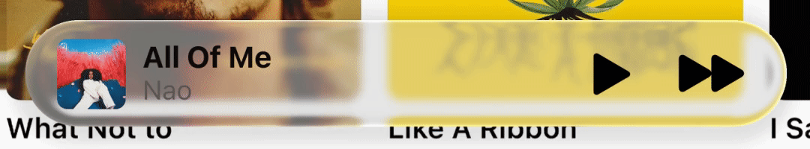

[Video](assets/study-music-mini-expanded-vector-paired-a.mp4) · [GIF](assets/study-music-mini-expanded-vector-paired-a.gif)

</details>

<details>
<summary>Motion — background B</summary>

<video controls preload="none" playsinline width="1080" height="200" aria-label="Expanded mini-player, background B motion"><source src="assets/study-music-mini-expanded-vector-paired-b.mp4" type="video/mp4"><a href="assets/study-music-mini-expanded-vector-paired-b.mp4">Open video</a></video>

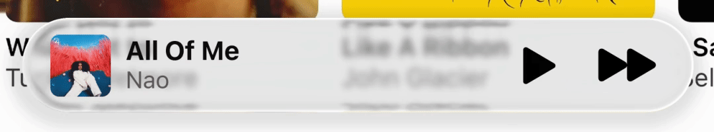

[Video](assets/study-music-mini-expanded-vector-paired-b.mp4) · [GIF](assets/study-music-mini-expanded-vector-paired-b.gif)

</details>

</details>

### Compact mini-player

**Primary: the exact expanded miniplayer model, shortened only.** One shared configuration supplies the spline, minor/corner geometry, index, background distance, incident blur and material. Compact received no fit.

The unfitted transfer passes all original paired guards; E43.579/38.032 becomes27.324/26.359. A frozen22-pixel old boundary cohort worsens44.194→48.286. The thin bright rim, cap light and return positions remain unresolved. No full-fidelity pass is claimed.

[Shared family configuration](../reconstruction/families/music-mini-player.json) · [Transfer and local regressions](../research/experiments/miniplayer-shared-transfer-06/README.md) · [Independent exact replay](../research/experiments/agent-miniplayer-family-peer-19/README.md). Original source, reference masks, artwork and foreground inputs remain fixed.


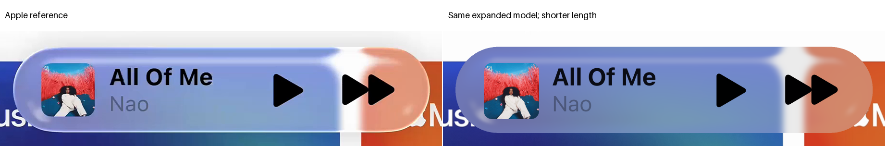

<details data-historical>
<summary>Earlier separately configured geometric initializer</summary>

**Historical: smoothed-cap harmonic geometric baseline.** The accepted contour, paired sources, artwork and original vector styles are preserved. Refraction uses the same surface-derived tracer as the other geometric controls.

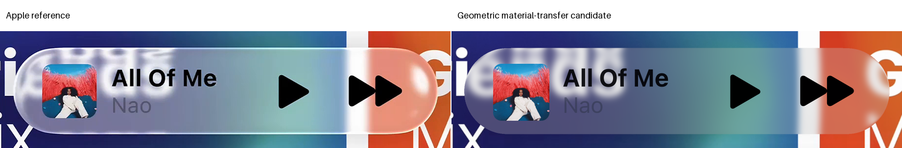

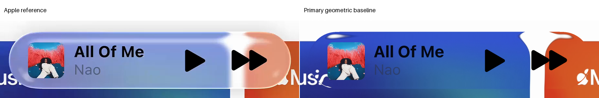

The raw unit body is too sharp and saturated; frosting, light body response and rim light remain open. All required source samples pass, including the 30 original scored subrays outside the physical outline.

[Earlier transfer study](../research/experiments/compact-geometry-01/README.md) · [Surface and certificate](../research/experiments/compact-geometry-01/surface.md) · [Raw scores and exact replay](../research/experiments/compact-geometry-01/raw-result.json). Original pre-foreground and subray data are retained for material checks.


</details>

<details data-historical>
<summary>Archived empirical reconstruction and motion</summary>

Historical round: **3/3** verified passes. Shared lighting, outer-normal and material updates change native E A 4.989875→4.988888/B 4.834120→4.831008. All ten glyph/artwork guards hold; artwork and exterior errors are unchanged. Frozen sources fully support the original emitted and scored subrays.

[Archived recipe](../reconstruction/studies/music-mini-compact-vector/review-round/pass-03.json) · [Independent verification](../reconstruction/studies/music-mini-compact-vector/review-round/pass-03-verification.json). Final motion uses this recipe: 6 seconds at 15fps, 1080px wide. Both full-size GIFs have 256 colors and remain below 10MB. [Motion verification](../reconstruction/studies/music-mini-compact-vector/review-round/motion.json). The sampled moving source checks pass; this is illustrative motion, not captured Apple animation or device-performance evidence.

Frames A/B: 2.5/2.0 seconds. This tests the compact state of the same playback component. The exterior mask remains fixed while the silhouette is refined; it cannot move to conceal shadow error.

[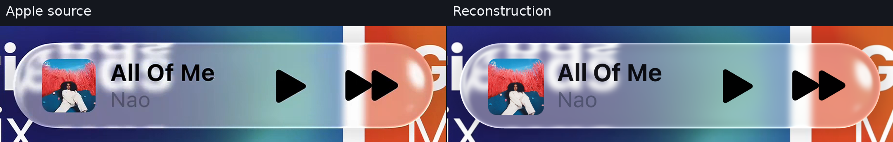](assets/study-music-mini-compact-vector-paired-a.png)

[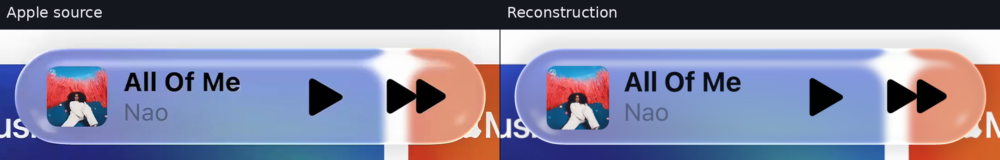](assets/study-music-mini-compact-vector-paired-b.png)

- [Shared recipe](../reconstruction/studies/music-mini-compact-vector/paired/accepted.json) · [Verification](../reconstruction/studies/music-mini-compact-vector/paired/verification.json) · [A diagnostics](../reconstruction/studies/music-mini-compact-vector/paired/a/diagnostics.json) · [B diagnostics](../reconstruction/studies/music-mini-compact-vector/paired/b/diagnostics.json).
<details>
<summary>Motion — background A</summary>

<video controls preload="none" playsinline width="1080" height="282" aria-label="Compact mini-player, background A motion"><source src="assets/study-music-mini-compact-vector-paired-a.mp4" type="video/mp4"><a href="assets/study-music-mini-compact-vector-paired-a.mp4">Open video</a></video>

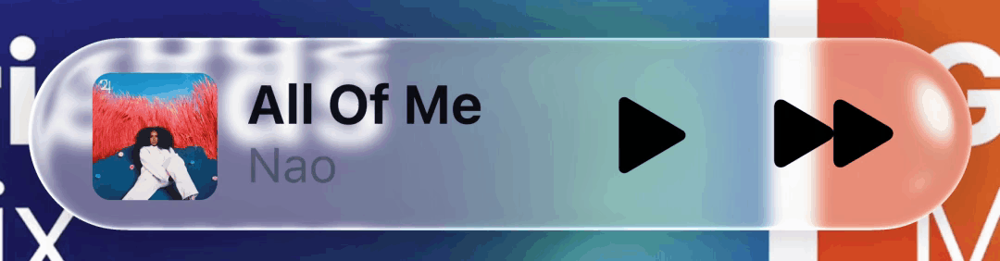

[Video](assets/study-music-mini-compact-vector-paired-a.mp4) · [GIF](assets/study-music-mini-compact-vector-paired-a.gif)

</details>

<details>
<summary>Motion — background B</summary>

<video controls preload="none" playsinline width="1080" height="282" aria-label="Compact mini-player, background B motion"><source src="assets/study-music-mini-compact-vector-paired-b.mp4" type="video/mp4"><a href="assets/study-music-mini-compact-vector-paired-b.mp4">Open video</a></video>

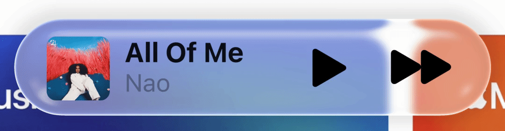

[Video](assets/study-music-mini-compact-vector-paired-b.mp4) · [GIF](assets/study-music-mini-compact-vector-paired-b.gif)

</details>

</details>

### Detached Search control

Current: **shared harmonic geometry with verified neutral tone**, using original 2.5/2.0-second references. Incident blur6.75 runs before refraction. Both references use one encoded gain/bias; all original and partial-boundary guards pass. E66.086/55.940 becomes27.662/22.030.

The thin bright rim, feature placement and illumination remain wrong. B lower-return color and source-feature contrast regress. Conditional source availability and the historical fingerprint discrepancy remain disclosed. This is an accepted tone component, not full fidelity or paired physical identification.

[Primary decision and exact replay](../research/experiments/search-neutral-primary-01/README.md) · [Color record and local regressions](../research/experiments/agent-music-search-neutral-05/README.md) · [Rejected blur bracket](../research/experiments/agent-music-search-incident-blur-04/README.md).

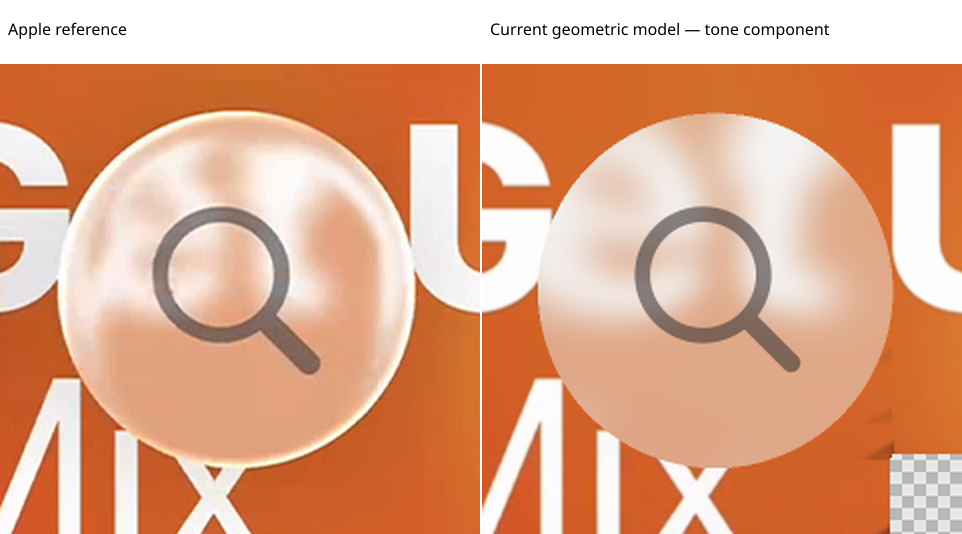

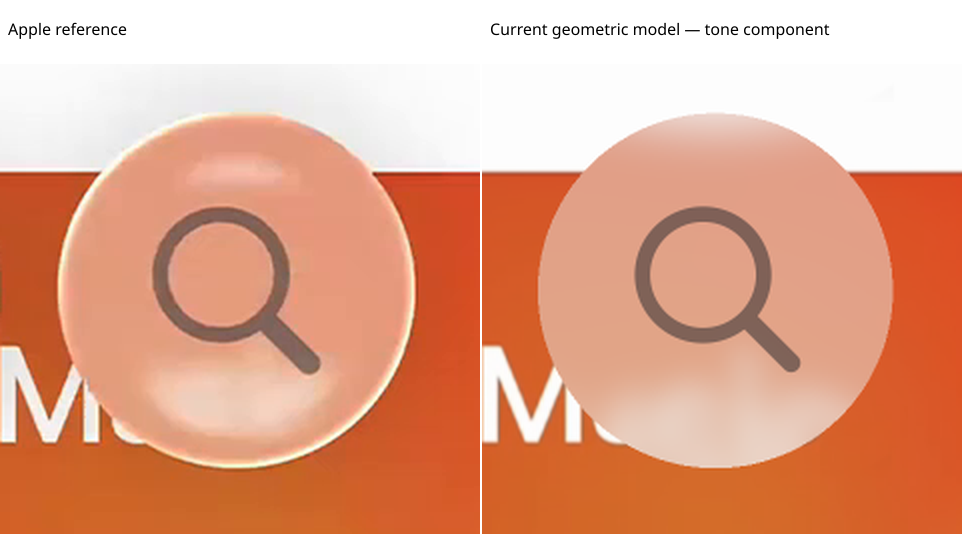

<details data-historical>
<summary>Historical empirical reconstruction and motion</summary>

Historical round: **3/3** verified passes. Shared material updates: native E A7.230750→7.227650 and B7.124124→7.120881. Glass and foreground improve on both; exterior shadow stays fixed. Unknown exterior is completed from nearest defined source RGB for presentation only; scored pixels are unchanged. Motion below uses this third-pass recipe:6 seconds at 15fps,1080px wide.

GIFs preserve full dimensions below10MB (A10fps/96colors; B6fps/256colors). [Motion verification](../reconstruction/studies/music-search-vector/review-round/motion.json).

[Archived recipe](../reconstruction/studies/music-search-vector/review-round/pass-03.json) · [Independent verification](../reconstruction/studies/music-search-vector/review-round/pass-03-verification.json).

Frames A/B: 2.5/2.0 seconds. The magnifier is a clean symmetric vector trace; color and opacity are fitted separately. The icon geometry does not contain video compression artifacts.

[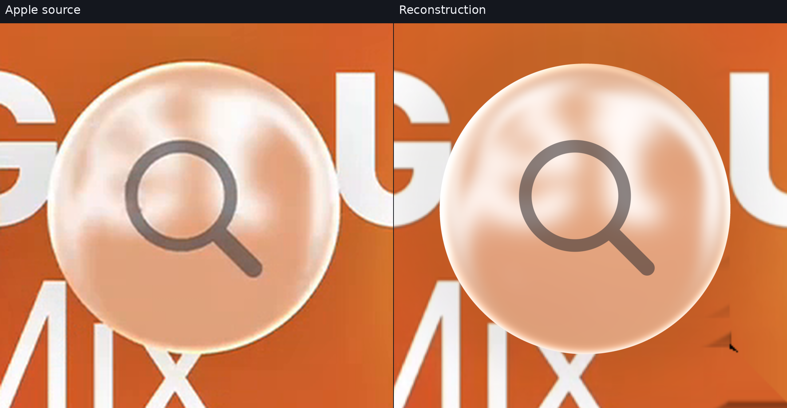](assets/study-music-search-vector-paired-a.png)

[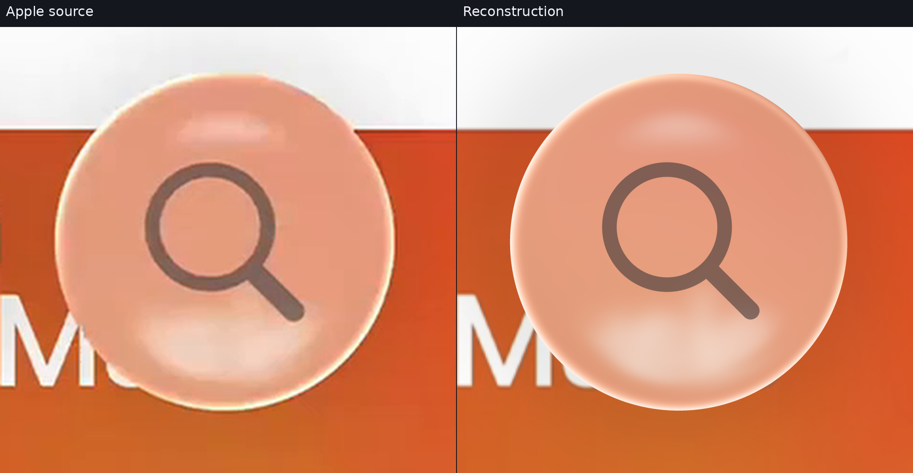](assets/study-music-search-vector-paired-b.png)

- [Shared recipe](../reconstruction/studies/music-search-vector/paired/accepted.json) · [Verification](../reconstruction/studies/music-search-vector/paired/verification.json) · [A diagnostics](../reconstruction/studies/music-search-vector/paired/a/diagnostics.json) · [B diagnostics](../reconstruction/studies/music-search-vector/paired/b/diagnostics.json).
<details>
<summary>Motion — background A</summary>

<video controls preload="none" playsinline width="1080" height="1058" aria-label="Search control, background A motion"><source src="assets/study-music-search-vector-paired-a.mp4" type="video/mp4"><a href="assets/study-music-search-vector-paired-a.mp4">Open video</a></video>

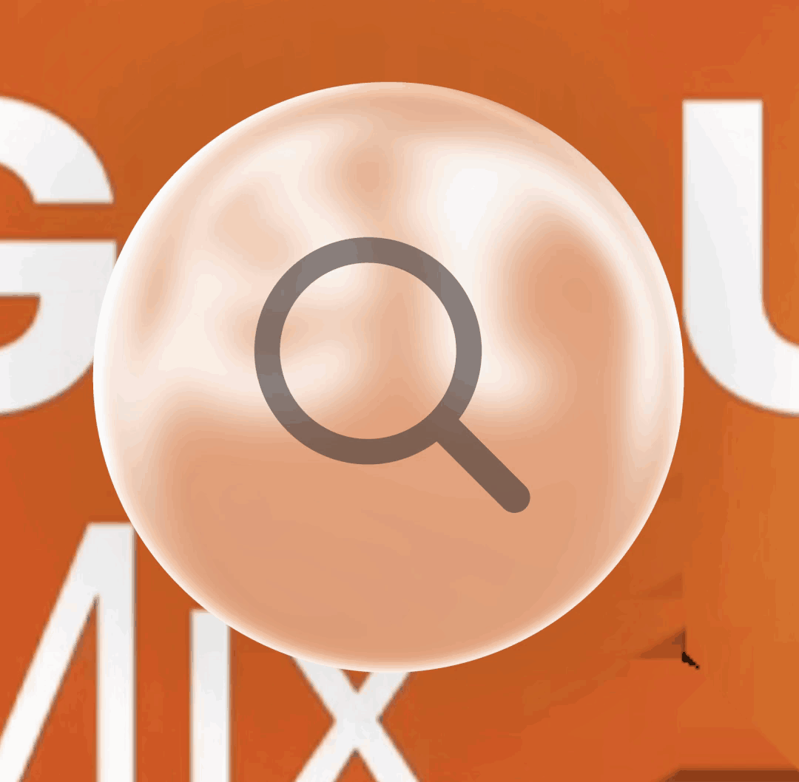

[Video](assets/study-music-search-vector-paired-a.mp4) · [GIF](assets/study-music-search-vector-paired-a.gif)

</details>

<details>
<summary>Motion — background B</summary>

<video controls preload="none" playsinline width="1080" height="1058" aria-label="Search control, background B motion"><source src="assets/study-music-search-vector-paired-b.mp4" type="video/mp4"><a href="assets/study-music-search-vector-paired-b.mp4">Open video</a></video>

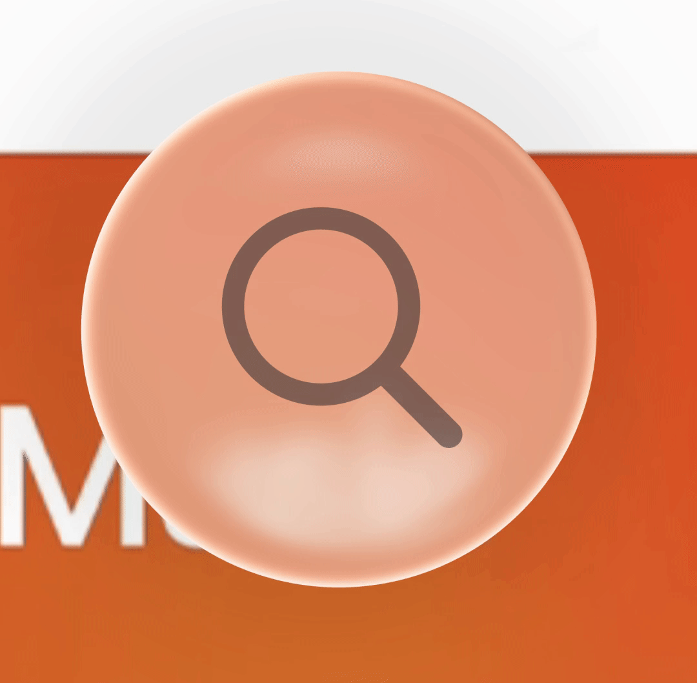

[Video](assets/study-music-search-vector-paired-b.mp4) · [GIF](assets/study-music-search-vector-paired-b.gif)

</details>

</details>

### Navigation control

**Primary: harmonic rounded-rectangle geometric baseline.** Source and footprint checks pass. Incident blur is present; body tone, cap/text returns and bright rim remain inaccurate.

References: the same Apple Music clip, frames at 0 and 6.033 seconds. The original source mosaics and foreground remain fixed.

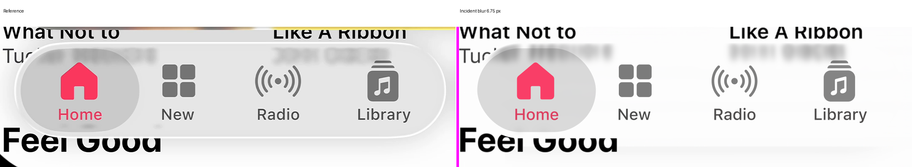


The source-blur variant improves body texture but fails foreground guards. Exact cached replay now preserves the nonlinear foreground chain. A historical raw-H1 shadow trial improves exterior aggregates but worsens A completed glass/rim error. It is not a filtered-baseline verdict. Checkerboard marks unavailable unscored exterior.

Outline radiance and dispersion remain unresolved. Historical raw-body chroma diagnostics do not establish current filtered-body ceilings or physically coupled spectral bounds.

[Original geometric study](../research/experiments/navigation-geometry-01/README.md) · [Selected baseline](../research/experiments/navigation-geometry-01/raw-result.json) · [Surface and certificate](../research/experiments/navigation-geometry-01/surface.md).

<details>
<summary>Latest tone candidate: visibly closer body; boundary guard still fails</summary>

One shared neutral response reduces paired E from 22.795 / 23.522 to 9.716 / 7.618. All original paired body, SSIM and sixteen foreground guards pass. The predeclared B partial-boundary guard worsens from 84.818 to 85.643, so the candidate is held, not accepted.


Geometry, incident blur, sources, masks and foreground styles stay fixed. This encoded response follows cached pixel integration; it is not an optical transmission measurement. Texture contrast and missing rim light remain imperfect. All four declared factors fail the boundary guard; no additional factor is tried.

[Complete colour report and regressions](../research/experiments/agent-navigation-neutral-06/README.md) · [Exact saved-panel extraction](../research/presentation/navigation-tone-held.json).

</details>

The [fixed spline transfer](../research/experiments/agent-navigation-spline-03/README.md) and both [longitudinal height modulations](../research/experiments/agent-navigation-longitudinal-05/README.md) fail paired geometry comparisons. Their valid surfaces and source checks do not establish transferred fidelity.

[Final eight-stage review and compatibility limits](../research/experiments/agent-navigation-final-review-07/README.md). H1 remains selected; incomplete outline, shadow/glow and dispersion assessments are not silently counted as successful or absent.

<details data-historical>
<summary>Archived empirical reconstruction and motion</summary>

Historical round: **3/3** verified passes. Native E: A1.979013→1.975144; B7.434360→7.429451. All16 foreground and exterior measurements are unchanged. Shared outer-normal and rim-lighting width adjustments improve both references; advisory interior error slightly increases in passes2–3. Unknown exterior context uses nearest defined source RGB for presentation only; measured pixels are unchanged.

Motion below uses the third-pass recipe:6 seconds at 15fps,1080px wide, with full-size GIFs below10MB. One bottom row is codec padding. [Motion verification](../reconstruction/studies/music-navigation/review-round/motion.json).

Frames A/B: 0/6.033 seconds. The study separates the outer glass, fixed gray selection backing, symbols and text. Original font outlines are used for labels; unresolved symbols use clean traces or a documented public vector. **The upper rim on B remains too dark.

** A shared normal-white rim addition at amplitude.005/.0025 (width.028) improves A but worsens B’s aggregate in both cached proposals; no new native render or accepted pass. [Frozen recipe/hash checks and rejected predictions](../reconstruction/studies/music-navigation/review-round/normal-rim-transfer-rejected.json). The mostly white background A weakly constrains refraction.

[](assets/study-music-navigation-paired-a.png)

[](assets/study-music-navigation-paired-b.png)

- [Archived recipe](../reconstruction/studies/music-navigation/review-round/pass-03.json) · [Independent verification](../reconstruction/studies/music-navigation/review-round/pass-03-verification.json) · [Historical calibration](../reconstruction/studies/music-navigation/paired/accepted.json) · [A diagnostics](../reconstruction/studies/music-navigation/paired/a/diagnostics.json) · [B diagnostics](../reconstruction/studies/music-navigation/paired/b/diagnostics.json).
<details>
<summary>Motion — background A</summary>

<video controls preload="none" playsinline width="1080" height="336" aria-label="Navigation control, background A motion"><source src="assets/study-music-navigation-paired-a.mp4" type="video/mp4"><a href="assets/study-music-navigation-paired-a.mp4">Open video</a></video>


[Video](assets/study-music-navigation-paired-a.mp4) · [GIF](assets/study-music-navigation-paired-a.gif)

</details>

<details>
<summary>Motion — background B</summary>

<video controls preload="none" playsinline width="1080" height="336" aria-label="Navigation control, background B motion"><source src="assets/study-music-navigation-paired-b.mp4" type="video/mp4"><a href="assets/study-music-navigation-paired-b.mp4">Open video</a></video>


[Video](assets/study-music-navigation-paired-b.mp4) · [GIF](assets/study-music-navigation-paired-b.gif)

</details>

</details>

### Home control

Current boundary-approximation round: **3/3** verified passes. This is a new input epoch, not a claimed gain over the historical backdrop. Nearest-defined RGB estimates missing incident content while preserving every originally observed pixel and target scoring mask.

About 0.44%/0.30% of full emitted rays still depend on unobserved content; this is a boundary assumption, not recovered Apple imagery. Within that fixed epoch, native E improves A 6.342535→6.342152/B 10.160994→10.160404. A shared bounded icon-color response reduces foreground RMSE A 11.1165→11.0619/B 11.8255→11.6845. **The overly dark outer rim and foreground mismatch remain unresolved. **

[Archived recipe](../reconstruction/studies/music-home-vector/boundary-round/pass-03.json) · [Independent verification and source limits](../reconstruction/studies/music-home-vector/boundary-round/pass-03-verification.json). Motion below uses the final recipe: 1080px wide, 6 seconds at 15fps; GIFs use10fps/128colors and stay below10MB each. The moving boundary includes estimated content (minimum original scored-kernel support 92.7% on A,100% on B); it is an illustration, not an observed Apple animation. [Media verification](../reconstruction/studies/music-home-vector/boundary-round/motion.json).

Reference frames A/B: 2.5/2.0 seconds. The source-brightness response, white incident-field approximation and clean Home vector retain their earlier two-background calibration; this does not establish behavior outside those observations.

[](assets/study-music-home-vector-progress-a.png)

[](assets/study-music-home-vector-progress-b.png)

- [Historical paired21 recipe](../reconstruction/studies/music-home-vector/paired/accepted.json) · [Single-to-paired boundary](../reconstruction/studies/music-home-vector/paired/bridge.json) · [Independent native replay](../reconstruction/studies/music-home-vector/paired/verification.json) · [Archived invalid chain](../reconstruction/studies/music-home-vector/paired-invalid-boundary/status.json).
- A 0.08L inset keeps the source-color calculation on defined pixels.
- A narrow uniform-white incident field improves the outer contour; it is an empirical lighting assumption, and a dark upper-rim mismatch remains.
- The source-brightness law is tested only over these two backgrounds.
- Final stills reuse lossless zero-shift movie frames; no extra high-resolution optical render. [Prior capture diagnostics](../reconstruction/home-gallery-progress.json) remain historical.
- The [target-independent edge-lighting probe](../reconstruction/studies/music-home-vector/boundary-round/edge-lighting-diagnostic.json) records negative pre-clamp values in the signed rim model; no pixel correction is applied.

<details>
<summary>Rejected thin-rim attenuation</summary>


A shared gain of.99 or.995 on the existing thin-light terms, including their source-brightness response, fails the two-background checks. At.99, E changes A6.34215→6.33972/B10.16040→10.17527; A's held region and B's glass/rim regress. The.995 backtrack fails the same guards. Four native renders; no accepted pass, source/mask change or external-shadow adjustment. This is separate from the earlier rejected10% shadow reduction.

A separate [existing white grazing-field strength check](../reconstruction/studies/music-home-vector/boundary-round/grazing-strength-rejected.json),.5→.55/.525, also fails cached guards: A held error worsens and B stays tied. No native body was rendered for that family. The current primary previews remain unchanged. [Frozen baseline checks and results](../reconstruction/studies/music-home-vector/boundary-round/thin-rim-attenuation-rejected.json).

</details>


<details>
<summary>Motion — background A</summary>

<video controls preload="none" playsinline width="1080" height="1104" aria-label="Home correction, background A motion"><source src="assets/study-music-home-vector-paired-a.mp4" type="video/mp4"><a href="assets/study-music-home-vector-paired-a.mp4">Open video</a></video>


[Video](assets/study-music-home-vector-paired-a.mp4) · [GIF](assets/study-music-home-vector-paired-a.gif)

</details>

<details>
<summary>Motion — background B</summary>

<video controls preload="none" playsinline width="1080" height="1104" aria-label="Home correction, background B motion"><source src="assets/study-music-home-vector-paired-b.mp4" type="video/mp4"><a href="assets/study-music-home-vector-paired-b.mp4">Open video</a></video>


[Video](assets/study-music-home-vector-paired-b.mp4) · [GIF](assets/study-music-home-vector-paired-b.gif)

</details>

## Active switch

Current short round: **3/3** verified passes (revision9). Native E A 14.075943→14.075935 / B 15.317416→15.317073. Shared directional-separation/output-blur and source-luminance lighting updates preserve both whole-glass and fixed-exterior guards; standalone rim error on A worsens and remains an advisory metric.

Geometry, ordinary source blur, kernel direction/length/fade and generated shadow are fixed; the final step changes only the existing ambient response and common neutral thin-lighting coefficient. A is bit-exact unchanged in that final step; B improves.

Original native transmission, RGB-split, reflection and material-context source checks pass against the **defined estimate**, with observed-source minimum0; this is not photographic recovery. Frames A/B are9.4/10.5 seconds in [Apple's Details video](https://www.apple.com/newsroom/videos/2025/autoplay/06/apple-introduces-a-delightful-and-elegant-new-software-design/apple-wwdc25-liquid-glass-details/large_2x.mp4).

[](assets/study-active-switch-paired-a.png)

[](assets/study-active-switch-paired-b.png)

- The hidden track is a symmetric, uniform-color estimate; scores are conditional on it. A [source-color sensitivity check](../reconstruction/studies/active-switch/review-round/pass-06-source-sensitivity.json) gives E ranges **14.075–14.093 / 15.165–15.699** within the recorded exposed-color bounds.
- These are stress tests, not statistical confidence intervals. Frozen scoring inputs stay unchanged; source changes never count as optical gains.
- A shared source-color rule reduces the material’s green cast on neutral backgrounds without desaturating refracted RGB detail.
- Directional channel separation reproduces part of the inner fringe; upper-rim color and edge shape remain incomplete; there is no claim of a recovered Apple solid.

[Current native recipe](../reconstruction/studies/active-switch/review-round/pass-09.json) · [Independent verification](../reconstruction/studies/active-switch/review-round/pass-09-verification.json) · [Finite source proof](../reconstruction/studies/active-switch/review-round/pass-09-source-proof.json) · [Historical recipe](../reconstruction/studies/active-switch/paired/accepted.json) · [Snapshot measurements](../reconstruction/switch-gallery-progress.json). [Native paired replay](../reconstruction/studies/active-switch/paired/verification.json) reproduces the 24 historical paired checkpoints under their original nonregression gate.
- Final motion uses revision9: 1080px wide, 90frames at 15fps, full-size256-color GIFs below10MB (A6.01MB/B3.09MB). [Motion verification](../reconstruction/studies/active-switch/review-round/motion.json).
- The moving input remains the declared modeled track; this is illustrative motion, not captured Apple animation or Android performance.

<details>
<summary>Motion — green track</summary>

<video controls preload="none" playsinline width="1080" height="772" aria-label="Active switch on green track motion"><source src="assets/study-active-switch-paired-a.mp4" type="video/mp4"><a href="assets/study-active-switch-paired-a.mp4">Open video</a></video>


[Video](assets/study-active-switch-paired-a.mp4) · [GIF](assets/study-active-switch-paired-a.gif) · [Final motion checks](../reconstruction/studies/active-switch/review-round/motion.json). The video and GIF are both1080px wide; this illustrates backdrop movement, not measured Apple interaction timing.

</details>

<details>
<summary>Motion — gray track</summary>

<video controls preload="none" playsinline width="1080" height="784" aria-label="Active switch on gray track motion"><source src="assets/study-active-switch-paired-b.mp4" type="video/mp4"><a href="assets/study-active-switch-paired-b.mp4">Open video</a></video>


[Video](assets/study-active-switch-paired-b.mp4) · [GIF](assets/study-active-switch-paired-b.gif) · [Final motion checks](../reconstruction/studies/active-switch/review-round/motion.json). Same shared model and normalized travel as the green-track capture.

</details>

<details>
<summary>Colored rim — final review09 crops and measurements</summary>

The current sheet shows Apple, accepted review06, and final accepted review09 in three columns. It reuses the exact historical normalized/native crop rectangles and saved native composites; no optical rerender, recentering, or color matching. Local RGB error increases at A/B lower-left and B center.

A right-rim chroma and B right-rim luma also worsen; all changes remain in the advisory metrics. The tiny global gains do not resolve the heavy inner contour, excess softness, or colored fringes. A bounded follow-up changed the existing dispersion angle by±3° and moved its fade center left by.02/.04.

Angle changes traded the two backgrounds against each other; both fade shifts worsened overall error. All four proposals were rejected; the accepted image and pass count remain unchanged. [Measurements](../reconstruction/studies/active-switch/review-round/direction-review.json).

[](assets/switch-round09-crops.png)

[Accepted06 → final09 native crop metrics](../reconstruction/studies/active-switch/review-round/pass-09-crops.json). Both states are recomputed from saved native arrays; do not concatenate these numbers with historical HQ-derived crop scores. Native scoring masks and gates are unchanged.

Historical evidence: [review05 → 06 crop scores](../reconstruction/studies/active-switch/review-round/pass-06-crops.json) · [review06 exterior bands](../reconstruction/studies/active-switch/review-round/pass-06-shadow-tails.json). The older sheet below retains snapshot24. The gray-track reference contains a warm patch near RGB `(251,236,209)` and a cyan lower rim, while the estimated track is near `(190,195,189)`. The modeled hidden input and these hue discrepancies remain uncertain.

[](assets/switch-rim-detail.png)


Earlier source-derived reflection reduced the unsupported lower dark contour independently of exterior shadow; its historical lower-contour MSE1124/1688 is not a new final09 measurement. Thin inner colored bands remain calibration targets.
- [Historical rim measurements](../reconstruction/switch-rim-analysis.json) and [competing color models](../reconstruction/switch-color-hypotheses.json) retain their own frozen baselines. The present tiny changes do not establish a physical dispersion model or Apple parity.
- Geometry-dependent highlights, ambient color, chromatic transmission, video processing, and source-estimation error remain possible contributors. Defined source support does not establish observed hidden RGB.

</details>

## Active segmented selector

**Visually rejected calibration. ** Single-reference pass 20 has weighted loss308.506 and glass RMSE19.935, but introduces blur absent from the reference and has an incorrect refraction map. It is retained below for audit, not as an accepted reproduction. The next geometry study fixes source/output blur at zero. The source is Apple's Details video at 16.4 seconds.

The earlier13 source-biased passes are [archived and excluded](../reconstruction/studies/active-segmented-selector/invalid-track-registration/status.json); the corrected source is constrained by both distant track ends. An [intermediate caption proxy](../reconstruction/studies/active-segmented-selector/invalid-lensed-caption-proxy/status.json) is also excluded; current caption geometry uses only independently unoccluded labels.

A second observed position at 16.35 seconds is reserved for paired calibration; it was chosen by silhouette dimensions after the original 16.5s frame showed a different interaction shape. This is a posthoc matched-state test, not blind validation. No paired acceptance is claimed yet.

[](assets/study-active-segmented-selector-progress-a.png)

- The incident texture uses solid SF font outlines with selected red text; the exterior retains gray text.
- Hidden track geometry, font choice, recoloring before refraction and layout transfer are explicit estimates, not photographic recovery or a claim about Apple's rendering pipeline.
- [Current native measurements and source limits](../reconstruction/active-segmented-selector-progress.json) · [Recipe and pass records](../reconstruction/studies/active-segmented-selector/accepted.json). The reconstruction panel is evaluated at 4×; native scoring remains fixed.

<details>
<summary>Shape investigation — capsule, continuous crown and superellipse</summary>

The blue curves compare three geometric footprints against the same Apple rim. Columns are capsule, continuous crown and superellipse. These are contour diagnostics, not accepted new optical renders. The crown has lower held-out white-ridge error in both frames; the clear refraction trials still fail the retained image-score gate.


[Equations and limits](recreation-models.md#continuous-pill-footprint-candidate) · [Measurements](../reconstruction/studies/active-segmented-selector/crown-diagnostics.json)

</details>

## Scores

Primary geometric measurements are linked from each selected model above. The tables below preserve historical image-fit checkpoints; they do not choose the primary model or establish cross-model visual ranking.

Historical experiment counts below include rejected proposals and ties; they are not counts of verified passes. The [current verification protocol](recreation-models.md#verified-improvement-protocol) defines nonregression, measurable progress and independent checks; it replaces the earlier fixed0.5% minimum.

### Music and switch studies

Earlier calibration checkpoints are listed below; current guarded revisions are linked in each section above. Experiment totals include rejected trials and are not verified improvement counts.

| Study | Weighted loss A / B | Glass RMSE A / B | Initial / paired experiments | Status |
| --- | ---: | ---: | ---: | --- |
| Expanded mini-player | 29.031 / 9.723 | 4.366 / 2.571 | 22 / 21 | Completed study |
| Compact mini-player | 24.899 / 23.369 | 4.370 / 4.325 | 29 / 21 | Completed study |
| Search | 52.284 / 50.753 | 6.794 / 6.592 | 28 / 21 | Completed study |
| Navigation | 3.916 / 55.270 | 1.611 / 6.044 | 20 / 24 | Completed study; rim mismatch |
| Home | 40.187 / 103.246 | 5.861 / 9.223 | 22 / 21 | Historical paired bridge; incident domain incomplete |
| Active switch, review 6 | 198.132 / 234.623 | 11.156 / 13.641 | 24 / 24 historical | Shared two-reference revision |

Each sample's weighted loss and whole-glass RMSE must hold or improve. Rejected experiments retain the incumbent.

$$
\mathcal{L}=0.7\,\mathrm{RMSE}_{\mathrm{glass}}^2+0.3\,\mathrm{RMSE}_{\mathrm{rim}}^2
$$
- Independent replay also checks that the first paired baseline protects the retained single-background result.
- These studies use two samples per output axis and fixed native-reference masks. They are not directly ranked against the earlier four-sample-per-axis studies below.
- Foreground errors and source-footprint diagnostics remain separate from glass scores.
- Both references come from the same video, not independent device validation. Native calibration uses the scored pixels; its checkerboard subset is not an independent holdout.
- Higher-resolution presentation does not create new source detail or change native scoring. Export dimensions and frame rates vary; consult each linked media record.

### Earlier HD studies

| Scene | Glass RMSE | Rim RMSE | Interior RMSE | Withheld-block RMSE | SSIM |
| --- | ---: | ---: | ---: | ---: | ---: |
| Playback — review 3 | 8.040 | 11.094 | 2.632 | 8.301 | 0.9733 |
| Archive / plus, review 3 | 5.796 | 8.678 | 3.683 | 5.526 | 0.9818 |
| Active slider | 7.227 | 8.850 | 6.566 | 7.445 | 0.9718 |
| Regular light | 1.532 | 2.894 | 0.578 | 1.544 | 0.9991 |
| Regular dark | 0.871 | 1.664 | 0.298 | 0.886 | 0.9997 |

Playback icon-color RMSE: **3.211** ([current review](../reconstruction/studies/playback/review-round/pass-03-verification.json)); the historical settled score file below retains the original 3.228 calibration. Toolbar foreground errors are reported independently in its current native score record; the earlier calibration copied those glyphs and did not score them.

- Encoded RGB errors use a 0–255 scale. Lower RMSE is better; higher SSIM is better. **SSIM is not a fidelity percentage.
- ** Scores use unquantized calculated glass; PNG rounding changes them slightly. Full metrics, counts and registration evidence: [settled-scores.json](../reconstruction/settled-scores.json).
- Glass excludes the first 0.75 native pixel inward from the silhouette and symbol boxes. Rim means the first 20% of the shorter half-extent. Exterior shadows are excluded.
- Playback and the current toolbar revision report separately rendered foreground errors.
- Omitted 32-pixel spatial blocks share the same frame, source estimate and manually chosen outline. They were inspected during calibration and are **not independent-scene validation**. Replay performs no optimization.
- SSIM uses mean encoded RGB, an 11 × 11 Gaussian window and an eroded mask. Registration uncertainty, inferred backdrops and different material freedoms limit cross-scene comparisons.

<details>
<summary>Playback progression, including earlier PR commits</summary>

| Stage | Glass RMSE | Rim RMSE | SSIM | Icon RMSE |
| --- | ---: | ---: | ---: | ---: |
| First published HD fit (7a8061b) | 10.182 | 11.956 | 0.9577 | — |
| Corrected published HD fit (b1636bb) | 8.617 | 11.692 | 0.9434 | — |
| Pass 01 | 8.690 | 11.792 | 0.9477 | — |
| Pass 02 | 8.690 | 11.792 | 0.9477 | 3.497 |
| Pass 03 | 8.690 | 11.792 | 0.9477 | 3.497 |
| Pass 04 | 8.676 | 11.853 | 0.9456 | 3.081 |
| Pass 05 | 8.058 | 11.115 | 0.9738 | 3.195 |
| Pass 06 | 8.070 | 11.138 | 0.9730 | 3.243 |
| Settled final | 8.082 | 11.152 | 0.9724 | 3.244 |

Rows re-score archived **8-bit outputs** using the same glass/rim masks. This differs slightly from the unquantized replay table. Earlier copied icons are unscored. Source/filter/material changes prevent attributing the entire improvement to optics. [Full values and provenance](../reconstruction/progression.json).

</details>

## Material roles

| Context | Evidence and calibration rule |
| --- | --- |
| Media controls over photos/video | Clear preserves detail. Transfer the circular model first to other circular Clear controls; retain proportional filtering and validate foreground contrast. |
| Navigation/toolbars/text | Regular adapts blur/brightness. Fit displacement and scattering separately; uniform blur can conceal inverted rim detail. |
| Larger menus | Size/context can alter appearance; button coefficients need not remain fixed as it becomes a panel. |
| Active slider/switch thumb | Manipulation temporarily reveals a clear lens. This contact state is separate from page material choice. |
| Scroll-edge treatment | Additional effects beneath floating controls may belong to scrolling content rather than glass. |
| Appearance/accessibility | Record settings when known. An unlabeled screenshot does not establish universal defaults. |

Primary sources: [Materials HIG](https://developer.apple.com/design/human-interface-guidelines/materials), [variants/legibility](https://developer.apple.com/videos/play/wwdc2025/219/?time=828), [active controls](https://developer.apple.com/videos/play/wwdc2025/219/?time=250), [size adaptation](https://developer.apple.com/videos/play/wwdc2025/219/?time=360). [Model roles](specification.md#surface-roles) keep geometry and material claims separate.

## Reproduce

Use Python 3.11+ and the [pinned dependencies](../reconstruction/requirements.txt) in a private virtual environment. Linux DejaVu Sans affects captions only. Download original HD videos privately as `219-hd.mp4` and `284-hd.mp4` using [sources.json](../reconstruction/sources.json); replay checks hashes and decoded dimensions.

Comparison figures declare caption bounds in [comparison-panels.json](comparison-panels.json). Update those dimensions with each resized figure so wipe mode preserves the full rendered body.

From the repository root:

```sh
python3 reconstruction/verify-recipes.py
python3 reconstruction/settled.py /private/videos /private/replay
python3 reconstruction/motion.py /private/replay /private/motion
```

The second command renders **the five historical frozen recipes**, native-resolution outputs and scores; current toolbar/switch commands are linked in their model sections. Add `--assets guide/assets` to update public comparison figures. The third recreates the playback translation video/GIF and requires ffmpeg. Neither refits or modifies the live lab; no GPU is needed.

The portable specification is the [equations](recreation-models.md) and [dimensionless parameters](../reconstruction/recipes.json); commands fix one sampling implementation. Codec/library versions can change encoded media bytes.

Background recovery uses SIFT/RANSAC registration for dune/text scenes and smooth uncovered-page fits elsewhere. Inputs are quantized to eight-bit intermediate images to match calibration. Hidden text/track endpoints remain estimates. The historical settled stills use four samples per axis; current studies declare their native sampling in their records.

Sampling is bilinear, filter boundaries reflect, and coverage is separate.

The play mask contains coverage only. In that historical toolbar replay, glyph colors and distant exterior remain shared Apple imagery; the current revision uses independent vectors and a generated shadow. A ten-pixel contact band uses the recovered source plus a normalized low-frequency exterior residual; it is unscored.

Motion uses the playback recipe at two samples per axis and omits shadows. Archived MP4/GIF encoding is separate from numerical still replay.

Historical search tools and [results.json](../reconstruction/results.json) retain alternative models; they are **not the selected recipes/current scores**. Search again only in a separate directory. Tool consistency, Apple similarity and Android performance require different checks.

## Attribution and limits

Apple excerpts © Apple Inc., reproduced for attributed rendering analysis. Original frame sizes/rates, URLs and hashes are recorded with each study. Source videos, Apple fonts and private user feedback are not bundled.

Remaining validation: independent scenes, multiple sizes/contact states, temporal stability, reconstructed exterior shadows and device performance. Further lab work is preserved separately; these frozen studies do not replace the deployed lab or native renderer.
