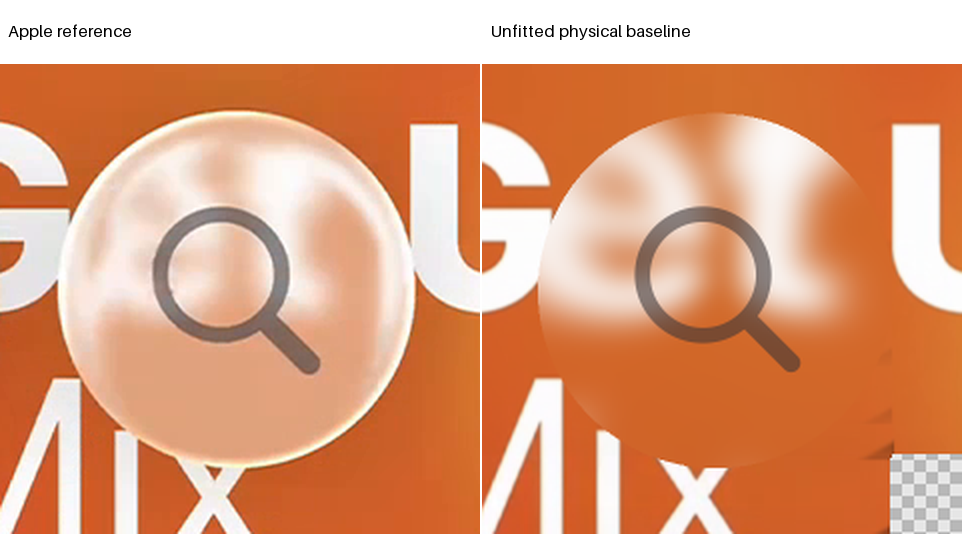
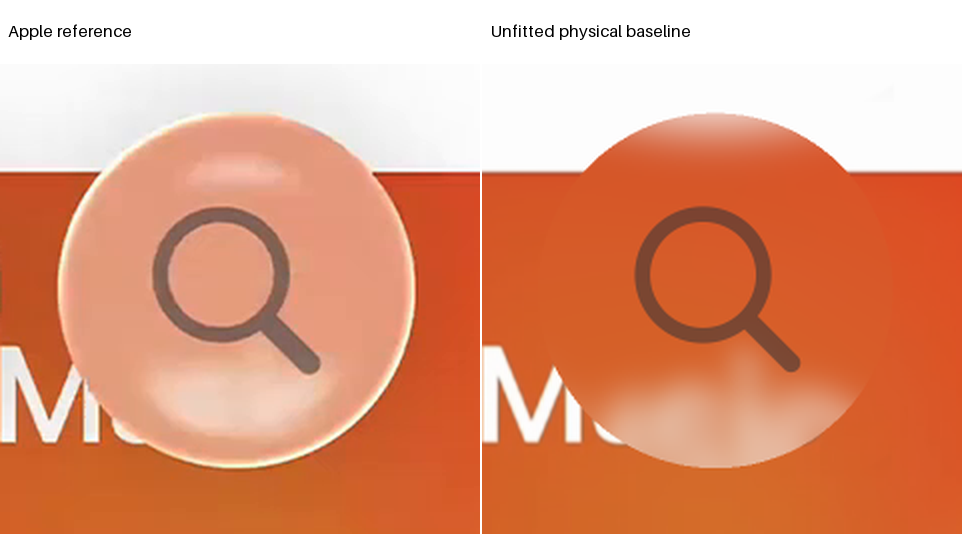

# Detached Music Search: one unfitted physical baseline

The authorized pair is complete and visibly negative. Both source gates and exact shared-renderer parity pass, but the unit-body images lack the bright reference rim and place white returns incorrectly. B remains too dark and saturated. This is a prospective count-zero baseline, not a fitted replacement or a gain against historical pass03.

The actual start was 24 October 2026 at 00:25:20.608 UTC. The checkpoint deadline was 00:32:20.608; the subpass deadline remains 00:55:20.608. The four-hour cycle ends at 04:25:20.608. Setup, restoration, controls, the one pair and packaging are charged to refraction. No unused stage time is banked.

See [protocol](protocol.json), [schedule](schedule.json), [result](result.json), [source proof](source-preflight.json), [parity](parity.json), [readiness](review-ready.json) and [final accounting](accounting-review.json). No further geometry, distance, material or source setting follows this observation without review.

## Worktree and frozen provenance

The linked Search branch starts at exact shared checkpoint `94bf6bc59afa18afb6d7aa0abd0531bad4806dd8`. Only intake commit `6c2a7109` was cherry-picked, producing `20fb30ce`, which was immediately pushed and remote-verified. The old worktrees and history remain untouched. Shared modules are unchanged and pinned in [code-pin.json](code-pin.json).

Checkout completed at the correct commit, but its post-checkout hook returned an error because git-lfs was absent from PATH. The existing workspace git-lfs executable was used for normal cherry-pick and push. No hook, session, account or model configuration was changed; checkout and scientific work were not repeated.

The style-bearing [A case](cases/a.json) and [B case](cases/b.json) come from the approved intake's canonical verification protocol. Source, target, known and SVG bytes were restored exactly from indexed evidence, with [byte hashes](restored-inputs.json). No frames, donor registration, source construction, fills or new foreground fitting occurred.

The current case fingerprints are A `f760954ab02f7567c47354ef620b39598d7b0a536c3993cfb39ba4165486e7dd` and B `87d6ff0b76d6bd3eca8b8de1f87046b6943227071eb6c612740a5e33ecfb093e`. They exactly match the accepted verification-protocol cases, including types, as recorded in [case audit](case-audit.json).

Those fingerprints differ from the historical recipe's receipts. That discrepancy remains unresolved; no alias or same-epoch identity is invented. The reviewed authority permits these verified current cases only as a prospective count-zero baseline. Historical pass03 and the invalidated older passes remain separate and immutable.

## One actual surface and coordinate contract

Original case normalization is L = 89 native pixels. Accepted center is [1511.2043368857017,672.8753258356955]. Corrected radius is 88.75191176648384 native pixels. The private radius adapter wraps only shared HarmonicCircularBack with depth .15 and crown .4, retaining height in original-L units:

$$
R=\frac{88.75191176648384}{89},\qquad
h(x,y)=h_{\mathrm{base}}\!\left(\frac{x}{R},\frac{y}{R}\right),\qquad
\nabla h=\frac{1}{R}\nabla h_{\mathrm{base}}\!\left(\frac{x}{R},\frac{y}{R}\right).
$$

The maximum height stays .10909090909090907L. The conservative global slope is .8022362401312, giving primary clearance-rate lower bound .4421778700649713 at index 1.5. The background plane is z=-2L beneath a flat front at z=0. One actual height supplies geometry, normals and retained sections.

[Geometry controls](geometry-checkpoint.json) passed finite differences, exact base-circle chain rule, mirrors, pose, uniform physical scaling, unit index and exact crease status. Maximum finite-difference discrepancy was 2.03249e-11. Exact boundary rays remain unresolved with NaN source coordinates. No normal rescaling independent of the height, reflected traversal or convex-solid claim is introduced.

The checkpoint completed at 00:29:35.300 UTC. Asset hashes were checked before fixtures, but actual mask-count checks followed the 245 fixture rays. This ordering deviation is explicitly preserved and was reviewed before RGB continuation. No fixture repeat, clock reset or claim of perfect protocol ordering is made.

## Original scoring and foreground contract

| Original mask | A pixels | B pixels |
| --- | ---: | ---: |
| Glass | 14,904 | 14,904 |
| Rim | 8,364 | 8,364 |
| Held | 4,763 | 4,763 |
| Interior | 6,540 | 6,540 |
| Fixed exterior | 10,074 | 10,074 |
| Half-open foreground box | 9,216 | 9,216 |

Original case-based masks are unchanged. The exterior mask preserves the final historical verification metric's accepted-profile distance convention, rather than switching to the older exterior_reference_shape. Foreground exclusion remains inclusive for glass; foreground error remains the half-open 96-by-96 box. Original scored pixels outside the predicted physical outline are not removed.

The accepted traced magnifier, placement, color and opacity remain fixed. Independent known-backing checks passed at two levels for each reference. Actual original compositing is used, with no Navigation nonlinear response or Safari vector substitution. The clean trace is not asserted to be an original Apple/SF path or exact UI weight.

The [historical cache inventory](historical-cache-inventory.json) finds two retained material arrays, but no verified matching current-case material-and-complete pair. The historical recipe fingerprint mismatch blocks an exact old replay claim. No old optical baseline was rerendered and no original raw samples were invented.

## Source-first incident material and integration

One explicit 43-by-43 incident Gaussian per reference uses sigma 6.75 native pixels and radius 21. Only actual inside rays sample that field. Straight misses retain the original unfiltered source. AA2 remains separate; body gain is one, bias zero and gamma one. Old transition mixing, output blur, normal lighting and generated shadow are absent from this declared diagnostic.

This operator is not an exact replay of the old automatic-kernel/transition/gamma/shadow recipe. Historical reconstruction remains the comparator record, not a weak baseline from which progress is manufactured. Source confidence is conditional temporal-mosaic availability, not recovered hidden photographic truth.

Both complete source audits passed before RGB. Each case checks 98,989 whole-body subrays and a 139,337-subray required union. The 59,616 original scored subrays include 52 outside the new outline. All finite incident-kernel texels and four bilinear corners are certified, including straight misses and foreground/backing dependencies.

A retains 5,601 unavailable unscored subrays; B retains none. Unavailable presentation is marked explicitly. It is never filled, clamped, scored or sampled. Each audit records actual subray and corner-mask work plus its full known-mask erosion, rather than calling source certification zero work.

Integration reuses the one certified geometry grid for both identical poses. The approved exact-bilinear expression preserves shared operation order and dtypes. Six two-by-two parity patches cover lens, straight miss and partial coverage for both references. Coordinates, membership, support, sampled RGB and integrated outputs are exact against the pinned shared renderer.

Raw lens/clear samples, coverage, premultiplied contributions, physical pre-foreground pixels and complete images are retained. Complete paths include front entries, back exits, surface normals, exit directions, path status and source coordinates. [Cached sections](cached-sections.json) select actual retained AA rows/columns; no additional height or ray evaluation generates them.

## Native measurements, not acceptance gains

| Metric | A | B |
| --- | ---: | ---: |
| Original-mask E | 66.085856893 | 55.939570425 |
| Glass RMSE | 62.464336395 | 56.681549072 |
| Rim RMSE | 73.848609924 | 54.168777466 |
| Held RMSE | 58.318763733 | 58.039188385 |
| Interior RMSE | 43.785465240 | 59.741310120 |
| SSIM | .728946507 | .819225609 |
| Fixed exterior RMSE | 16.447525024 | 15.983244896 |
| Completed foreground RMSE | 39.606090546 | 57.556995392 |
| Partial-boundary RMSE, 38 pixels each | 140.474060059 | 108.760757446 |

Body scoring uses the actual integrated physical pre-foreground image, including straight clear contributions. It does not substitute normalized lens-only color on partial or missed rays. Complete-image scores on the glyph-excluded original masks are identical here. Foreground and exterior metrics use complete pixels. Both raw sample clipping counts are zero.

All original and completed metric values are retained in [A results](a-result.json) and [B results](b-result.json). No same-epoch nonregression verdict against the old recipe is licensed by these numbers. The current baseline has no earlier accepted physical error threshold; count remains zero pending primary review.

A's broad bright incident structure is rearranged incorrectly and the thin bright boundary is missing. Large orange regions remain too saturated. B's top return is squeezed against the upper edge while the lower white patch is too low and diffuse. The interior remains much darker than the frosted reference.

The fixed magnifier consequently has a different contrast against its backing even though its vector and coefficients are unchanged. Missing light and incorrect source returns remain distinct from glyph geometry. Reversal itself is not prohibited; its reference-specific location and transition are the meaningful questions.

The fixed upper-rim, left-cap, lower-return and glyph rectangles retain RGB, luma, chroma and signed residual summaries. They are advisory only. Their original-frame coordinates were declared before sampling; no fitting mask or reference crop moved. Preview width is 480 per side from the same native result, not a new optical export grid.

## Cumulative budget and disclosures

| Work | Actual | Cap |
| --- | ---: | ---: |
| Fixture and parity rays | 341 | 3,000 |
| Native rays, one reused grid | 225,600 | 451,200 |
| Conservative final graph total | 3,164,892 | 6,000,000 |
| RGB queries, including parity | 445,755 | 500,000 |
| Incident fields | 2 | 2 |
| Candidate images | 2 | 2 |
| Fits or additional settings | 0 | 0 |

The immutable as-run ledger reports 2,939,292 graph charges. Final accounting adds 225,600 original reference-mask points from four repeated Study constructors. Those calls were omitted from the optional mask subtotal, not from the shared physical adapter counter. The supplement is disclosed without repeating fields, resetting counters or concealing the as-run record; the total remains within cap.

Source auditing separately records 451,200 subrays, 3,609,600 corner-mask lookups and two 2,073,600-cell known-mask erosions. Four fixed synthetic foreground controls are not full candidate images. No historical optical replay was run. Original asset identity, prospective fingerprints and unresolved historical receipts remain explicit.

The one pair stops here. A next bounded saved-path correspondence question was requested before packaging ended, without activating it. Later blur, color, outline, shadow, foreground and dispersion stages remain pending review, not absent or satisfied. Unsupported radiance or source identity cannot be replaced with a fitted environment or painted repair.
