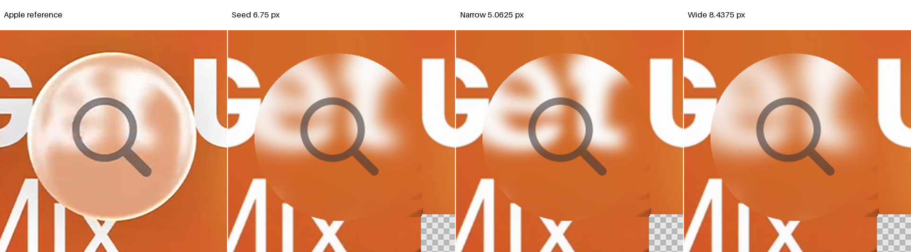
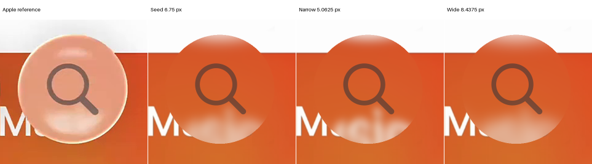

# Music Search: two fixed incident-blur widths

**Neither width is adopted.** The narrower field fails several original and completed guards on both references. The wider field improves their aggregate metrics, but B's original 38-pixel partial-boundary error worsens. Missing bright rim light, incorrect feature positions and unit-body tone remain visible. The selected initialization stays at sigma 6.75 pixels and radius 21.

The stage started on 24 October 2026 at 01:21:15.083 UTC, after the outline peer review was sealed. Its hard deadline is 01:41:15.083, including checks and versioning. The existing Search cycle ceiling remains 04:25:20.608. No unused time is transferred. See [protocol](protocol.json), [result](result.json) and [ready flag](review-ready.json).

## Frozen state and exact reuse

The count-zero H1 baseline remains the radius-adapted HarmonicCircularBack at index 1.5 and background distance 2L. Original L is 89 pixels. Actual paths, pose, predicted coverage, all original masks, input PNGs, vector/style and unit neutral response are unchanged. No geometry, distance, output blur, shadow, illumination or spectral parameter is adjusted.

The prior outline peer scientific files also match published checkpoint `ffaca751` byte-for-byte; [verification](peer-checkpoint-verification.json) records the hashes. That is a read-only publication check, not new expanded research. Shared modules remain at the Search baseline pin.

Two [cached identity controls](identity.json) reproduce original pre-foreground and complete arrays exactly. They average retained raw samples with the original AA2 reshape/mean/cast and run the original full foreground compositor. No historical optical baseline, incident seed field or clear sample was regenerated. The historical recipe fingerprint mismatch and masks-after-fixtures ordering disclosure remain unchanged.

## Predeclared widths and source-first gates

| State | Sigma, native pixels | Finite radius | Sigma divided by original L |
| --- | ---: | ---: | ---: |
| Selected seed | 6.75 | 21 | 0.0758426966 |
| Fixed narrow | 5.0625 | 16 | 0.0568820225 |
| Fixed wide | 8.4375 | 26 | 0.0948033708 |

The two settings are exactly 0.75 and 1.25 times the seed. There is no width fit, quantization change, smaller fallback radius or third setting. The pinned shared `incident_source_filter` computes the explicit finite Gaussian before refraction. Only actual inside rays use it; clear rays keep their saved unfiltered values.

All four width/reference source gates passed before any changed field or RGB query. Each checks 98,989 whole-body subrays, the 139,337-subray original required union, and 59,616 original scored subrays. The latter retain all 52 misses outside the new outline. Complete finite-kernel support and every bilinear corner are checked for each setting.

The [source proof](source-proof-FIRST.json) reports zero unsupported required, body or scored samples. A's 5,601 unavailable unscored subrays remain unavailable; B has none. No source extension, clamp, fill or mask repair occurs. Conditional mosaic availability remains distinct from recovered hidden photography.

Four preflight known-mask erosions precede four internal helper erosions. Shared helper support matches each preflight mask exactly. Known-mask filtering replaces unknown inputs with zero internally, but complete certified kernel support prevents those unknown values from contributing to any evaluated lens sample. This is not a source-completion claim.

## Integration and original guards

Only the already certified bilinear expression is reused at cached coordinates. All inside samples are replaced by the changed incident field; every clear sample remains bit-exact. AA2, coverage, premultiplied clear contribution and original foreground order remain exact. There are no new parity rays, alternate samplers or per-pixel corrections.

All four candidates retain raw samples, lens and clear contributions, pre-foreground integration and complete arrays. Raw before-response and unit-response clipping counts are zero. Complete original masks exclude the fixed foreground; glyph error is separately measured on the original half-open box. No partial or outside-outline scored pixel is removed.

| Reference/state | E | SSIM | Glyph RMSE | Partial-glass RMSE |
| --- | ---: | ---: | ---: | ---: |
| A seed | 66.085857 | 0.728947 | 39.606091 | 140.474060 |
| A narrow | 68.762989 | 0.690725 | 42.293987 | 140.825333 |
| A wide | 63.998740 | 0.753863 | 38.277176 | 139.807953 |
| B seed | 55.939570 | 0.819226 | 57.556995 | 108.760757 |
| B narrow | 57.268636 | 0.803877 | 58.270168 | 108.248650 |
| B wide | 54.766134 | 0.826720 | 56.957378 | 109.295517 |

Narrow fails glass, rim, held, interior, E, SSIM and glyph nonregression on both references. A's partial-boundary error also increases. Wide passes those original and completed aggregate guards on both references, but its B partial-boundary error increases. Exterior RMSE is unchanged at 16.447525 for A and 15.983245 for B.

Every original and complete metric is retained in [narrow A](narrow-a-result.json), [narrow B](narrow-b-result.json), [wide A](wide-a-result.json) and [wide B](wide-b-result.json). Improvements are not hidden by the rejection. No epsilon waiver, historical fidelity replacement or pass-count change follows them.

## Softness diagnostic and visible limits

The fixed original upper-rim, left-cap, lower-return and glyph rectangles are unchanged. RGB, luma, chroma and signed residuals are recorded for every rectangle. The predeclared detail diagnostic uses adjacent luma differences in both axes, restricting both endpoints to original glass pixels with baseline coverage one. It does not move fitting or scoring masks.

$$
\begin{aligned}
Y&=0.2126R+0.7152G+0.0722B,\\
A_Y&=\sqrt{\frac{1}{N}\sum_{(i,j)\in\mathcal{P}}(Y_j-Y_i)^2},\\
E_{\Delta Y}&=\sqrt{\frac{1}{N}\sum_{(i,j)\in\mathcal{P}}
\left[(Y_j-Y_i)-(Y_j^{\mathrm{ref}}-Y_i^{\mathrm{ref}})\right]^2}.
\end{aligned}
$$

Values use eight-bit luma levels; the pair set is frozen. These reductions confound geometric placement, source content and missing illumination. They cannot identify an incident PSF merely because a difference error or aggregate RGB score decreases.

| Crop/reference | Target adjacent RMS | Seed | Narrow | Wide |
| --- | ---: | ---: | ---: | ---: |
| Upper rim A | 4.07765 | 2.15927 | 2.89197 | 1.66677 |
| Lower return A | 5.27169 | 0.20151 | 0.16461 | 0.20719 |
| Upper rim B | 4.47356 | 1.65028 | 1.86279 | 1.51292 |
| Lower return B | 5.99389 | 0.97591 | 1.64130 | 0.77705 |

Narrow makes A's upper broad features sharper, but their placement remains wrong. Its upper gradient-error RMS rises from 4.41442 to 4.74290. Wide suppresses that mismatch and lowers this error to 4.26142 while moving detail energy farther below the reference. Neither behavior alone establishes the correct softness.

In B, narrow exposes more lower lettering texture. Wide suppresses it, but does not reproduce the reference's raised white patch or thin bright rim. Wide upper-rim gradient error increases from 4.39320 to 4.40869. Its lower-return RGB error also rises from 27.96699 to 29.06836 despite a lower gradient-error RMS.

Both full comparisons and [A fixed crops](a-fixed-crops.png) / [B fixed crops](b-fixed-crops.png) were inspected. They display saved native arrays only. Full comparisons use 480 pixels per side; diagnostic crops use twice their original width. Unavailable presentation stays marked rather than copied from the target.

The stage is assessed, not absent or skipped. The bracket does not yield a paired replacement or an identified roughness law. Selected sigma 6.75 remains a defensible unchanged initialization while geometry, response and illumination limitations remain explicit.

## Actual work and remaining question

| Work | Actual | Cap |
| --- | ---: | ---: |
| New rays or heights | 0 | 0 |
| Lens RGB queries | 395,956 | 400,128 |
| Clear RGB queries | 0 | 0 |
| Incident fields | 4 | 4 |
| Full known-mask erosions | 8 | 8 |
| Candidate composites | 4 | 4 |
| Cached identity composites | 2 | 2 |
| Fits or extra widths | 0 | 0 |

The [ledger](ledger.json) separately records 112,800 original reference-mask points from two unavoidable Study constructors. They were reserved before evaluation and are not physical height fields. Source audits process 902,400 subrays, 7,219,200 corner-mask lookups and 16,588,800 known-mask cells across preflight and helper erosions.

Eight score calls invoke the unchanged SSIM metric's 40 Gaussian operations and eight small-mask erosions. These are explicitly counted score calculations, not additional material fields. Presentation resizes already saved pixels and creates no candidate composite or optical query.

The [next color question](next-colour-question.json) is proposal-only: whether one common encoded gain/bias can improve body tone while retaining all paired and partial-boundary guards. It would use the selected seed and existing retained inside samples. No coefficient was fitted, and no color stage starts without independent review. Outline, shadow, foreground and dispersion remain separate pending questions.
