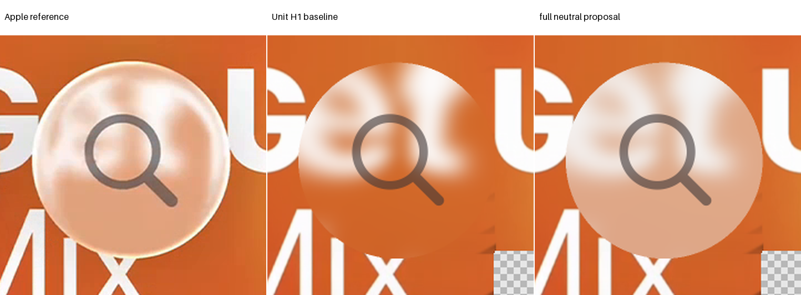

# Music Search: one shared neutral-tone proposal

**READY FOR PRIMARY, not adopted.** The first full-step pair passes every original and completed guard, including both partial-glass guards. The interiors visibly move toward the reference pastel tone. Missing bright rim light and incorrect feature placement remain. B's lower-return RGB and chroma diagnostics worsen and are preserved explicitly.

The stage started on 24 October 2026 at 01:34:03.118 UTC. Its hard deadline is 01:54:03.118, including reporting and versioning. The Search ceiling remains 04:25:20.608. The previous blur stage was already sealed. See [protocol](protocol.json), [proposal](proposal.json), [actual result](result.json) and [ready flag](review-ready.json).

## Frozen state and two exact identities

The selected comparison is the prospective count-zero H1 baseline: original circle pose/radius, index 1.5, background distance 2L, source incident sigma 6.75 pixels with radius 21, AA2, unit response and shadow zero. Sources, known masks, target, canonical cases, all original masks, magnifier vector and accepted fixed style remain unchanged.

The loader imports no baseline `common.py` or its ledger-writing hook. It verifies every baseline manifest hash and the pinned shared module hashes. Two original Study constructors and their reference-mask work are reserved before execution. No new physical geometry is evaluated, and the old ledgers remain immutable.

Two [cached unit controls](identity.json) apply the actual shared response to retained inside samples, integrate using the original AA operation order and run the full original foreground chain. Raw unit response, pre-foreground and complete arrays match exactly. Clear values are copied unchanged, including unavailable unscored values; no clear source lookup occurs.

The source proof transfers only because coordinates, membership, source/known inputs and incident kernels are unchanged. It remains conditional mosaic support rather than hidden photographic truth. Historical recipe fingerprint mismatch and the original masks-after-fixtures ordering disclosure remain unchanged. No historical acceptance or pass count is altered.

## One train-only finite active-set model

One common gain and bias act on all RGB channels and both references. They are empirical encoded tone, not physical transmittance, radiance or camera adaptation. The strict feasible triangle is:

$$
0\le g\le1,\qquad 0\le b\le1-g.
$$

The response is applied to retained inside samples **before** AA; clear samples are untouched. The real-arithmetic integrated basis follows from those same samples:

$$
\begin{aligned}
\mathbf{L}_i&=\frac{1}{4}\sum_{s=1}^{4} I_{is}\mathbf{S}_{is},\\
A_i&=\frac{1}{4}\sum_{s=1}^{4} I_{is},\\
\mathbf{U}_i&=\frac{1}{4}\sum_{s=1}^{4}(1-I_{is})\mathbf{S}_{is},\\
\mathbf{P}_i(g,b)&=g\mathbf{L}_i+bA_i\mathbf{1}+\mathbf{U}_i.
\end{aligned}
$$

Here each retained sample already contains the appropriate incident-filtered lens color or unfiltered clear value. The basis is not a new native operator or a foreground subtraction. Actual candidates still execute `neutral_color_response` per inside sample, then the original reshape, mean, float32 cast and foreground compositor.

Each reference contributes equally to the mean RGB squared objective. All 4,763 held pixels and the original foreground boxes are excluded; each reference contributes 10,141 training pixels. Original foreground styling is fixed color/opacity, with no transmission layer or fitted response. The train region lies outside that painted box, so its objective needs no fictitious foreground approximation.

$$
J(g,b)=\frac{1}{2}\sum_{r\in\{A,B\}}\frac{1}{3|\mathcal{T}_r|}
\sum_{i\in\mathcal{T}_r}\left\|\mathbf{P}_{r,i}(g,b)-\mathbf{T}_{r,i}\right\|^2.
$$

The three edge minima, feasible unconstrained interior and vertices produce six unique complete quadratic checks. The bias-zero edge duplicates identity and is recorded as an alias. There is one interior linear solve and no iterative optimizer. The two-dimensional matrix has rank two and condition number 23.3853 under the frozen conditional inputs.

The feasible unconstrained interior is the single proposal:

$$
g=0.5193880051291454,\qquad b=0.4473611800152188.
$$

Its objective is 0.008869659992844836, versus identity 0.055952427901720725. A direct train residual check differs from the quadratic value by 8.3961e-16. That representation check does not relax any native guard or constraint. Parameter feasibility and actual guard comparisons use no epsilon.

## One actual full-step pair

The first authorized factor, one, qualifies numerically. Factors 0.5, 0.25 and 0.125 were therefore not evaluated. No full-step failure is hidden, and no successful backtrack is fabricated. Independent primary review must decide adoption before any dependent work.

| Metric | A baseline | A full step | B baseline | B full step |
| --- | ---: | ---: | ---: | ---: |
| E | 66.085857 | 27.661699 | 55.939570 | 22.030139 |
| Glass RMSE | 62.464336 | 25.626425 | 56.681549 | 20.304304 |
| Rim RMSE | 73.848610 | 31.909771 | 54.168777 | 25.608704 |
| Held RMSE | 58.318764 | 22.714386 | 58.039188 | 19.315287 |
| Interior RMSE | 43.785465 | 13.941527 | 59.741310 | 10.039955 |
| SSIM | 0.728947 | 0.808975 | 0.819226 | 0.900126 |
| Glyph RMSE | 39.606091 | 13.477656 | 57.556995 | 10.046534 |
| Partial glass, 38 pixels | 140.474060 | 97.969154 | 108.760757 | 70.071236 |

Fixed exterior RMSE remains exactly 16.447525 for A and 15.983245 for B. Original and completed-image glass, rim, held, interior, E and SSIM agree here because their protected cohorts exclude the fixed foreground. Both full guard records are preserved in [A](full-a-result.json) and [B](full-b-result.json).

All raw before-response, preclip and after-response clipping counts are zero. Every clear sample and premultiplied clear contribution remains exact. The maximum difference between the real basis and actual integration before float32 is 2.22e-16; their float32 values have zero differing channels on required pixels. Actual native metrics, not the quadratic objective, decide the reported qualifier.

## Visual improvement and retained local regressions

Both full previews and fixed crops were inspected. The body is no longer excessively dark orange, and the fixed magnifier remains visible with a closer gray appearance. The body retains chroma rather than becoming uniformly white. Its improved glyph score comes from the changed backing; no glyph geometry or style coefficient was fitted.

The thin bright perimeter remains absent. A's upper features still have the wrong arrangement. B's upper return remains misplaced, and its lower white feature remains too low and locally too pale. The proposal makes the large body tone more convincing without establishing full material or optical fidelity.

The [A crop sheet](a-fixed-crops.png) and [B crop sheet](b-fixed-crops.png) use the same four original-frame rectangles. RGB, luma, chroma, signed residuals and frozen adjacent-luma diagnostics are advisory and were excluded from fitting. No crop or threshold search occurred.

| B lower-return diagnostic | Baseline | Full step |
| --- | ---: | ---: |
| RGB RMSE | 27.966990 | 28.644618 |
| Luma RMSE | 25.644922 | 24.313024 |
| Chroma RMSE | 12.974902 | 16.347488 |
| Signed RGB residual | [-1.054, -9.493, -13.549] | [2.592, 13.247, 19.370] |

The lower crop's RGB/chroma worsening is not concealed by its luma or aggregate improvement. Shared gain also reduces source-feature contrast: A upper-rim adjacent-luma RMS falls from 2.15927 to 1.12150, versus reference 4.07765. B lower-return RMS falls from 0.97591 to 0.50688, versus reference 5.99389. Missing light and correspondence confound these differences.

These observations support only an isolated encoded-tone proposal. They do not show refraction success, a physical PSF, recovered source truth, paired physical material validation or replacement of historical pass03. The original selected state and counts remain unchanged until primary acceptance.

## Work ledger and closure scope

| Work | Actual | Cap |
| --- | ---: | ---: |
| New optical rays, heights or source queries | 0 | 0 |
| New incident fields or material filters | 0 | 0 |
| Unique quadratic objective checks | 6 | 8 |
| Total declared model checks | 14 | 128 |
| Cached unit identity composites | 2 | 2 |
| Actual candidate composites | 2 | 8 |
| Original reference-mask points | 112,800 | 112,800 |
| Native score calls | 4 | 16 |
| SSIM metric Gaussian operations | 20 | 80 |
| SSIM metric mask erosions | 4 | 16 |

The [ledger](ledger.json) is local to this stage and never resets prior counters. Original mask construction and unchanged SSIM metric filtering are explicitly separated from physical fields or material filters. Presentation uses saved completed arrays only, at 480 pixels per side or twice-native diagnostic crop width.

No smaller factor, alternative coefficient, extra solve or dependent stage follows this qualifier. The record is ready for independent primary native/source/visual review. Subsequent outline, shadow, foreground and dispersion questions remain separate; no environment or optical repair is invented during color packaging.
