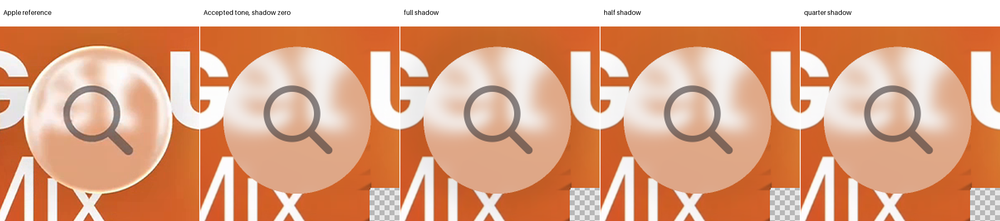
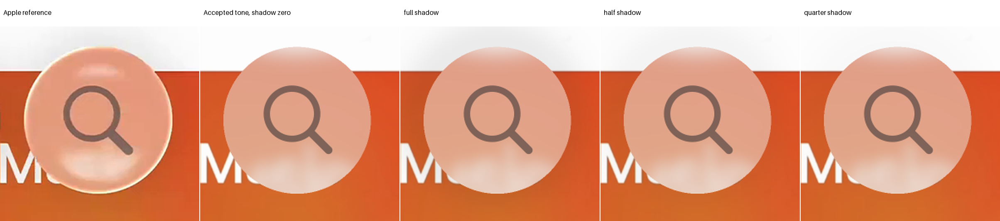

# Music Search: historical generated shadow rejected

**All three fixed strengths fail both references. Keep shadow zero.** Exterior error improves, but original and completed glass, rim, held, E and both partial-glass guards worsen. No boundary pixels are dropped. The accepted neutral tone, incident blur, physical geometry and foreground remain unchanged.

The stage began on 24 October 2026 at 01:53:50.740 UTC. Its hard deadline is 02:08:50.740, including checks and versioning. The overall Search ceiling remains 04:25:20.608. See the [declared protocol](protocol.json), [result](result.json), [identities](identity.json) and [ready flag](review-ready.json).

## Exact historical operator and frozen state

The historical source is `reconstruction/studies/music-search-vector/review-round/pass-03.json`, SHA256 `40f8e4443f963b8021c78ab0a57c6604e27db3742271b7fa81d78bb0d792a365`. Only its generated-shadow spatial parameters and shape parameters are used. Its empirical optical map, lighting, gamma and old blur operators are not executed.

| Parameter | Frozen value |
| --- | ---: |
| Historical opacity | 0.07122886993343976 |
| Shadow sigma, original L units | 0.24802838204149674 |
| Shadow offset x, original L units | -0.049999984470484225 |
| Shadow offset y, original L units | -0.07017835536762522 |
| Shape x shift | -0.00894003499211507 |
| Shape y shift | -0.001400833306792197 |
| Half-x delta | -0.002787508241754526 |
| Half-y delta | 0; radial mode uses the half-x delta on both axes |
| Radius delta | 0; radial mode takes the corrected minor half-extent |
| Cap join width | 0, unchanged default |
| Original normalization | L = 89 native pixels |

The exact shared `extended_shadow.shadow` function evaluates a Gaussian of the nonnegative distance from the translated accepted contour. It is sampled on the finite native pixel grid. No convolution, source lookup or extra three-sigma truncation is introduced. This is a generated empirical exterior operator, not measured lighting or a traced shadow.

$$
s(\mathbf{x})=o\exp\left[-\frac{1}{2}\left(\frac{\max(d(\mathbf{x}-\boldsymbol{\delta}),0)}{\sigma}\right)^2\right].
$$

The three predetermined opacity values are 0.07122886993343976, 0.03561443496671988 and 0.01780721748335994. No opacity, offset or width was fitted. The exact case center, radius, original masks and source epoch remain frozen. Historical recipe fingerprint mismatch is not resolved by reusing its explicitly declared shadow parameters.

The accepted common tone remains gain 0.5193880051291454 and bias 0.4473611800152188, on the original H1 D2 geometry with incident sigma 6.75/radius 21 and AA2. The original style-bearing magnifier cases are unchanged. No glow, output blur or missing-rim illumination is added.

## Cached contribution contract

Let the retained accepted-tone lens and clear contributions already include their AA weights. Only the clear contribution receives attenuation:

$$
\mathbf{P}_{s}=\mathbf{L}_{\mathrm{cached}}+(1-s)\mathbf{U}_{\mathrm{cached}}.
$$

The result is cast to float32 and passed through the original full foreground compositor. No foreground is subtracted from a completed image. Both zero-opacity controls reproduce the accepted pre-foreground and complete arrays exactly. The old baseline loader with its ledger-writing hook is never imported.

Every fully covered pixel remains exact before and after foreground composition. The lens contribution is unchanged everywhere. Original clear samples and their retained premultiplied array stay immutable; a separate attenuated clear array is saved. This distinction prevents a generated shadow from being mislabeled as a changed optical source.

Both cases have exactly equal native coordinates, original L, radial status, half-extents and radius. One unit-opacity field is therefore shared without approximation. Its 56,400 evaluated points reserve 112,800 nested point calls for `Study.shape` and its distance helper before execution. No optical height or ray function is called.

The unchanged source proof transfers only for the retained map, incident kernel and source inputs. It does not measure a physical lighting setup or turn the temporal mosaic into hidden photographic truth. Missing environment radiance from outline remains unresolved. Original mask ordering and historical fingerprint disclosures remain intact.

## Every fixed strength fails protected boundaries

| Factor | A partial RMSE | B partial RMSE | A exterior RMSE | B exterior RMSE |
| --- | ---: | ---: | ---: | ---: |
| Selected shadow zero | 97.969154 | 70.071236 | 16.447525 | 15.983245 |
| Full | 99.910751 | 72.022156 | 12.612718 | 10.535778 |
| Half | 98.929604 | 71.032570 | 13.670066 | 12.184076 |
| Quarter | 98.446747 | 70.548309 | 14.890042 | 13.901890 |

All 38 partial-glass pixels remain in each reference's original score and separate guard. No epsilon or smaller fourth strength is allowed. At every factor, both original and completed glass, rim, held and E guards fail. Interior, SSIM and glyph metrics remain exact because their retained support is fully covered or unaffected.

| Factor | A completed E | B completed E |
| --- | ---: | ---: |
| Selected shadow zero | 27.661699 | 22.030139 |
| Full | 27.683553 | 22.049935 |
| Half | 27.672457 | 22.039830 |
| Quarter | 27.667036 | 22.034932 |

All finite pre-foreground clipping counts remain zero; no clipping operation conceals the failure. Six actual candidate composites and two zero controls ran. Every exact recipe, opacity field, lens/clear contribution, pre-foreground array, completed image and guard record is retained. No additional solve or fallback follows.

## Fixed crops and visual limits

Both full comparison sheets and all four original defect crops were inspected. Stronger shadow creates visible exterior darkening, especially above B. It does not supply the thin bright perimeter, correct the wrong return positions or change the fully covered body and magnifier. Exterior improvement alone does not justify the protected boundary regression.

The [A fixed crops](a-fixed-crops.png) and [B fixed crops](b-fixed-crops.png) preserve the original rectangles. RGB, luma, chroma, signed residuals and adjacent-luma detail remain advisory. Every full diagnostic is retained in the six result files, with a compact [RGB summary](crop-summary.json). No crop or threshold search occurred.

Full strength worsens A upper-rim crop RGB RMSE from 25.113207 to 25.173412. It improves B upper-rim crop RMSE from 23.094056 to 20.032506, mostly through exterior darkening. B lower-return crop RMSE improves from 28.644618 to 28.157188 while the protected partial-glass error worsens. These different cohorts must not be conflated.

## Work ledger and next questions

| Work | Actual | Declared cap |
| --- | ---: | ---: |
| Shadow-field native points | 56,400 | 112,800 |
| Nested shadow shape/helper point calls | 112,800 | 225,600 |
| Original mask-constructor points | 112,800 | 112,800 |
| Original mask geometry-helper point calls | 112,800 | 112,800 |
| Candidate composites | 6 | 6 |
| Cached identity composites | 2 | 2 |
| Original score calls | 12 | 12 |
| SSIM metric Gaussian operations | 60 | 60 |
| SSIM metric mask erosions | 12 | 12 |
| Optical rays, heights, source queries, material filters or fits | 0 | 0 |

Mask geometry and SSIM metric work were reserved separately before execution. They are not hidden optical probes or material filtering. Presentation only resizes saved completed arrays. Original unavailable unscored exterior remains marked; no target context or nearest-color completion enters any calculation.

The next proposed question is a bounded fixed-foreground fidelity review: distinguish the clean vector's authenticity/pose limits, its exact rendering identity and visible residuals on the accepted backing. Retain the existing style and geometry. This does not authorize a font search, retint or foreground candidate.

A subsequent proposed saved-dispersion question would separate source chroma, blur, feature correspondence and unobserved illumination in the fixed crops. It must not infer spectral refraction from colored backgrounds alone. No new index law, spectral image or surface is authorized. Both questions await primary review; shadow stays zero.
