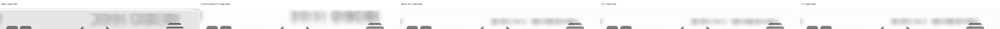
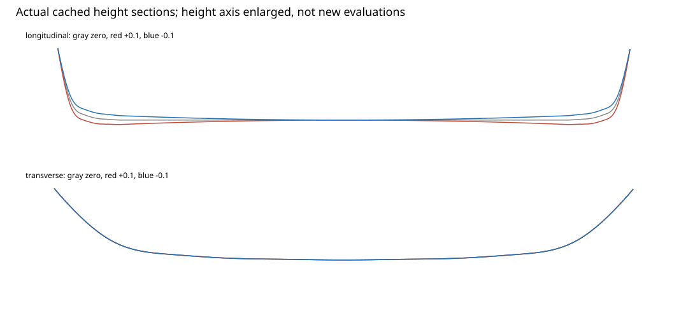
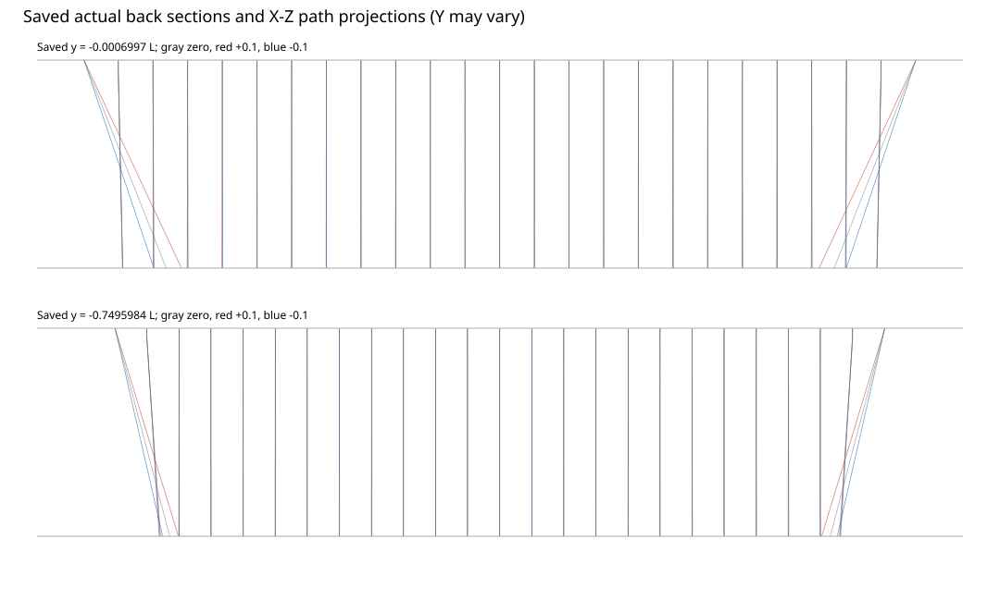

# Navigation: two fixed longitudinal height signs

Both fixed settings fail as fidelity replacements. Negative strength improves aggregate error relative to the zero-strength spline, but still fails the selected incident H1 baseline and original foreground guards. Positive strength worsens the misplaced dark cap return. No model, source, mask, historical count or selected image changes.

The [zero-strength transfer](../agent-navigation-spline-03/README.md), positive sign and negative sign complete the mandatory three-setting review. There is no fourth geometry setting, amplitude search, calibration or automatic target rotation.

## Authority, clocks and immutable dependencies

| Item | Record |
| --- | --- |
| Actual start | 2026-10-23 22:53:33.082 UTC |
| Checkpoint due | 23:00:33.082 UTC; passed and notified earlier |
| Actual optical completion | 22:58:28.084610 UTC |
| Earlier hard finish | 23:23:33.082 UTC, including packaging/versioning |
| Absolute latest supplied | 23:34:11.659 UTC; the earlier limit controls |
| Shared commit | `983b1676e707b9004118fcd99472919d4d25a29b` |
| Own merge, pushed and verified | `ad197ddc0c37157d68eb7f1122d7546c3890060e` |
| Wrapper SHA256 | `5c404cbbcd578821ffea03008c1f218deefd09c590720544dc0415f005e6dc2d` |

[Protocol](protocol.json), [code pin](code-pin.json) and [checkpoint](checkpoint.json) preserve the declared limits. The exact shared commit merged without conflicts. Its existing three tests were reused; they were not repeated. Shared tracer, sampler, material and foreground code hashes match the sealed transfer.

## One real-height hypothesis, two settings

The shared [LongitudinalHeight](../../../reconstruction/longitudinal_height.py) wraps the exact eleven-control spline. The complete gradient derives from the same height:

$$
\begin{aligned}
h_\epsilon(x,y)&=\left(1+\epsilon\frac{x^2}{a^2}\right)h_0(x,y),\\
\nabla h_\epsilon&=\left(1+\epsilon\frac{x^2}{a^2}\right)\nabla h_0
+\frac{2\epsilon xh_0}{a^2}\begin{pmatrix}1\\0\end{pmatrix},\\
\epsilon&\in\{+0.1,-0.1\}.
\end{aligned}
$$

The fixed magnitude is a conservative discriminator, not an inferred Apple parameter. The surface supplies all actual intersections and normals through the unchanged primary tracer. There is no independent normal, coordinate warp, painted edge or reflected-path claim.

Both signs have conservative bounds, recomputed from full precision:

$$
\begin{aligned}
H_{\max}&=0.15200011228820176,\\
M_{\max}&=0.7467450139874668,\\
(n^2-1)M_{\max}^2&=0.6970351448939276<1,\\
\gamma_{\min}&=0.5504224333237813>0,\qquad D=2.1>H_{\max}.
\end{aligned}
$$

Posed gradients, mirroring, physical scale, exact crease status and longitudinal slope signs pass. Maximum finite-difference gradient error is about 3.09e−11. Exact creases remain unresolved; no normal or boundary band was repaired.

## Frozen stages and comparisons

| Stage | Fixed choice |
| --- | --- |
| Geometry | Original accepted pose, half-extents, radius, zero cap-join width and spline controls |
| Optical convention | Flat front, normal incidence, index 1.5, background distance 2.1 L |
| Native AA | Original 2×2 lattice; original case L=113.5 pixels |
| Incident softness | Sigma 6.75 native pixels, finite radius 21, before refraction |
| Clear exterior | Original unfiltered source; saved clear samples reused exactly |
| Body response | Unit gain, zero bias, no independent lighting or output blur |
| Foreground | Original vectors, styles and ordered nonlinear current-backing response |
| Shadow / spectrum | Zero new shadow; no spectral direction or environment |

Current incident H1 remains the selected comparison at distance 2 L. The rejected zero-strength spline at distance 2.1 L is the matched-tuple comparison. These roles are separate. H1-to-spline differences cannot be attributed to longitudinal modulation alone.

The exact earlier compositor prerequisite is reused only after unchanged case, source, target, known-mask, vector, scoring-mask and shared-code hashes pass. No baseline material, complete image or ray grid was rerendered. The nonlinear foreground chain runs on each new integrated backing; no foreground subtraction or fixed-opacity substitute is used.

## Source-first and integration checks

[Positive source proof](plus/source-proof.json) and [negative source proof](minus/source-proof.json) pass for both references before each sign's RGB sampling. Each audit includes actual whole-body rays, original glass/rim/held/exterior guards, all sixteen paired foreground guards and full nonlinear backing dependencies.

Every required finite radius-21 footprint and all four bilinear texels are supported. Each case has 884,008 body subrays and 1,071,709 required subrays. The 7,370 unsupported clear subrays remain outside every guard and appear unavailable. No mask exclusion, source completion or coordinate clamp occurs.

The old filtered fields were not retained. Exactly one unchanged incident filter per reference was constructed after the positive source proofs, then retained and hash-verified for the negative sign. Two audit-mask erosions and the two filter-mask erosions are recorded separately. Source mosaics remain conditional availability, not recovered hidden photographic truth.

[Positive parity](plus/parity.json) and [negative parity](minus/parity.json) contain twelve 2×2 native patches spanning lens, straight miss and partial coverage. Raw RGB samples, source coordinates, membership, support and integrated pre-foreground pixels are exact against the pinned shared renderer. All comparator rays and duplicate sampler calls are charged.

Both signs retain entry/back positions, actual normals, exit directions, statuses, source coordinates, membership, support, raw RGB, lens/clear layers, coverage, pre-foreground output and complete images. Clear samples and integrated clear layers are exact against zero strength. Actual raw clipping is zero in all four observations.

## Original and completed-image results

| Setting | A E | B E | A SSIM | B SSIM |
| --- | --- | --- | --- | --- |
| Selected incident H1 | 22.794806 | 23.521786 | 0.976969 | 0.977107 |
| Spline zero | 25.797215 | 25.704831 | 0.967924 | 0.972055 |
| Positive 0.1 | 25.870702 | 27.647697 | 0.968307 | 0.971367 |
| Negative 0.1 | 25.722250 | 24.868928 | 0.967562 | 0.972733 |

[Positive results](plus/result.json), [negative results](minus/result.json) and [review data](review-data.json) preserve every original and completed-image guard. Both signs fail glass, rim, held, E and SSIM against H1 on both references. Exterior ties exactly. Negative A interior improves; all other new interior comparisons against H1 fail.

| Setting | Failed A foreground guards | Failed B foreground guards |
| --- | --- | --- |
| Positive | Home label, New icon/label, Radio label | Home label, New icon, Radio icon, Library icon/label |
| Negative | Home label, New icon/label, Radio label, Library label | New icon, Radio icon, Library icon/label |

The negative sign also fails A SSIM and four A foreground guards against zero strength; B interior and Home icon fail against zero. Positive A SSIM improves against zero, but other failures remain. No microscopic improvement, tie waiver or aggregate-only acceptance is claimed.

All 95 partial/zero-coverage scored glass pixels per reference remain present. A completed partial-boundary RMSE rises from H1 11.80044 to 11.82344 / 11.81813. B improves from 84.81813 to 84.46301 / 84.36366. These local improvements do not remove the full-image failures.

## Visible and fixed-crop review

Both full pairs and the fixed crops were inspected. Negative strength reduces the B cap error relative to zero, but the dark arc and extra upper text return remain incorrectly placed. Positive strength makes this mismatch more prominent. The reference's bright edge is still missing.

A's upper lettering remains a thin, compressed return rather than the reference's broader lettering. Neither sign establishes improved off-center text spacing in both references. Foreground changes arise through the frozen current-backing mechanism; the vector geometry itself was not fitted or altered.

Reversal is not prohibited. The objection is the specific misplaced arc/text correspondence and original guard failures, not the existence of a negative map derivative.

| RGB crop RMSE | H1 | Zero | Positive | Negative |
| --- | --- | --- | --- | --- |
| A left cap | 19.2731 | 21.7250 | 21.8631 | 21.5767 |
| A upper body | 21.6472 | 26.1327 | 26.3332 | 25.9213 |
| A lower body | 22.4331 | 22.2954 | 22.2985 | 22.2963 |
| B left cap | 26.1979 | 32.3555 | 35.9672 | 29.5910 |
| B upper body | 22.6825 | 23.9489 | 24.0519 | 23.8345 |
| B lower body | 24.1942 | 24.4538 | 24.5014 | 24.4281 |

Full luma, chroma and signed-RGB values remain in the result files. A lower RGB stays slightly better than H1, while its chroma remains worse. B negative left-cap RGB improves versus zero while chroma slightly worsens. No crop moved or became a fitting mask.

[All positive A/B comparisons](plus/a-comparison.png) and [positive B](plus/b-comparison.png), plus [negative A](minus/a-comparison.png) and [negative B](minus/b-comparison.png), retain full crops at 1080 pixels per side. Additional fixed crops remain beside this report.

## What changed geometrically

Saved coordinates quantify actual source-map changes relative to zero strength. No new rays or height samples were generated for this analysis. The straight-body cohort excludes two subray widths around the cap join; cap membership is separately reported. These are coordinate differences, not estimated image displacement or identified source landmarks.

| Coordinate change versus zero | Positive | Negative |
| --- | --- | --- |
| Straight-body horizontal RMS | 0.2705 px | 0.2715 px |
| Straight-body horizontal maximum magnitude | 0.5281 px | 0.5326 px |
| Straight-body vertical RMS | 1.1887 px | 1.1249 px |
| Cap horizontal RMS | 3.9777 px | 3.4935 px |
| Cap horizontal maximum magnitude | 18.8674 px | 15.0563 px |

The actual multiplicative height changes transverse slopes and cap slopes together with longitudinal curvature. This is not an isolated horizontal displacement adjustment. The central transverse section is analytically unchanged; the nearest saved column is slightly offset from zero and is labeled accordingly.

The larger cap changes relative to the half-pixel straight-body shifts explain why the new degree of freedom does not simply repair text spacing. This observation does not select an amplitude, justify an optimizer, or prove all longitudinal surfaces fail.

[Sections](saved-sections.json) and [selected paths](saved-paths.json) retain actual coordinates, normals and directions. Projection plots are not new traces. Source text, incident blur, mostly white regions, nonlinear foreground and unobserved illumination still limit correspondence interpretation.

## Mandatory three-setting review

| Setting | Finding | Disposition |
| --- | --- | --- |
| Zero spline | Valid transfer mechanics; wrong text/cap returns and failed paired guards | Rejected fidelity replacement |
| Positive 0.1 | Certified true longitudinal mode, but stronger B cap/text mismatch and guard failures | Rejected |
| Negative 0.1 | Relative E/cap improvement, insufficient reference correspondence and failed H1/foreground guards | Rejected |

Surface representation, shared tracing, support certification and nonlinear composition transfer. These particular profile coefficients and their fixed modulation do not transfer fidelity. Shape-coordinate assumptions and incident correspondence remain open; no universal failure of splines or geometric optics is inferred.

No fourth setting is proposed here. The incident H1 state remains selected. No accepted tone, new blur width or speculative environment is used to rescue the rejected geometry.

## Budgets and retained work

| Charged quantity, this discriminator | Actual | Cap |
| --- | --- | --- |
| Fixture and parity rays | 452 | 5,000 |
| Native rays | 2,894,400 | 2,894,400 |
| Wrapper/base/footprint evaluations | 23,159,788 | 30,000,000 |
| Actual RGB sampling queries | 3,536,304 | 6,000,000 |
| Candidate complete images | 4 | 4 |
| New baseline renders | 0 | 0 |

The persistent [ledger](ledger.json) charges wrapper height/boundary and every delegated base height/boundary/footprint batch before evaluation. Each full native grid reserved eight evaluations per subray. Exactly one grid per sign was reused for the identical A/B geometry. No graph counter was reset.

Source work is separate: 5,788,800 audited subrays, 46,310,400 known-mask corner lookups, four 43×43 erosions covering 8,294,400 output mask pixels, and two fixed Gaussian filters covering 4,147,200 RGB pixels. Filtering is recorded work, not free sampling or a width trial.

Across the sealed zero transfer and these two signs, cumulative native rays are 4,341,600, fixture/parity rays 967, graph charges 31,847,970 and RGB queries 6,416,100. These combine separately authorized budgets; they are not compared against this discriminator's limits or used to reset prior counts.

The old slider evidence and all earlier Navigation failures remain unchanged. The shared root wrapper's 167 height/boundary test evaluations are inherited evidence, not repeated local work or new rays.

## Later stages and reproduction

| Stage | State after this discriminator |
| --- | --- |
| Refraction | Three settings reviewed; no replacement or fourth setting. |
| Ordinary blur | Existing incident 6.75 seed and finite support retained; no new width assessment. |
| Color | Unit response frozen for this comparison; no tone calibration. |
| Outline | Unobserved radiance and missing bright edge remain unresolved. |
| Shadow | Zero here; historical completed-glass regression remains preserved. |
| Foreground | Original nonlinear chain verified by unchanged prerequisite and hashes; visible/guard residuals remain. |
| Dispersion | Prior identification limits remain; no spectral fit or claim of absence. |

[Driver](driver.py) uses only the pinned shared surface wrapper and tracer. [Observation](observe.py) preserves the approved exact-bilinear expression, dtypes and AA ordering. [Packaging](package_saved.py) reads saved arrays only. Required Python dependencies include NumPy, SciPy, OpenCV, Pillow and CairoSVG/Cairo.

The executed order was checkpoint, masks, positive source audit, positive pair, negative source audit, negative pair, then saved packaging. Scripts preserve completion markers and the original deadline. A future replay needs fresh authority and outputs; do not erase markers or reset the sealed counters.

No main/Pages publication, motion, new target, shared module edit or physical-material identification is claimed. Final checks and artifact hashes are recorded in [checks](checks.json) and [manifest](manifest.json).
