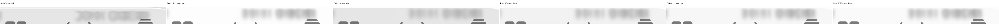

# Navigation: one shared neutral color proposal

All four declared factors fail the protected B partial-boundary guard. Every original paired body, SSIM, foreground and completed-image aggregate guard improves or ties, but that does not override the boundary failure. No tone is adopted. Current incident H1 and historical pass03 remain unchanged.

The full proposal visibly reduces excessive body brightness. It does not repair refraction, missing outline light or source uncertainty. This is a useful tonal direction with a concrete blocking guard, not evidence that neutral grading is globally infeasible.

## Clock and frozen state

[Protocol](protocol.json) fixes the actual start at 2026-10-23 23:08:58.483 UTC and the twenty-minute finish at 23:28:58.483 UTC, including documentation and versioning. Candidate evaluations finished at 23:12:33.818419 UTC. Unused time is not transferred to another stage.

| Item | Frozen state |
| --- | --- |
| Baseline | Current H1 at distance 2 L; no rejected spline or modulation |
| Incident softness | Sigma 6.75 native pixels, finite radius 21 |
| Geometry | Original footprint, pose, source coordinates and native AA2 |
| Source / masks | Original temporal mosaics, known masks and scoring cohorts |
| Foreground | Original vectors/styles and complete ordered nonlinear chain |
| Other stages | Shadow zero; no illumination, spectrum or output-filter change |

No rays, height/graph evaluations, source queries, filtering or baseline material rendering occurred. The existing blur assessment is retained evidence, not proof that blur is absent or fully solved.

## Declared operator position and exact identity

This stage grades retained integrated lens color, then updates its contribution to the pre-foreground image. It is an empirical encoded-color component after pixel integration. It is not asserted equivalent to grading individual rays before AA, physical transmittance, adaptation or reconstructed radiance.

Let the stored lens color be M, physical coverage alpha and exact cached pre-foreground backing P0. The declared native operation is:

$$
\begin{aligned}
\widehat M&=gM+b,\qquad M'=\operatorname{float32}(\operatorname{clip}_{[0,1]}(\widehat M)),\\
P'&=\operatorname{float32}\left(P_0+\alpha(M'-M)\right).
\end{aligned}
$$

The update applies only where physical coverage is positive; elsewhere the old material and backing remain unchanged. Differences and addition use float64 before the final float32 cast. Actual preclip values are retained. Strict range constraints and audits make the clip inactive for every contributing lens color.

This delta form preserves the original native identity rounding and clear contribution. It does not recover or invent old raw subrays. No foreground is subtracted. The original pre-foreground backing was already proved exact by restoring retained material at fully covered painted pixels and leaving unpainted cached backing intact.

[Identity controls](identity.json) reproduce both complete H1 outputs exactly, including unavailable NaNs. Stored material, backing, complete and clear arrays are float32; coverage is float64. Every painted vector pixel has physical coverage one. Both identity composites are charged; no optical baseline is repeated.

Every new backing runs through the original nonlinear Home response and every other foreground layer in order. No fitted foreground coefficient or fictitious quadratic foreground approximation is used. Original completed-image scores and all sixteen foreground guards decide each actual candidate.

## One bounded train-only solve

Both references contribute equally. Each uses 85,332 original valid training pixels, excluding held pixels, actual foreground paint and zero physical coverage. Original scoring masks remain unchanged. The least-squares objective is:

$$
\mathcal L(g,b)=\frac12\sum_{j\in\{A,B\}}
\frac{1}{3|\mathcal T_j|}\sum_{i\in\mathcal T_j}\|gM_{j,i}+b\mathbf1-T_{j,i}\|^2.
$$

The shared gain and bias obey:

$$
\begin{aligned}
0.5\leq g\leq1.2,\qquad -0.1\leq b\leq0.25,\\
gm_{\min}+b\geq0,\qquad gm_{\max}+b\leq1.
\end{aligned}
$$

The actual contributing finite lens range across both references is [0.2677616179, 0.9929425716]. These are retained lens-color extrema, not assumed black/white endpoints. Parameter feasibility is checked without tolerance; every actual candidate also has zero coded clipping.

[Proposal](proposal.json) records one finite active-set solve: the unconstrained interior and feasible one-dimensional edge minima, with duplicate candidates reused. Six unique complete quadratic/constraint evaluations were made. Four later native-factor parameter checks bring the conservative total to ten, below sixteen. No optimizer restart, sweep or channel-specific coefficient is used.

The selected constrained proposal is:

$$
g_*=0.6592022260558144,\qquad b_*=0.25.
$$

Bias reaches its declared upper bound. The two-variable matrix has rank two and condition number 989.8159, reflecting correlated gain/bias information in mostly bright source regions. Numerical rank does not establish physical identifiability. Bounds materially influence this proposal; no larger bias or new solve is attempted.

Training MSE falls from 0.0080558873931 to predicted 0.0005899420564. Actual float32 graded material gives 0.0005899420538, a residual of −2.60e−12. This validates the material-only model arithmetic, not the nonlinear foreground or held performance; those were separately evaluated.

## Four actual paired outcomes

| Factor | Gain | Bias | A E | B E | B partial-boundary RMSE |
| --- | --- | --- | --- | --- | --- |
| Identity | 1 | 0 | 22.794806 | 23.521786 | 84.818130 |
| 1 | 0.6592022261 | 0.25 | 9.715935 | 7.617910 | 85.643211 |
| 0.5 | 0.8296011130 | 0.125 | 14.009881 | 13.595714 | 85.121056 |
| 0.25 | 0.9148005565 | 0.0625 | 18.173030 | 18.408060 | 84.942001 |
| 0.125 | 0.9574002783 | 0.03125 | 20.445307 | 20.940742 | 84.873146 |

[All results](result.json) retain every original and completed-image glass/rim/held/interior/SSIM/exterior and foreground score. All those guards pass for every factor. Exterior ties exactly. Full-step SSIM becomes 0.983850 / 0.985301 versus H1 0.976969 / 0.977107.

The additional partial-boundary requirement is predeclared and strict. All 95 original partial/zero-coverage glass pixels per reference remain included. B worsens at every factor. Full strength worsens 33 points, improves 17 and ties 45; each smaller strength worsens 32, improves 18 and ties 45.

A partial-boundary RMSE improves from 11.80044 to 7.21807 / 8.69688 / 10.12093 / 10.93569. Every factor improves the same 50 A points and leaves 45 unchanged. No point or mask was dropped to hide the B regression. No epsilon waiver or fifth factor follows.

Actual preclip ranges, zero clip counts and bit-exact stored clear layers are retained per trial. The full proposal maps the global finite lens range into approximately [0.4265091, 0.9045500]. Better scores do not arise from saturation.

## Visible tone, texture and local limits

The full A/B comparisons were inspected. Body neutrality becomes visibly closer to the references; lettering and the Home backing remain legible. The fixed geometry still has incorrect returns, and the bright perimeter remains absent. The full step reduces contrast, so score improvement alone is not a texture certificate.

For A's upper crop, mean signed RGB residual falls from approximately +16.9 levels to +0.4. For B's upper crop, it falls from +21.4 to +0.84. These explain a tonal improvement without claiming source reconstruction or repaired light transport.

| Advisory contrast diagnostic | Reference | H1 | Full proposal |
| --- | --- | --- | --- |
| A upper luma standard deviation | 23.8790 | 27.7255 | 24.0403 |
| A upper horizontal-difference RMS | 4.5010 | 4.7378 | 4.2687 |
| B left-cap luma standard deviation | 52.5633 | 66.5319 | 56.0403 |
| B left-cap horizontal-difference RMS | 7.5493 | 8.5310 | 7.5872 |

The A upper difference metric crosses below the reference despite improved overall contrast. B upper behaves similarly. Those local over-softening-like appearances are tonal contrast changes, not new blur. Their meaning is confounded by source texture, glyphs and geometry; no PSF inference or spectral claim follows.

All six fixed crops retain original-frame coordinates. RGB, luma and chroma RMSE improve for all four factors in those crops; signed residual and texture diagnostics remain explicit in [saved review](saved-review.json) and each trial result. No crop moved or became a fitting mask.

[Full A comparison](trial-01/a-comparison.png) and [full B comparison](trial-01/b-comparison.png) show the strongest proposal. Every smaller factor's arrays and full comparison remain in its trial directory. The B partial-boundary failure prevents acceptance even where visible body tone improves.

## Source, guards and provenance

[Source transfer](source-transfer.json) pins original H1 whole-source and finite-kernel proofs. No source coordinates, input fields, kernels, pose, alpha, scoring masks or vector styles changed. Scalar grading on cached pixels requires no new sampling support. Conditional mosaic availability is not photographic truth.

[Identity records](identity.json) hash the actual retained inputs, including cached pre-foreground controls. The same shared neutral-response and original compositor bytes are verified against the previous code pin. No playback or slider tone was imported.

The full-step improvement could partly compensate imperfect modeled incident brightness. Gain/bias cannot identify an Apple material or separate hidden source from lighting. Missing outline radiance and feature correspondence remain unresolved, independently of this tonal assessment.

## Accounting and closure

| Work | Actual | Cap |
| --- | --- | --- |
| Algebraic proposal solves | 1 | 1 |
| Quadratic/parameter constraint evaluations | 6 proposal + 4 actual-factor checks | 16 |
| Cached identity composites | 2 | 2 |
| Actual paired trials | 4 | 4 |
| Candidate completed composites | 8 | 8 |
| Optical rays, height calls, source queries | 0 | 0 |
| Incident/output filters, baseline material renders | 0 | 0 |

[Ledger](ledger.json) distinguishes proposal evaluations from actual-factor feasibility checks. One post hoc cached training-loss reduction compares the retained full-step material to the already saved quadratic value. It is not a second solve or proposal. Standard SSIM scoring retains its original diagnostic Gaussian operation; no optical filtering was performed.

[Driver](run.py) and [saved packaging](package_saved.py) contain the exact ordering and dtypes. Scripts preserve completion markers and the original deadline. Future work must not erase markers or reset counts. [Checks](checks.json) and [manifest](manifest.json) record documentation, privacy and artifact verification.

The stage is closed with four rejects and a concrete B boundary blocker. The refraction question remains closed. Later material, outline, shadow, foreground and dispersion questions require separate review; none is activated as a rescue. Historical counts, current H1 selection and all sealed evidence remain unchanged.
