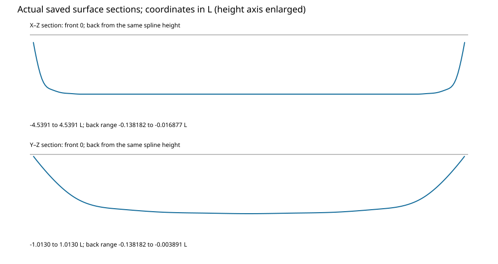
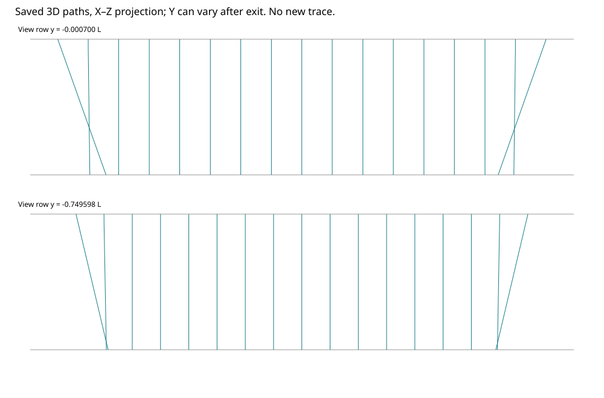
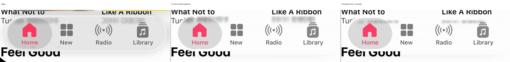
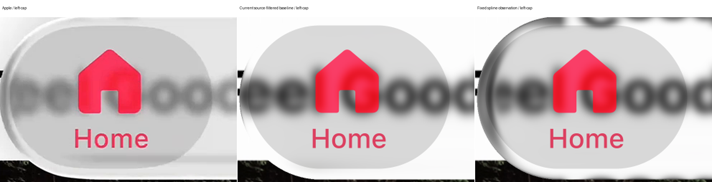

# Navigation: fixed positive-spline transfer is negative

The one fixed paired observation fails both references' original guards. It also fails completed-image boundary guards. The spline creates stronger cap structure, but does not match the reference text returns or dark upper-left region. Retain the current incident-filtered Navigation baseline and all historical evidence. No calibration or second setting follows.

## Fixed experiment

| Quantity | Frozen value |
| --- | --- |
| Shared base | `12bce1134f687f8f442d526a25fdb5f65d9e85cd` |
| Profile | Exact eleven positive spline-height controls and breaks from the published expanded study |
| Footprint | Accepted Navigation half-extents, radius and pose; cap join width zero |
| Index / background | 1.5 / 2.1L |
| Native integration | Two samples per axis, original phase |
| Incident blur | 6.75 native pixels, finite radius 21 |
| Body | Unit neutral response; no old lighting or added tone |
| Exterior | Unfiltered source; zero generated shadow |
| Foreground | Original ordered vectors and nonlinear Home response |

The transferred tuple includes distance 2.1L. The older harmonic Navigation baseline used distance 2L. This is not a controlled attribution to height alone, nor a distance fit. The fixed tuple was declared before execution and was not changed after seeing images.

The [protocol](protocol.json), [code pin](code-pin.json), [intake](../agent-navigation-intake-02/README.md) and [source proof](source-preflight.json) define the experiment. Both actual Music references remain at 0 and 6.033333333333333 seconds. Source mosaics and known masks retain their conditional provenance; no observed-confidence mask was invented.

## Actual surface and path scope

The unchanged root-owned spline defines actual height and gradient:

$$
h(\rho)=\sum_i c_i B_{i,3}(\rho),\qquad
\nabla h=h'(\rho)\nabla\rho.
$$

The saved control bounds on this footprint are:

$$
h_{\max}=0.1381819203L,\qquad
M\leq0.6732687149,\qquad
(n^2-1)M^2\leq0.5666134531<1.
$$

The shared flat-front primary certificate applies. No convex-solid reflection traversal was used. Creases remain unresolved, without invented normals or coordinate clamps. The scalar footprint coordinate has no central straight-body longitudinal curvature; it cannot independently control every horizontal text deformation.

The ray diagram projects saved three-dimensional paths onto X–Z. Its outgoing Y coordinate can vary. Both diagrams use existing arrays; no additional geometry evaluation was performed for illustration.

## Exact compositor prerequisite

Both cached zero controls reproduce the current completed images pixel-for-pixel. All 65,122 painted vector pixels per reference have physical coverage exactly one. Their exact pre-foreground backing is therefore the saved integrated material. Outside actual vector coverage, the completed cache is already the pre-foreground image.

The control selects those two unchanged regions, then applies the actual ordered compositor once. It does not subtract or invert foreground pixels. Home retains its nonlinear response to the current backing after selection. All 103,180 full-box style-dependency pixels per case remain required source pixels.

[Contract evidence](contract-result.json) records exact equality and layer roles. The changed observation retains raw samples, integrated pre-foreground output and completed output independently, eliminating the old cache-retention limitation for future reviewed diagnostics.

## Source-first and numerical controls

Both required source proofs passed before any changed RGB sampling. One exactly identical geometry grid was reused across the references. Every whole-body ray, original guard, foreground dependency and straight miss was tested with the complete incident kernel and four bilinear texels.

| Source proof, per reference | Count |
| --- | ---: |
| Audited subrays | 1,447,200 |
| Whole-body rays | 884,008 |
| Required-union rays | 1,071,709 |
| Unsupported required rays | 0 |
| Unsupported clear, unscored rays | 7,370 |

Unknown unscored exterior stays unavailable and is shown as a checker pattern. No source completion, domain extension, target context or mask removal was used. Numerical availability is not hidden photographic truth.

The [geometry checkpoint](geometry-checkpoint.json) passes gradients, circle algebra, mirror, scale, pose, unit-index and crease controls. Six small [shared-renderer parity patches](parity.json) cover lens, straight misses and partial coverage. Samples, coordinates, membership, support and integrated pixels match exactly.

The private sampler preserves the shared bilinear expression, floating-point types and original AA mean/cast order. It only indexes certified coordinates. Shared tracing and rendering code remain untouched.

## Paired results

| Measurement | A current | A spline | B current | B spline |
| --- | ---: | ---: | ---: | ---: |
| Original E | 22.79481 | 25.79721 | 23.52179 | 25.70483 |
| Original SSIM | 0.976969 | 0.967924 | 0.977107 | 0.972055 |
| Partial-boundary RMSE | 11.80044 | 11.81759 | 84.81813 | 84.95744 |
| Left-cap RGB RMSE | 19.27311 | 21.72500 | 26.19792 | 32.35552 |
| Upper-body RGB RMSE | 21.64718 | 26.13267 | 22.68248 | 23.94894 |
| Lower-body RGB RMSE | 22.43313 | 22.29540 | 24.19416 | 24.45384 |

A glass, rim and held errors regress; its interior improves. B glass, rim, held and interior all regress. Exterior error ties in both. Original foreground guards fail for five A layers and four B layers. All sixteen paired foreground measurements remain retained. No epsilon or aggregate-score override is applied.

Both references retain all 95 original glass pixels with partial or zero actual coverage. Their completed-image partial-boundary errors worsen. The [full result](result.json) separates historical material scores from completed-image scores and records every local RGB, luminance, chroma and signed-channel change. Actual sampled RGB has zero out-of-range channels.

Historical empirical pass03 remains a separate accepted record with E approximately 1.97514 and 7.42945. Its old grading, lighting and coordinate model are not matched nuisances or an acceptance claim for this physical observation. No historical case, score or count changed.

## Visible correspondence

A's upper-body lettering becomes more vertically compressed and displaced toward a thin band, rather than matching the reference's broader blurred return. Its lower-body crop improves slightly in RGB while chroma worsens slightly. That local change does not rescue the failed paired guards.

B develops a strong dark cap arc and an extra upper-edge text return. The underlying left-side lettering remains darker and less compressed than the reference. The reference's bright boundary is still missing. These are correspondence and radiance limitations, not a blanket objection to reversal.

The fixed crops preserve their original frame rectangles. Their presentation widths obey the bar-control rule. A lower-body improvement and all local regressions remain explicit; no crop was moved to select a favorable region.

## Runtime, counters and stop

The task began at 22:14:11.659 UTC with a 22:44:11.659 UTC cap. Geometry checkpoint and its message preceded the 22:22:11.659 checkpoint limit. The pair finished at 22:26:43.500 UTC. Subsequent work only extracts saved evidence, checks documentation and versions this branch.

| Work | Actual | Cap |
| --- | ---: | ---: |
| Fixture and parity rays | 515 | 5,000 |
| Native rays | 1,447,200 | 2,894,400 |
| Nested height/boundary/footprint charges | 8,688,182 | 12,000,000 |
| RGB sampling queries, including parity | 2,879,796 | 3,000,000 |
| Full candidate composites | 2 | 2 |
| Cached zero controls | 2 | 2 |

Source work is additional and explicit: 2,894,400 audited subrays, 23,155,200 bilinear mask lookups and two finite known-mask erosions. Two fixed incident filters produce the sampled fields. Neither filtering nor source support is described as zero work.

Startup failures involved missing CairoSVG, a loader mismatch and a Python ABI mismatch. A counter attachment also failed on an immutable footprint before field evaluation. Logs preserve each failure. Recovery used existing dependencies and a forwarding counter proxy; clocks and numerical caps were not reset.

The [persistent ledger](ledger.json) charges nested calls before evaluation and preserves counts at process exit. The native grid was reserved before tracing. No completed baseline or native grid was rerendered. No model, account, session, main branch or Pages configuration changed.

The result is closed as a useful negative. No next calibration, animation, geometry setting or target is active. The old slider worktree and its published history remain intact.
