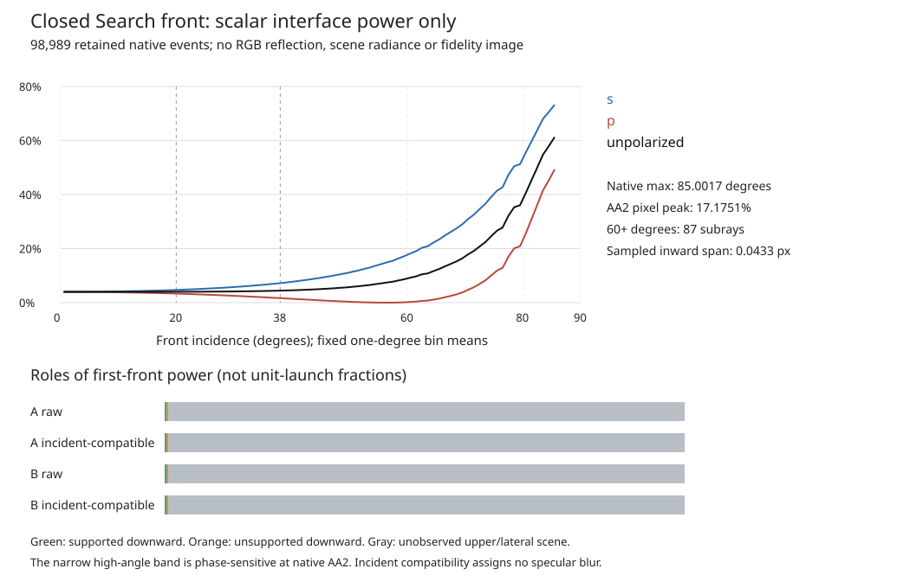

# Full native closed-front power: strong locally, extremely thin

**The closed front reaches substantial grazing reflectance, but only in an extremely thin sampled band.** All 98,989 regular native front events are processed. Maximum unpolarized reflectance is 61.29 percent; the mean is 4.022 percent. Scene radiance remains unobserved or conditionally supported, so this is not an RGB reflection or fidelity result.

## New execution and preserved failure

Execution31 starts at 07:55:38.975 UTC and ends by 08:10:38.975 UTC. Its checkpoint passes at 07:56:39.732 UTC and continues directly to primitives without a wait. Stopped30 remains unchanged, including its failed clock and zero primitive ledger.

The [prepared provenance](prepared-provenance.json) binds the original driver hash. `audit.py` is byte-identical to 30; only the new protocol clock and output directory differ. Existing metadata proof is reused by current hashes. The identical driver's fast selected-header validation and repeated decoding are charged as new work, not called zero access.

| Actual work | Count | Cap |
| --- | ---: | ---: |
| Retained front normals | 98989 | 100000 |
| Shared reflection plus Fresnel inputs | 197978 | 200000 |
| Selected decoded cache/mask bytes | 19348800 | 536870912 |
| Source-plane geometric/reference checks | 921 | 250000 |
| Raw four-corner indexed lookups | 1216 | 1000000 |
| Incident-compatible indexed lookups | 1216 | 1000000 |
| As-run saved-reduction elements | 974923 | 1000000 |
| Rays, heights, RGB, erosion, filters, composites and fits | 0 | 0 |

A conservative 2,000 additional derived scalar elements cover plot and summary packaging, keeping the total reduction bound at 976,923. The original measured ledger is preserved separately. No native grid, source/target RGB decode, threshold search or substitute subset runs.

## One first interface

The geometry remains the exact closed24 ellipsoid, with radius, depth, pose, original L 89 and index 1.5 unchanged. Selection is every cached `regular_entry`, including the 549 launches whose later primary transmission encountered TIR. Later completeness is not a filter on front reflection.

Shared reflection uses actual cached unit front normals and the vertical incident direction. Shared Fresnel returns the two first-interface power coefficients. The unpolarized average is formed once; no repeated scalar-average products are used.

$$
\begin{aligned}
\boldsymbol i&=(0,0,-1),\\
\boldsymbol d_{\mathrm{reflected}}&=\boldsymbol i-2(\boldsymbol i\cdot\boldsymbol n)\boldsymbol n,\\
R_f&=\frac{R_s+R_p}{2}.
\end{aligned}
$$

| Native first-interface statistic | Minimum | Maximum |
| --- | ---: | ---: |
| Front incidence, degrees | 0.004710 | 85.001654 |
| s reflectance | 0.040000 | 0.732421 |
| p reflectance | 8.269e-8 | 0.493371 |
| Unpolarized reflectance | 0.040000 | 0.612896 |

These are sampled ranges, not continuum bounds at an exact grazing tangent. Exact projected tangencies remain unresolved under the existing convention. No normal replacement or extra edge sample is introduced.

## How thin is the sampled grazing band?

Fixed incidence bins were declared before execution. The lower-angle majority dominates integrated first-front power because it covers most of the projected body. High local reflectance does not imply a broad bright rim.

| Incidence band, degrees | Subrays | Mean unpolarized reflectance | Fraction of total first-front power |
| --- | ---: | ---: | ---: |
| 0–20 | 96800 | 0.040005 | 97.2659% |
| 20–38 | 1697 | 0.041099 | 1.7518% |
| 38–60 | 405 | 0.055035 | 0.5598% |
| 60–80 | 79 | 0.161212 | 0.3199% |
| 80–90 | 8 | 0.510777 | 0.1026% |

| Fixed grazing cohort | Count | Maximum sampled inward span, native pixels |
| --- | ---: | ---: |
| Incidence at least 60 degrees | 87 | 0.043279 |
| Incidence at least 80 degrees | 8 | 0.003890 |
| Reflectance at least 0.5 | 5 | 0.001634 |

The span is measured from retained launch positions to the projected edge. It is a discrete sampled-band statistic, not a certified continuous band width. Its subpixel size makes extreme values sensitive to the original lattice phase. This does not authorize a changed scoring quadrature.

## Original AA2 unit-reflectance field

The saved scalar field uses the original four subray weights. Outside regular front events there is no interface contribution; this zero is not assigned black scene radiance. A separately saved covered mean distinguishes coverage from reflectance.

$$
\overline R_{f,p}=\frac{1}{4}\sum_{j=1}^{4}\mathbf{1}_{\mathrm{regular},pj}R_{f,pj}.
$$

The 235-by-240 pixel-averaged field peaks at 0.171751. Eleven pixels exceed 0.1; none exceeds 0.25. The field, coverage and covered mean are retained in the indexed `AA2-unit-reflectance` archive. No optical blur, selected tone or source color is applied.

The curves show fixed one-degree bin means of existing samples; lines only guide the eye. Dashed 20/38-degree markers contextualize the reported coarse root diagnostic, not a rerun or assertion of identical geometry. The plot assigns no environment radiance or target color.

## Which scene supplies first-front reflection?

| Direction role | Native events |
| --- | ---: |
| Upward, unobserved scene | 98682 |
| Downward, modeled background plane first | 307 |
| Exactly lateral | 0 |
| Downward endpoints outside original bounds | 155 |

All downward branches are intersected with the fixed background plane before any infinite environment. Raw four-corner and radius-21 incident-compatible masks are inspected separately under their original hash-proven semantics. No erosion, RGB lookup, border clamp or source completion occurs.

For vertical incidence, the actual reflection formula explains why the strongest grazing fronts cannot automatically receive an upper studio emitter. The direction's vertical component changes sign at 45 degrees of front incidence.

$$
d_{\mathrm{reflected},z}=2n_z^2-1.
$$

Thus the 60-degree and higher cohorts point downward toward the modeled background. Upward directions still need unobserved scene radiance. The incidence threshold describes a direction identity, not a fitted image mask.

| First-front power sums under unit normalization | A raw | A incident-compatible | B raw | B incident-compatible |
| --- | ---: | ---: | ---: | ---: |
| Supported downward | 16.398127 | 14.608547 | 17.778263 | 16.973789 |
| Unsupported downward | 14.096969 | 15.886549 | 12.716833 | 13.521307 |
| Unknown upper/lateral scene | 3950.884074 | 3950.884074 | 3950.884074 | 3950.884074 |

The common total is 3981.379171 over all 98,989 unit-normalized front events. These are interface-power sums, not radiance or image brightness. The unknown upper scene accounts for about 99.23 percent of the summed first-front power; locally strong grazing power is much smaller spatially.

Incident compatibility is only an availability diagnostic. It neither applies the transmission frosting to specular radiance nor adopts the selected encoded tone. Conditional mosaic support does not establish photographic truth. No annular black/white value is assigned to a downward branch, and unsupported power is never discarded.

## Scope and decision

This native circle resolves high-incidence fronts missed by a coarse sample, but it does not identify the missing reference rim's radiance. Strong local Fresnel power, sparse AA2 coverage and missing scene inputs must remain separate. There is no RGB reflection, score, complete-scene claim or model adoption.

Full per-front powers, directions, endpoints and support flags remain in the indexed `first-front` archive. [Results](result.json), [histogram](angle-histogram.json), [power summary](power-summary.json) and [ledger](ledger.json) retain the complete cohort and accounting. No low-power deletion occurs.

Preserve closed24, path25, inverse27, transfer29 and selected Search unchanged. No new scene, target, height, fit or automatic continuation is activated.
