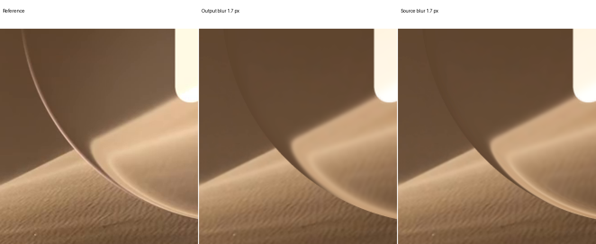
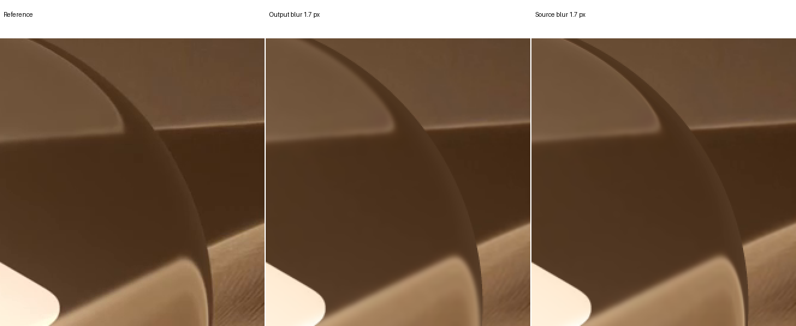
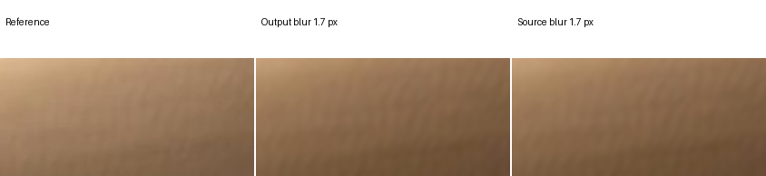

# Clear play: source blur and outline transport

Status: blur comparison complete; useful mechanism result, no accepted replacement. Outline investigation is active.

## Question

Feedback F-001: compressed edge texture appears too blurred under the accepted output filter. Test whether filtering incident content before refraction preserves central softness while changing edge sharpness through the physical map.

## Frozen state

G05 surface, refractive index 1.5, background distance 2L, original registered source, native 4×4 integration, masks and historical foreground remain fixed. The accepted output filter is 1.7 native pixels. No dispersion, geometric fit, color fit or new source is permitted.

## Blur comparison

Use five declared source widths: 1.25, 1.5, 1.7, 2 and 2.5 native pixels. Select by matching accepted central texture bandwidth in the fixed 140×65 center crop. Reuse previous source widths 0.5 and 1 as historical controls.

Audit the complete finite Gaussian and bilinear footprint against the registered source before sampling. Preserve unfiltered clear exterior contributions. Use cached physical queries; no new ray tracing is required.

Allow at most two new full native candidates and one independent replay. Retain all original guards and inspect the lower-left, upper-left, upper-right and center crops. Never select an edge-specific blur radius.

## Outline investigation

Review saved Fresnel paths and their unresolved power. Permit one bounded continuation or boundary diagnostic using the same surface, up to 64 launches, 4,096 events and two million level evaluations. No reflected RGB image is authorized without supported scene radiance.

Explain what the actual surface predicts, which illumination is missing, and whether transmission softness should affect specular reflection. No painted halo or target-colored environment is allowed.

## Clock and outcome

[protocol.json](protocol.json) records actual UTC start and deadlines. The maximum allocation is 10 minutes intake, 50 blur, 45 outline and 15 verification. Close answered stages early; stop at failed invariants or exhausted budgets.

A visible component improvement, useful negative or incomplete result are valid outcomes. Historical filtered evidence remains labeled; mathematical correctness and visible fidelity are separate claims.

## Blur result

The matched source filter sharpens compressed edge structure while preserving central texture. It does not restore the missing bright rim or incorrect crossings. Local RGB errors and several original guards worsen; retain the accepted output-filter result.

| Measurement | Output blur | Source blur |
| --- | ---: | ---: |
| Width, native pixels | 1.7 | 1.7 |
| Center bandpass RMS | 1.122451 | 1.122313 |
| Glass RMSE | 12.569344 | 12.856474 |
| Rim RMSE | 13.872038 | 14.391801 |
| Outer-rim MAE | 16.897352 | 16.467651 |
| Foreground MSE | 98.166603 | 98.166603 |

[Native results](result.json), [center selection](center-selection.json), [source proof](source-proof.json) and [zero controls](native-zero-controls.json) preserve all guards. One full candidate and five fixed center-crop comparisons were evaluated; no new refraction rays were traced.

## Why edge softness changes

Let the physical ray map send an image position to a source-plane position. Source and output filtering generally differ:

$$
C_{\mathrm{source}}(\mathbf{x})=(G_\sigma*S)(F(\mathbf{x})),\qquad
C_{\mathrm{output}}(\mathbf{x})=G_\sigma*(S\circ F)(\mathbf{x}).
$$

For a locally invertible map, the source-filter covariance appears in image coordinates as:

$$
\Sigma_{\mathrm{image}}\approx J_F^{-1}\Sigma_{\mathrm{source}}J_F^{-\mathsf{T}}.
$$

Strong source-coordinate travel compresses the apparent filter width along that direction. This local approximation fails at singular folds and does not create a missing specular highlight. The test uses the full retained geometric map, not this approximation as an image warp.
