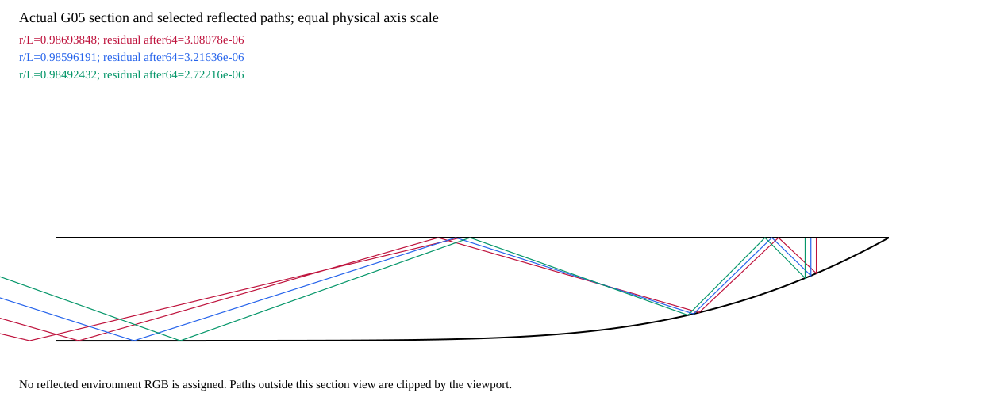

# Outline transport: supported paths and missing light

Status: useful negative. No reflected image or outline improvement is accepted.

The existing surface explains paths and reflection weights. The available source photograph does not specify every scene region reached by those paths. Extending selected traces reduces unresolved power but does not close that gap.

## Bounded test

| Quantity | Result |
| --- | ---: |
| Retained primary starts | 64 |
| New primary rays | 0 |
| Internal interface encounters | 2,135 / 4,096 cap |
| Level evaluations | 86,982 / 2,000,000 cap |
| Maximum remaining power after 32 encounters | 0.0419325 |
| Maximum remaining power after 64 encounters | 0.00786349 |
| Paths above remaining-power tolerance | 21 |
| Unsupported secondary background events | 20 / 114 |
| Maximum energy-conservation error | 2.22×10⁻¹⁶ |
| Reflected environment observations | 0 |

The selection prioritizes residuals from the earlier 997-ray audit. Its unfinished internal states were not saved, so these selected starts required bounded replay. This is not a complete image-domain proof.

The section uses the same G05 height and traced points. Both axes have the same physical scale; the thin lens has not been exaggerated into a decorative shape.

## Material implication

The flat front has the same normal across the control. A uniform environment reflected at that interface contributes broadly, without independently creating a thin rim. Back-surface angles and later reflections vary, but their scene radiance must be specified.

A complete model would combine scene-linear transmission and reflection along actual paths:

$$
L_{\mathrm{o}}(\mathbf{x})=
T_{\mathrm{p}}(\mathbf{x})\,(G_\sigma*L_{\mathrm{s}})(F(\mathbf{x}))
+\sum_k w_k(\mathbf{x})\,L_{\mathrm{s}}(Q_k(\mathbf{x}))
+\sum_j v_j(\mathbf{x})\,L_{\mathrm{env}}(\boldsymbol{\omega}_j(\mathbf{x}))
+L_{\mathrm{remaining}}(\mathbf{x}).
$$

For the lossless path accounting used here:

$$
T_{\mathrm{p}}+\sum_k w_k+\sum_j v_j+w_{\mathrm{remaining}}=1.
$$

The first term shows the tested incident-plane PSF approximation. It does not justify applying the same blur to specular reflection. Fresnel weights act on radiance; the historical encoded image response does not establish a calibrated radiometric pipeline.

No unknown term is filled from the target. More bounces alone cannot supply missing background or environment observations. The next discriminating input is an independently supported reflected environment and complete secondary source coverage.

[Path results](outline-result.json) record budgets, conservation and unsupported destinations. [Independent verification](verification.json) checks saved boundary points against the same surface without retracing.
