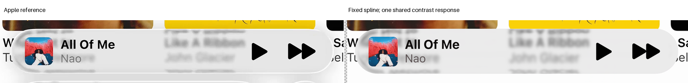

# Expanded playback: shared contrast clears the native guards

One cached-native pair passes every original paired guard and the float64 residual checks. Independent replay reproduces both completed images exactly. This is an accepted combined geometry/tone improvement, not proof of Apple's surface or a completed full pipeline. The actual spline and incident blur stay fixed.

| Measurement | A H1 | A candidate | B H1 | B candidate |
| --- | ---: | ---: | ---: | ---: |
| E | 45.423695 | 12.907854 | 18.219819 | 8.575871 |
| Glass RMSE | 38.077415 | 11.516128 | 15.106258 | 7.306179 |
| Rim RMSE | 59.115406 | 15.682034 | 23.959862 | 10.981710 |
| SSIM | 0.871073 | 0.976339 | 0.922811 | 0.974080 |
| Partial-boundary advisory RMSE | 30.508701 | 26.549803 | 34.845521 | 26.494083 |

All ten artwork/glyph guards pass. Exterior is unchanged. All sixteen original partial-coverage glass pixels per case remain included. No mask or guard is removed. Actual clipping is zero.

## Frozen question

The [earlier compensation](../expanded-spline-material-01/README.md) stopped with an inconclusive solver failure. Its tiny gain/bias box did not answer whether a broader shared contrast response could preserve the body improvement without foreground regressions.

The fresh [protocol](protocol.json) preserves the [spline observation](../expanded-spline-observation-01/README.md), actual paths, source sigma 6.75, inputs, masks, original artwork/vectors and native AA2. Both original Music references and H1 numerical thresholds stay fixed. Historical empirical pass03 remains a different archived comparison.

The twenty-minute budget permits one model solve and conditionally one actual pair. Old expired trials remain closed. There are no new rays, source queries, optical filters, height evaluations or coordinate corrections.

## Old-box certificate

The saved squared-error guard forms are:

$$
f_i(\boldsymbol\delta)=\boldsymbol\delta^{\mathsf T}H_i\boldsymbol\delta+
2\mathbf v_i^{\mathsf T}\boldsymbol\delta+c_i\leq0.
$$

The A artwork and B play guards admit a positive weighted combination with a positive-semidefinite quadratic term and exactly canceled bias coefficient. On the old box:

$$
\begin{aligned}
|\delta_g|,|\delta_b|&\leq0.01,\\
f_A+\lambda f_B&\geq c-0.02\lVert\mathbf v\rVert_1\\
&=0.000833341417\ldots>0,\qquad \lambda>0.
\end{aligned}
$$

Both guards cannot hold there. [Exact rational arithmetic](feasibility.json) treats the saved decimal coefficients as rationals, including their existing foreground reserves. This certifies that model box only; it is not global native infeasibility or a geometric limitation.

## One broader common response

The new family compresses encoded contrast while permitting only a small decrease of the response at white:

$$
\begin{aligned}
g&=g_0-r,& b&=b_0+r+w,\\
0\leq r&\leq0.125,& -0.001\leq w&\leq0,\\
0\leq r+w&\leq0.125,& g+b&=g_0+b_0+w.
\end{aligned}
$$

Gain and bias are common to RGB and both references. They change cached lens-ray responses before the original AA integration and foreground compositor. Clear rays retain their original samples. This is empirical encoded grading, not measured radiance or coefficients for individual icons, images or regions.

One convex feasibility solve evaluates seven distinct points. Its strictly feasible proposal is:

$$
\begin{aligned}
r&=0.10579158907593204,\qquad w=-0.001,\\
g&=0.596189238519786,\qquad b=0.3290237590837732.
\end{aligned}
$$

The white-change bound is active. Bounds and correlated gain/bias information limit physical identification. No additional coefficient, half-step or optimizer start is tried.

## Actual result and limits

Both original-response identities reproduce pre-foreground and completed arrays exactly. The single changed pair passes original body, held, SSIM, exterior and all artwork/glyph guards. Every corresponding float64 residual guard passes. [Native results](native-result.json) retain all values, raw clipping counts and input hashes.

[Independent verification](peer-verification.json) reproduces the identities, candidate arrays and reported scores exactly. Its [certificate check](peer-certificate.json) independently confirms the saved rational model proof. Held cohorts participate as preservation constraints, not fresh independent test data.

The comparisons show much closer body tone and background-return structure than H1. The bright perimeter remains missing, B's lettering return remains misplaced, and A's colored backdrop is imperfect. Passing guards does not mean these defects are solved or the material is uniquely identified.

The source proof transfers because paths, finite incident kernels, masks and raw samples are unchanged. Conditional temporal-mosaic support is not hidden photographic truth. Device performance and complete reflected radiance are not tested.

The first dependency probe lacked Cairo's shared-library search path. The existing Python/Cairo bundle resolved it before any identity or candidate evaluation. [Setup evidence](runtime-setup.json) records this without installation or a deadline extension.

## Reproduction and accounting

Restore frozen inputs with [the existing restorer](../expanded-geometry-02/restore-inputs.cjs), Git LFS and the [reconstruction requirements](../../../reconstruction/requirements.txt). CairoSVG also requires its shared library. Retained raw samples and exact recipes reproduce the response without new source sampling.

[Feasibility code](feasibility.py) and [native code](native.py) preserve one-attempt markers and the original deadline. Independent replay should use a separate review output; do not erase markers or overwrite sealed evidence to rerun a trial.

| Work | Actual |
| --- | ---: |
| Model evaluations / feasibility solves | 7 / 1 |
| Cached identity composites | 2 |
| Candidate native pairs / completed outputs | 1 / 2 |
| Rays, heights, source queries, optical filters | 0 |

Science finished at 00:07:34.739 UTC on 24 October 2026. The [primary decision](primary-decision.json) accepts this combined increment for publication. No full-pipeline pass, uniquely identified material or completed outline is claimed.
