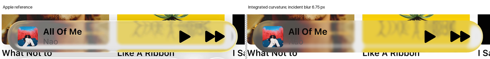
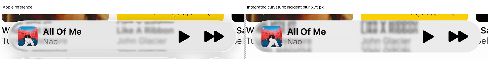
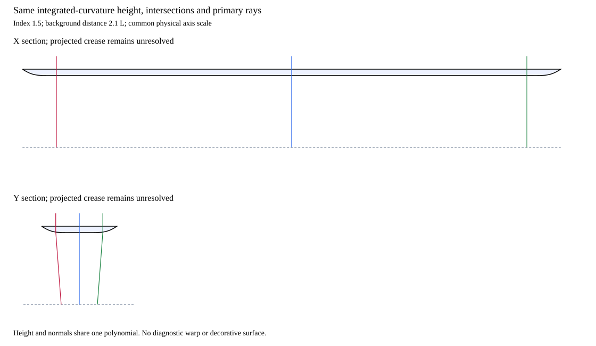

# Expanded playback: integrated perimeter height

Status: useful partial result, rejected by original guards. Rim structure improves substantially; interior and foreground regressions prevent acceptance. No further native trial or fit extension was run.

## Geometry

Nonnegative curvature is integrated into one actual height profile:

$$
H''(\rho)=-\kappa(\rho),\qquad \kappa(\rho)\geq0,\qquad H'(0)=0,\qquad H(1)=0.
$$

The frozen convex rounded coordinate defines the full back and its normal:

$$
h(\mathbf{x})=H(\rho(\mathbf{x})),\qquad \nabla h=H'(\rho)\nabla\rho.
$$

The existing radial-curvature polynomial supplies both height and derivatives. The [shared adapter](../../../reconstruction/footprint_curvature_back.py) changes the footprint, not the optical equations. There is no independent normal or empirical displacement after tracing.

A fixed background distance 2.1 normalized units provides near-critical clearance margin. It is an explicit prior, not an identified Apple distance or image-color fit.

## Initialization and controls

One fit to the historical diagnostic normal component stopped at 96 evaluations and 12,384 calibration rays. Solver convergence was not reached. The best actually evaluated feasible geometry was retained.

[Inference](inference.json) preserves losses and the best feasible coefficients. Non-best probe vectors were not retained; the [retention limit](retention-limit.json) records the gap without rerunning the fit. Maximum height is 0.170776; global slope bound is 0.650629, below the first-exit critical slope.

[Checkpoint](checkpoint.json) passes 581 fixture rays, including true-circle normalization and scale covariance. Three [permanent software checks](software-QA.json) add 23; the total remains below the original 640 cap.

The [source preflight](source-preflight.json) traces one shared 1,360,000-ray grid. Both sources pass whole-body, every original guard and the full incident-kernel/bilinear footprint before RGB. Coverage stays bit-exact.

## Paired result

| Completed-image E | H1 incident baseline | Inferred profile |
| --- | ---: | ---: |
| A | 45.423695 | 34.483173 |
| B | 18.219819 | 15.235412 |

| Rim RMSE | H1 | Inferred profile |
| --- | ---: | ---: |
| A | 59.115406 | 30.629288 |
| B | 23.959862 | 14.735183 |

Both interior and artwork guards worsen; additional title, artist or symbol guards fail. B glass and held error also worsen. These regressions remain in the [complete result](result.json); no epsilon or mask change is used.

Incident width 6.75 native pixels and the common neutral response remain fixed. The improvement cannot be credited to a new blur radius or color fit. Missing highlights, feature returns and body response remain unresolved.

## Actual sections

[Sections](sections.json) reuse the same polynomial and checkpoint paths. No decorative surface, new tracing or reflected illumination is substituted.

## Implication

The map audit identified the missing perimeter power more directly than uniform front bending. A concave profile still trades peripheral and interior correspondence; the initialization is not globally optimal or a recovered Apple surface.

The historical full map has local compatibility violations. It cannot simply become geometry. A next discriminating question is whether a bounded nonconcave height can retain complete primary paths without the present concavity restriction.

That question needs its own certificate and budget. The current refraction block stops at its original deadline. No new optical work is authorized by deleting completed guards.

The prior H1 remains the selected incumbent. Later material comparisons must retain its original guards, rather than reset the baseline to this rejected candidate.
