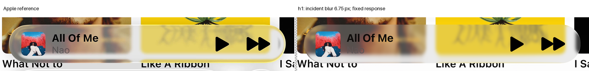
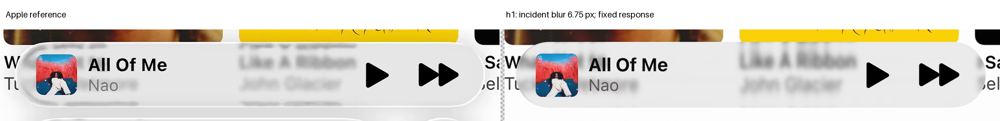

# Expanded playback: matched incident softness

Status: distance reduction rejected. The source-first H1 state is primary by modeling convention, with numerical regressions preserved. No geometry fit or complete reconstruction acceptance is claimed.

## Question

Does a closer physical background improve card/text correspondence when both references retain the same incident softness and neutral response?

The original harmonic surface, normals, pose, inputs, masks, AA2, foreground styles and artwork remain frozen. Only the saved background distance differs.

## Material initialization

The historical source width is nominally 6.786617200054694 native pixels. Its quarter-pixel cache uses 6.75. That effective width seeds incident filtering here; output material filtering is zero.

The finite Gaussian radius is 21 pixels. This is a softness initialization, not an exact replay of the historical mixed/output operator or an identified physical roughness.

Common gain 0.701980827595718 and bias 0.22423217000784113 are retained from the expanded study. No circular-play material assumption or per-reference coefficients are introduced.

## Distance result

| Completed-image E | A | B |
| --- | ---: | ---: |
| Original distance 2L | 45.423695 | 18.219819 |
| Closer distance 0.5L | 47.935315 | 18.972107 |

The closer plane improves interior error and SSIM, but worsens glass, rim, held and overall error in both references. Some foreground guards also regress. Keep the original distance.

[All distance guards](distance-guards.json) and [native measurements](result.json) preserve these tradeoffs. Folding remains reference-specific; it is not rejected merely for occurring.





## Operation-order selection

Source-first H1 lowers overall error versus the historical output-filtered physical state: A 49.127160 → 45.423695; B 19.818510 → 18.219819.

Both artwork guards and A SSIM regress. This is not a strict numerical qualifier. The [selection](selection.json) adopts the required operation order while preserving [all historical-output guards](historical-output-guards.json).

Bright rims, cap returns, body tone and underlying feature positions remain wrong. Sharper compressed detail does not resolve them. No target-colored reflection or extra blur was added.

## Source and replay

The [preflight](source-preflight.json) checks 5,440,000 cached subrays before RGB: whole body, all original guards, full incident kernel and four bilinear corners. Required unsupported samples are zero.

Each image retains 2,750 unavailable unscored presentation pixels. Checkerboard marks them; there is no source completion. Existing confidence does not establish hidden photographic truth.

Sparse raw replay is float32 exact on 96 native pixels per reference. The original foreground function syntax tree is unchanged. Four cached composites use 5,398,768 RGB queries; zero new geometric rays or fits.

## Reproduction

Use the reconstruction dependencies and Git LFS. Restore exact indexed inputs before running the declared checks:

```sh
node research/experiments/expanded-geometry-02/restore-inputs.cjs
```

[Additional inputs](additional-inputs.json) identify frozen masks and raw material controls. Completed drivers refuse reruns; preserve their results and declare a new experiment instead of deleting guards.

## Next discriminating geometry

The distance test does not repair the missing longitudinal/transverse balance. A separately bounded same-height curvature-redistribution experiment can test real surface parameters, with fresh source support before RGB.

Later outline, shadow, foreground and dispersion stages remain pending, not absent. The original refraction deadline and overall pass deadline remain fixed in the [protocol](protocol.json).
