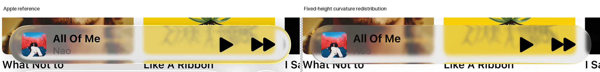
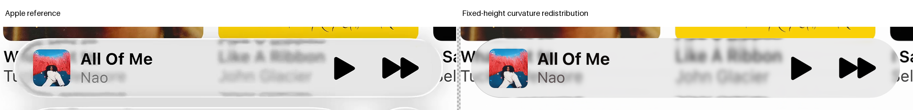

# Expanded playback: fixed-height curvature test

Status: useful negative. The changed physical surface is valid and fully source-supported, but it fails original paired guards. The prior H1 incident-blurred model remains selected.

## Hypothesis

Redistribute transverse and longitudinal depths while preserving maximum thickness and the original projected footprint. The [same-surface derivation](surface.md) predicts twice the central longitudinal curvature magnitude.

Incident width 6.75 native pixels, common neutral response, background distance, source, AA2, artwork, vectors and masks remain frozen. No optical warp, independent normal or blur rescue was added.

## Result

| Completed-image E | Original H1 | Redistributed surface |
| --- | ---: | ---: |
| A | 45.423695 | 44.775691 |
| B | 18.219819 | 18.750305 |

A overall error falls, but SSIM and title foreground regress. B glass, rim, held, overall, SSIM, play and forward guards regress. Interior error improves in both; that does not excuse other regressions.

The changed surface still misses the bright rim and produces incorrect edge returns. Its stronger longitudinal curvature does not independently solve the cap/body balance.

## Correctness and accounting

The [checkpoint](checkpoint.json) passes 1,722 height evaluations and 618 rays. Gradient error is below 0.000000001; center curvature doubles while maximum height remains unchanged.

The [fresh source proof](source-preflight.json) checks one shared 1,360,000-ray geometry and both original source domains. Every required kernel and bilinear texel is supported; coverage is bit-exact.

Two [native observations](result.json) use the certified coordinates, unchanged foreground chain and zero clipped lens channels. No fit or backtrack was run.

The initial driver filename shadowed an imported module. It failed before RGB, then was renamed without changing its bytes. The [failure receipt](driver-import-failure.json) is preserved; no rays or source proofs were repeated.

## Implication

This single negative does not prove a globally inadequate height family. It shows that the tested same-height redistribution trades longitudinal and transverse behavior rather than resolving both references.

A final bounded geometric hypothesis may vary the actual front surface, using the shared ordered-intersection tracer. It must prove occupancy, normals, paths and source support before RGB. No fourth refraction family follows without review.

Use the [protocol](protocol.json) and restore inputs through the preceding [expanded experiment](../expanded-geometry-02/README.md). Completed drivers retain stop guards; do not erase results to rerun them.
