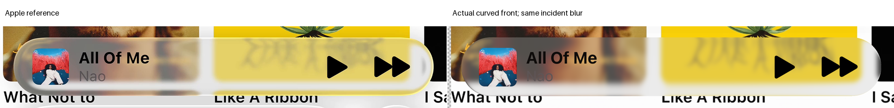
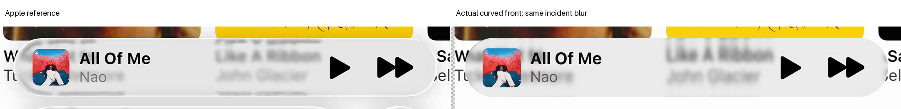
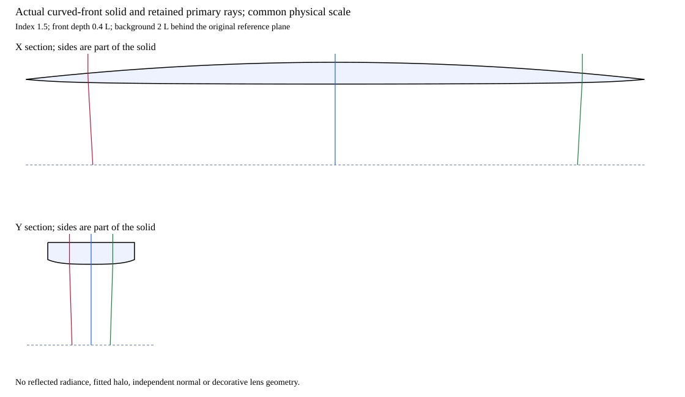

# Expanded playback: actual curved front

Status: useful negative. The closed solid is valid and supported, but original paired guards reject the candidate. The H1 incident-blurred state stays selected.

## One solid

A parabolic cylindrical front extends toward the viewer above the original back. Front, back and sides share one occupancy function. The [certificate](certificate.md) defines the same fields used for intersections, normals and sections.

Only front depth changes. Incident width 6.75 native pixels, neutral response, source plane, orthographic camera, silhouette, masks, artwork and vectors remain fixed.

The new [shared adapter](../../../reconstruction/parabolic_front_solid.py) imports the certified rounded back. It uses the existing ordered-intersection tracer without modification; no displacement correction or independent normal field is present.

## Result

| Completed-image E | Flat front | Curved front |
| --- | ---: | ---: |
| A | 45.423695 | 43.572068 |
| B | 18.219819 | 17.956980 |

Both glass and rim errors improve. Interior and artwork guards regress in both references. A play/forward and B title/artist guards also fail; B SSIM worsens. Overall error does not excuse these regressions.

Cap and underlying feature structure remain wrong; the bright rim is still missing. Front curvature alone does not establish a correct optical reconstruction.

## Correctness and bounds

The [checkpoint](checkpoint.json) passes 920 comparator launches. Zero-front source coordinates agree with the analytic model within the declared tolerance. The true-circle control matches the existing closed-circle adapter.

Five [permanent software checks](software-QA.json) add 84 launches. Combined checkpoint launches are 1,004, below the original 1,024 limit. Actual level gradients agree with finite differences.

The [native preflight](source-preflight.json) traces one shared 1,360,000-ray grid, then checks both original source domains. All required branches and full finite incident kernels pass before RGB.

Native intersection brackets stay below 0.00000000001 normalized units. No total-internal-reflection or unknown required path is silently replaced. Geometry calculations use about 41 million level evaluations, below 80 million.

Two [native observations](result.json) retain exact coverage, original masks and every foreground/artwork guard. All lens channels remain unclipped. There is no fit or extra front-depth setting.

## Same-parameter view

The [section record](sections.json) verifies actual boundary levels and reuses checkpoint rays. Source plane, camera direction and geometry parameters match the image calculation. No decorative alternative lens is drawn.

## Limits and next question

This is primary transmitted transport with empirical encoded grading. Reflected illumination remains unknown; there is no complete radiance or measured-material claim.

[Three-hypothesis review](review-after-three.md) closes this geometric comparison. A next discriminating audit may compare the historical diagnostic map with realizable geometry; the map itself cannot become the renderer.
