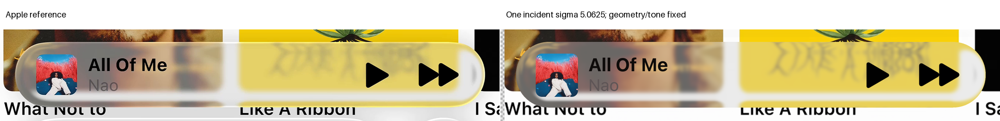
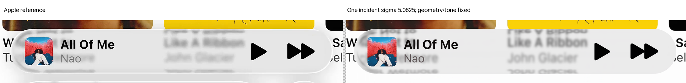

# Expanded playback: narrower incident blur is rejected

One fixed source width increases detail but worsens both original paired error and SSIM checks. Keep the accepted spline, shared contrast and incident sigma 6.75. No second width, geometry change or response adjustment follows.

| Measurement | A selected | A narrower | B selected | B narrower |
| --- | ---: | ---: | ---: | ---: |
| E | 12.907854 | 13.707963 | 8.575871 | 10.221450 |
| SSIM | 0.976339 | 0.967568 | 0.974080 | 0.951683 |
| Glass RMSE | 11.516128 | 12.311945 | 7.306179 | 8.896455 |
| Rim RMSE | 15.682034 | 16.512566 | 10.981710 | 12.789996 |
| Partial-boundary advisory RMSE | 26.549803 | 26.215344 | 26.494083 | 26.325423 |

Artwork error improves, but title, artist, play and forward guards regress on both references. Exterior ties. Every original and float64 residual comparison remains in [results](result.json). The local partial-boundary improvement does not override the body/foreground failures.

## One isolated change

The [protocol](protocol.json) freezes the accepted [spline/contrast state](../expanded-contrast-guard-02/README.md), actual paths, index, background placement, original sources/masks, foreground/artwork, unit phase and AA2. It tests one common incident Gaussian width before refraction:

$$
\sigma_{\mathrm{trial}}=0.75\sigma_{\mathrm{selected}}=5.0625\ \mathrm{px},\qquad
r_{\mathrm{kernel}}=\lceil3\sigma_{\mathrm{trial}}\rceil=16\ \mathrm{px}.
$$

There is no quarter-bin quantization or output-space filter. The previously tested H1 widths concerned a different geometry/material state; they are not relabeled as this observation.

## Source-first proof and integration

Both [source audits](source-first.json) pass before filtering or RGB sampling. Required coverage includes every subray of any physically covered pixel, all original guard pixels and original foreground dependencies. Every finite kernel texel and bilinear corner is included. No unsupported required ray is filled or removed.

The exact retained paths supply the new source coordinates. Only lens samples are queried; clear samples are reused bit-for-bit. The new response uses the selected shared coefficients before the original mean/cast and ordered foreground compositor. Existing registered mosaic support remains conditional availability, not hidden photographic truth.

Sixty-four independent RGB interpolation controls use the same new fields with SciPy. Maximum discrepancy is approximately 2.22e−16. These queries are included in the total. This validates interpolation arithmetic, not optical fidelity. Actual response clipping is zero.

## Fixed detail crop

The crop was declared before evaluation: original-frame bounds [820,310,1360,480], restricted to the unchanged glass mask. Horizontal differences require both adjacent pixels to be valid; glyph boundaries are not added to the texture metric.

| Horizontal luma-difference RMS | Reference | Selected | Narrower |
| --- | ---: | ---: | ---: |
| A crop | 0.964989 | 0.794634 | 1.053961 |
| B crop | 1.160601 | 1.091656 | 1.775895 |

A's diagnostic moves closer but crosses above the reference. B overshoots substantially. Luma variation also increases in both crops. These statistics do not establish correct feature correspondence; the wrong returns remain a geometric/scene limitation.

Source filtering and subsequent warping locally differ from a constant image-space blur. Away from singular mappings, a local approximation gives:

$$
I_{\mathrm{mat}}(\mathbf x)=(K_\sigma*S)(F(\mathbf x)),\qquad
\Sigma_{\mathrm{local}}\simeq
\sigma^2J_F^{-1}J_F^{-\mathsf T}.
$$

This explanatory covariance is not a renderer correction. The implementation filters only the incident source and uses actual traced coordinates. The approximation fails at singular folds; reversal alone is not a rejection criterion.

## Accounting and scope

| Work | Actual |
| --- | ---: |
| Candidate native pairs / completed composites | 1 / 2 |
| Source RGB queries, including controls | 1,781,760 |
| Incident fields | 2 |
| Known-mask erosions, preflight plus filtering | 4 |
| New rays / height evaluations / parameter fits | 0 / 0 / 0 |

[Study code](study.py) preserves a one-attempt marker and the twenty-minute cap. Both source gates precede RGB; changed arrays, clipping checks, masks and local regressions are retained. No expensive final media is generated. Keeping sigma 6.75 is a bounded decision, not proof that this PSF is uniquely correct.
