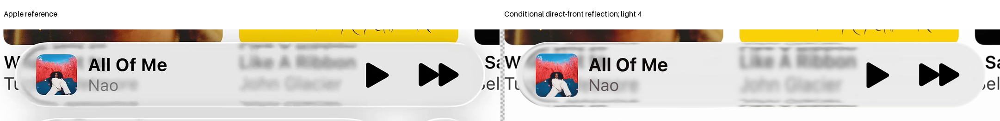

# Raised-front outline discriminator

**Rejected: direct front reflection reaches the outer edge, but refraction changes too much.** Adding half the original height above the selected back increases total thickness by 50 percent. Original paired body, foreground and boundary failures prevent adoption.

| Evidence | Record |
| --- | --- |
| Fixed physical surfaces and original deadline | [Protocol](protocol.json) |
| Ordered-path controls | [Checkpoint](checkpoint.json) |
| All candidates and original failures | [Results](result.json) |
| Preserved preflight failure and extra charges | [Recovery](recovery-protocol.json) |
| Joint review | [Three hypotheses](../miniplayer-outline-review-10/README.md) |

Both actual height graphs supply intersection residuals and normals. The shared solver retains brackets and monotone clearance bounds. Whole-body and all original guard finite-source audits pass before RGB; original inputs and masks stay fixed.

A missing saved union-mask field stopped the first preflight before RGB. Recovery reused the completed geometry, rebuilt the union from original guard masks and foreground boxes, and recorded repeated preflight charges. No fixture or native geometry grid was rerun.

## Escaping-path limitation

The as-run solver certified internal front/back order, but did not certify that the outgoing ray avoids re-entering the nonconcave back. Its support flags are conditional sampled-footprint records, not a complete escaping-path proof. Fixed09 has a separate positive bound. Future calls require explicit runtime escape clearance; old arrays and failures stay unchanged.
