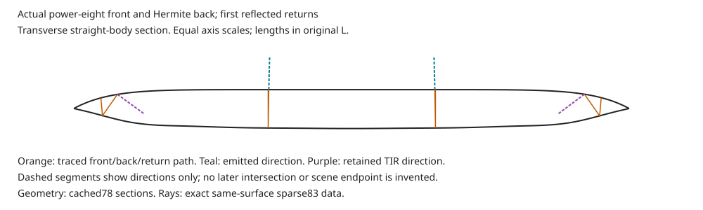

# First internal return: visible inset-band negative

**Useful negative.** The actual first internal return creates an incorrect bright inset band in both lengths. Every full-image error and SSIM comparison worsens. No model, light, material, source, mask or accepted count changes.

## Fixed question

The latest co-designed render omitted this physical branch. This observation adds it under the existing annular white environment, without fitting another parameter. Compact uses the exact expanded law; only major length differs.

The [first-return certificate](../miniplayer-first-return-83/README.md) uses global directional clearance, not solid convexity. All new intersections, normals and reflected/transmitted directions come from the actual power-eight front and Hermite back. The [nonconvexity finding](../miniplayer-convexity-certificate-80/README.md) remains valid; no convex-only intersector is called.

## Visible result

| Reference | Prior78 error | Added-return error | Prior SSIM | Added-return SSIM |
| --- | --- | --- | --- | --- |
| Expanded A | 12.25789 | 17.71977 | 0.95604 | 0.86231 |
| Expanded B | 6.76131 | 11.57293 | 0.97356 | 0.89725 |
| Compact A | 16.74083 | 18.07564 | 0.94983 | 0.79786 |
| Compact B | 16.57926 | 18.36203 | 0.94749 | 0.77167 |

Expanded comparisons show an extra interior line and over-brightened rim region, rather than the reference's thin exterior highlight. Compact develops the same doubled contour. The original 16/22-pixel partial cohorts tie exactly; this added light does not reach those boundary defects.

All four fixed body crops tie. Most rim/cap crops worsen. Compact A upper-left RGB RMSE improves from 18.55547 to 17.65723; that local benefit does not override family failures. Foreground and exterior guards tie, and actual clipping is zero.

| Full body | Fixed crops |
| --- | --- |
| [Expanded A](expanded-a-comparison.png) | [Expanded A crops](expanded-a-crops.png) |
| [Expanded B](expanded-b-comparison.png) | [Expanded B crops](expanded-b-crops.png) |
| [Compact A](compact-a-comparison.png) | [Compact A crops](compact-a-crops.png) |
| [Compact B](compact-b-comparison.png) | [Compact B crops](compact-b-crops.png) |

Crop rows are lower-right rim, upper-left rim, left cap and body. Each row compares reference, prior78 and added return at unchanged aspect and at most twice native size. Caption-only readability corrections preserve every image-body pixel; original sheets remain alongside them.

The section uses saved actual heights and rays from the identical geometry. Dashed segments indicate directions only. Later intersections and scene endpoints are not invented.

## Transport and remaining power

| Quantity | Expanded | Compact |
| --- | --- | --- |
| Actual first-return segments | 890,848 | 596,237 |
| TIR/blocked transmissions | 114,446 | 80,004 |
| Upward emissions | 776,402 | 516,233 |
| Maximum root residual | 4.15e-12 | 4.15e-12 |
| Maximum component closure error | 1.56e-15 | 1.45e-15 |
| Maximum retained power | 0.041321 | 0.041321 |
| Mean retained power | 0.007002 | 0.007238 |

Power is normalized to unit incident power. These means are per emitted camera subray, not pixel-area or radiance averages. TIR, all remaining matrices during evaluation, and every retained-power value are preserved in the calculation; no tail cutoff is used.

The existing coherency-matrix interface carries polarization changes. Full native matrices are reproducible from the retained inputs and exact code, rather than archived individually. The sparse predecessor retains complete matrices. Native archives retain actual events, normals, brackets, discriminants, emitted directions, powers and blocked statuses.

## Signal roles

Ordinary blur remains before refraction. The source response is empirical encoded gain/bias. Interface powers and the existing hypothetical environment are combined before encoding and the original 2-by-2 integration:

$$
\boldsymbol{c}=\mathcal{E}\!\left[
T_{\mathrm{primary}}\,\mathcal{D}\!\left(\mathcal{C}(\boldsymbol{S}_{\sigma})\right)
+4\left(R_{\mathrm{front}}A(\boldsymbol{d}_{\mathrm{front}})
+P_{\mathrm{return}}A(\boldsymbol{d}_{\mathrm{return}})\right)\boldsymbol{1}
\right].
$$

The environment function and radiance stay fixed. Blocked transmissions have zero emitted power and unavailable directions; they never query the environment. Neither transmission tone nor incident blur is applied to reflected scene radiance. Later retained power is unassigned, so this is a finite-path partial image, not complete radiance.

## Controls, support and budgets

All four zero-added-return pre-foreground and complete arrays are pixel-exact to78. Every original source/code binding verifies through its preserved snapshot mapping. Primary source coordinates are unchanged, so the original whole-body/all-guard finite-kernel proof transfers without repeating its rays.

All new return events completed before incident fields or RGB sampling. Valid emissions point upward and escape the same concave front. No new backdrop endpoint is introduced. The annular environment remains assumed, not observed; conditional source availability does not establish hidden photographic truth.

| Work category | Actual |
| --- | --- |
| Camera retraces / fits | 0 / 0 |
| First-return segments | 1,487,085 |
| Surface callbacks / conservative nested units | 57,996,315 / 1,159,926,300 |
| Polarized interface points | 4,461,255 |
| Direct-front plus return angular lookups | 2,779,720 |
| Source RGB queries | 2,974,170 |
| Incident fields / finite-mask erosions | 4 / 4 |
| Exact identities / new native composites | 4 / 4 |
| Score calls / SSIM Gaussians / metric erosions | 4 / 20 / 4 |

Every baseline angular lookup is charged this time. The earlier75/78 omissions and invalid budget claims remain recorded; this run does not repair those historical ledgers. The [current ledger](ledger.json) also separates cache decoding, artwork, foreground reservations and original mask-constructor work.

The [startup predecessor](../miniplayer-first-return-native-84/README.md) stopped before science because its hash check omitted the already documented as-run/maintained-driver distinction. Its failure remains unchanged. This run verifies both hashes through the preserved archive, with no altered scientific input.

The original checkpoint and 19:08:10 UTC deadline remain unchanged. First-chunk readiness was recorded at 18:32:04 UTC. Scientific work finished at 18:32:17 UTC. Publication verification is recorded separately; no clock reset is claimed.

## Implication

Adding this missing branch does not explain the outer rim under the frozen geometry and scene. Its inner band is already too bright; simply adding later positive light cannot remove it. Later paths could still affect other regions, and the retained tail is not negligible everywhere.

Review geometry, material and scene assumptions together before another outline hypothesis. Do not fit another intensity, blur the band away, adjust normals independently or claim that all reflection models are disproved. The current working selection remains unchanged.
