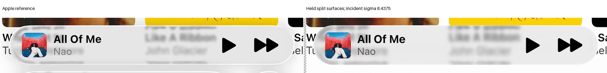
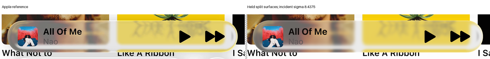

# Incident blur on the held split surfaces

**Both fixed widths are rejected.** Neither passes the original family guards against the held split-surface state and protected selected reconstruction. Retain incident sigma 6.75 pixels. Geometry, light and material response remain unchanged.

| Evidence | Record |
| --- | --- |
| Actual clock, widths and limits | [Protocol](protocol.json) |
| All-reference finite support before RGB | [Source preflight](source-FIRST.json) |
| Four exact cached identities | [Checkpoint](checkpoint.json) |
| Original and selected-state guards | [Results](result.json) |

| Reference | Held E, sigma 6.75 | Sigma 5.0625 | Sigma 8.4375 |
| --- | ---: | ---: | ---: |
| Expanded A | 11.051 | 11.981 | 10.826 |
| Expanded B | 8.522 | 10.116 | 7.934 |
| Compact A | 24.346 | 24.897 | 24.361 |
| Compact B | 23.331 | 24.119 | 22.734 |

The wider filter improves some background texture and expanded-body errors. It does not resolve the original interior, foreground and boundary failures. The narrower filter increases incorrect detail. No width is selected from aggregate error alone.

Both exact widths act on the incident background before refraction. Their finite radii are 16 and 26 pixels. Direct reflection receives neither filter; clear exterior samples and original foreground handling remain unchanged.

All four identities reproduce the held images exactly. Every changed whole-lens kernel and bilinear footprint passes before RGB. Original scored misses inherit unchanged clear paths and samples. Source availability remains conditional mosaic support, not photographic truth.

There are eight candidate composites, eight score calls and 5,948,340 lens queries. No new ray, height evaluation, geometry, color fit or output filter runs. The next isolated question concerns the common transmission response, with this geometry, light and original softness frozen.
