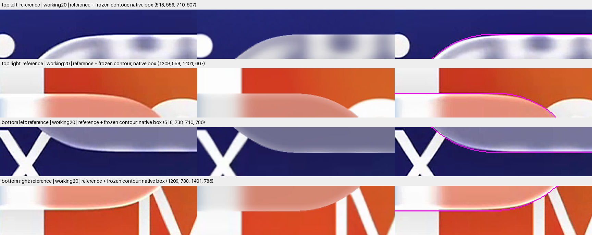
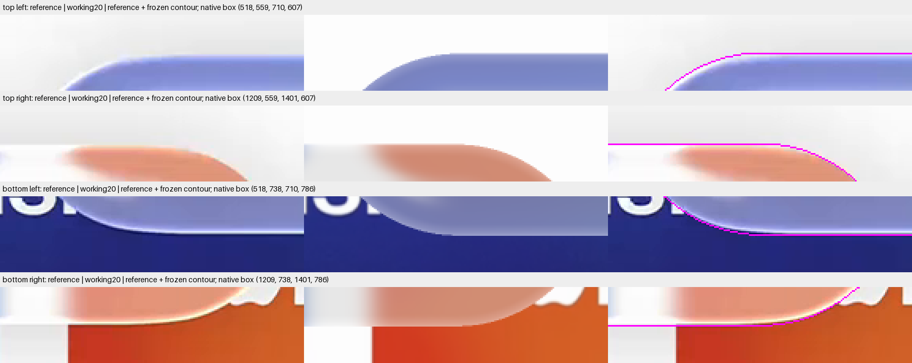
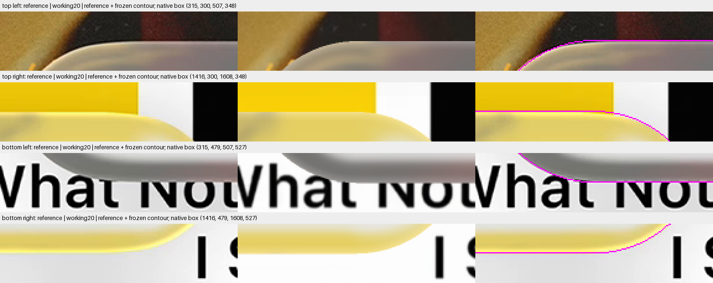
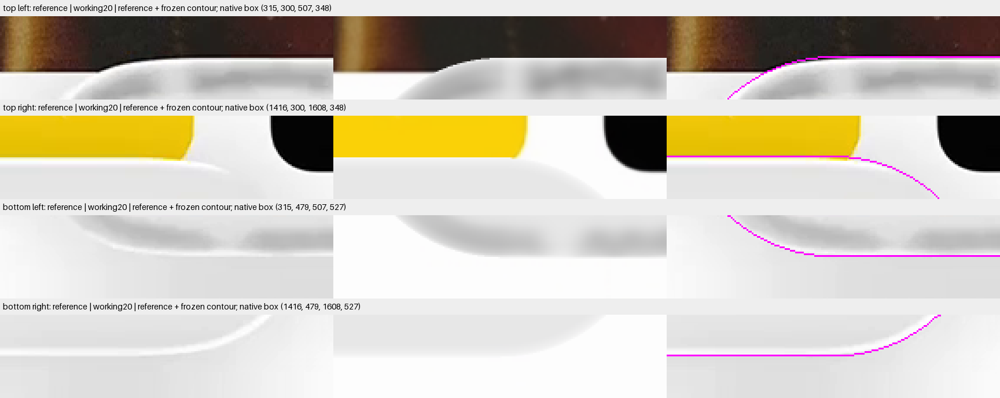

# Cap joins: a smooth contour is plausible, its amount remains unmeasured

The current footprint has straight sides and circular corner arcs. It is tangent-continuous but not curvature-continuous. New native observations show repeatable inward intensity-transition offsets at compact lower joins. They justify a smooth-contour hypothesis, not a recovered silhouette or a fitted blending amount.

**No shape, outline, shadow or selected model changed.** This is the first geometry checkpoint before the authorized shadow and color-aware highlight stages. Existing comparisons and original guards remain intact.

## Native join comparisons

Each row shows the original reference, frozen working20 body, and a separate reference copy marked with the current magenta contour. Crops retain native pixels and use nearest-neighbor enlargement. There is no image registration adjustment. The marked copy is an annotation, not a reconstruction.

### Compact A

### Compact B

### Expanded A

### Expanded B

The compact lower joins show similar smooth inward transitions across both references. Upper compact B is weak against bright backing. Expanded upper-left is informative, but lower typography and pale expanded B regions confound intensity landmarks. Expanded A's upper-right highlight retains yellow, supporting the proposed color-aware response investigation.

## What the present contour represents

Let the half-extents be A and B and the rounded-corner radius be R. The current inner rectangle has half-extents A minus R and B minus R. Adding a disk gives the ordinary rounded rectangle. Current B is slightly larger than R, so even the ends include a very short straight segment.

$$
K_0=[-(A-R),A-R]\times[-(B-R),B-R]\;\oplus\;\mathbb D_R.
$$

The join has matching position and tangent, but its curvature switches between these values:

$$
\kappa_{\mathrm{side}}=0,
\qquad
\kappa_{\mathrm{arc}}=\frac{1}{R}.
$$

Thus continuous position and tangent do not establish continuous curvature. The existing long sides have no bow. The earlier registration audit tested inconsistent size and position evidence; it did not establish that this contour family was exact.

## Measured brightness landmarks

Seventeen native integer rows surround the frozen contour at every selected column. Largest adjacent luminance differences and brightest samples are retained without smoothing or fitting. Negative offsets are inward. Fixed center and join windows avoid choosing regions from the observed residuals.

| Region | Center gradient offset | Left-join offset | Right-join offset |
| --- | ---: | ---: | ---: |
| Compact A, bottom |−0.82 px |−1.82 px |−1.82 px |
| Compact B, bottom |−0.82 px |−1.82 px |−1.82 px |
| Compact A, top |−0.39 px |−0.83 px |−0.79 px |
| Expanded A, top |+0.04 px |−0.86 px |−0.81 px |
| Expanded B, top |+0.04 px |−0.76 px |+0.04 px |

The compact bottom pattern repeats despite changed backing. It is directionally consistent with a more gradual inward join. However, shadow, highlight width, video filtering and pixel phase can move the intensity transition independently of the physical boundary. The roughly one-pixel difference is not a measured contour displacement.

Expanded upper midsections and center share the same sampled transition row. This does not resolve a subpixel bow. Compact B's top brightest samples often sit at the outer window endpoint, demonstrating backing contamination. Expanded bottom offsets conflict across references and are not used to claim a common shape correction.

[All fixed-window summaries](summary.json), [32-pixel bins](bins.json), and [lossless native profiles](profiles.json.gz) preserve disagreements and window endpoints. [Storage identity](profile-storage.json) records the exact decompressed bytes. The bands below retain native columns and contour-relative sample rows; they are not vertically aligned photographs.

[Expanded A bands](expanded-a-side-bands.png) · [Expanded B bands](expanded-b-side-bands.png) · [Compact A bands](compact-a-side-bands.png) · [Compact B bands](compact-b-side-bands.png)

## Recommended first geometric hypothesis

Replace the inner rectangle by an ellipse with the same half-extents, then add the same disk. This preserves the current overall width and height, introduces no fitted coefficient, and keeps major half-length as the only member-specific shape parameter.

$$
a=A-R,\qquad b=B-R,
\qquad
K_1=\mathcal E(a,b)\oplus\mathbb D_R,
\qquad a>0,\ b>0.
$$

Its support function is smooth and has positive curvature radius:

$$
s(\theta)=R+\sqrt{a^2\cos^2\theta+b^2\sin^2\theta},
\qquad
\rho(\theta)=R+\frac{a^2b^2}{\left(a^2\cos^2\theta+b^2\sin^2\theta\right)^{\frac{3}{2}}}>0.
$$

The contour has no arc-to-line curvature jump and no perfectly straight long segment. It lies inside the current rectangle-plus-disk contour while preserving axis extrema. The disk radius remains a construction parameter, not an unchanged local curvature radius. Current minor core half-height is approximately 0.7201 native pixel; this is inherited geometry, not a newly measured blend width.

This is a proposed first discriminator, not an implemented adapter or Apple identification. It may be too weak or have the wrong transition shape. No amplitude, position or curve was fitted to these intensity observations.

The [independent symbolic review](../agent-miniplayer-contour-theory-58/README.md) supports this special case and its limits. It identifies no fitted amount and performs no numerical experiment.

## Consequences before rendering

A new footprint must drive the actual front and back heights, their gradients, ray membership, projected outline and pixel-area integration. Replacing only the outline contour would create an inconsistent lens. Existing unsmoothed-rectangle escape certificates cannot simply be relabeled for the new coordinate.

Fresh geometry controls, original-mask coverage accounting and complete source/filter support must precede RGB. Original scoring masks and partial cohorts stay fixed. Only after a geometry decision should the separate exterior shadow and color-aware inner-edge response be tested.

The shadow should darken only exterior pixel area, outside refraction and source filtering. The highlight should brighten the underlying edge color with controlled desaturation. Their visible interaction needs separate and combined comparisons; neither should compensate silently for contour error.

## Provenance, clocks and accounting

The protocol started at 00:21:21.845 UTC on 26 October 2026, with checkpoint due 00:26:21.845 and sealing due 00:46:21.845. Header and hash checks passed at 00:22:25.477 before payload decoding. The [result](result.json) records the observation finish. No clock was reset.

| Work | Actual |
| --- | ---: |
| Original target bitmap pixels |8,294,400 |
| Saved completed-array payload bytes |13,459,200 |
| Paired native profile positions |139,264 |
| Native profile columns |8,192 |
| Diagnostic PNG exports |8 |
| Optical calls, fits, model trials |0 |

Each position reads a target RGB triplet and a saved-working RGB triplet: 278,528 triplets in total. The as-run profile counter counts positions, not channels or both fields separately. PNG inspection and metadata packaging are distinct from candidate rendering.

[Setup disclosures](setup-disclosures.json) preserve two pre-decode failures: a Python module-name collision and an unavailable private header reader. Only the successful observation decoded arrays. The display conversion warning concerns unavailable cached values; every retained profile sample was finite. No display byte conversion changed the scientific cache.

First and last hashes match. Inputs, masks, foreground and shared code remain unchanged. The profile archive is a verified lossless compression of the as-run JSON. The analysis distinguishes observed image structure, proposed geometry and future optical requirements.
