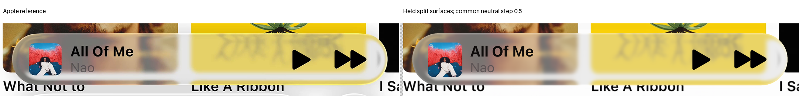
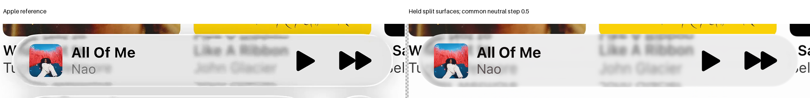

# Shared neutral response on the held split surfaces

**No family-wide qualifier.** One train-only direction and four fixed steps improve overall tone, but expanded boundary and foreground failures remain. Compact successes do not authorize a separate compact response. The selected family is unchanged.

| Evidence | Record |
| --- | --- |
| Scope, bounds and original clock | [Protocol](protocol.json) |
| Four exact identities and train exclusion | [Checkpoint](checkpoint.json) |
| One local quadratic proposal | [Proposal](proposal.json) |
| Every factor and original failure | [Results](result.json) |

The proposal has common gain 0.4957928905 and bias 0.4364003990. Factors one, one-half, one-quarter and one-eighth are evaluated, then stop. It is a local Gauss–Newton direction, not proof of exact nonlinear feasibility or physical transmittance.

| Reference | Selected E | Held split E | Half-step E |
| --- | ---: | ---: | ---: |
| Expanded A | 12.908 | 11.051 | 9.318 |
| Expanded B | 8.576 | 8.522 | 8.239 |
| Compact A | 27.324 | 24.346 | 18.791 |
| Compact B | 26.359 | 23.331 | 17.551 |

At half-step, expanded A fails its original partial-boundary comparison. Expanded B retains interior, title and playback-glyph guard failures. Both compact references pass their protected comparisons. Every actual clipping count is zero; no epsilon or family exception is used.

The fit uses 20,000 original deterministic training pixels with equal reference weighting. Held and foreground pixels are excluded. Geometry, incident blur and light remain fixed. The response acts only on transmission before the separate reflected-light term, AA integration and original foreground.

There is one solve, 19 proposal checks, four exact identities and 16 candidate composites. No ray, height, source query, filter or new material field runs. Glyph-box guards include their background; their failures do not uniquely identify glyph weight or material.
