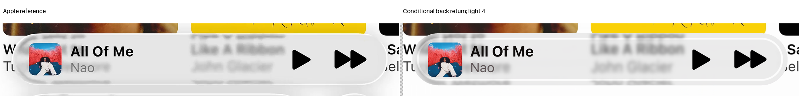

# Flat-front first-return lighting

**Rejected: the conditional reflected light makes an inset ring, not the reference's outer rim.** Both fixed strengths fail expanded B and SSIM guards. The selected model stays unchanged.

| Evidence | Record |
| --- | --- |
| Hypothesis, scene assumptions and original cap | [Protocol](protocol.json) |
| All four references, two fixed lights and guards | [Results](result.json) |
| Joint review and visible comparisons | [Three-hypothesis review](../miniplayer-outline-review-10/README.md) |

The actual cached surface normals determine reflection directions and separate s/p Fresnel powers. A same-surface first-return certificate supplies event order. No fresh geometry grid, source query, fit or optical filter runs.

The annular studio emitter is hypothetical, not observed. Later internal power remains an explicit radiance interval. Existing effective primary transmission is retained; this is not calibrated complete radiometry or an accepted outline.
