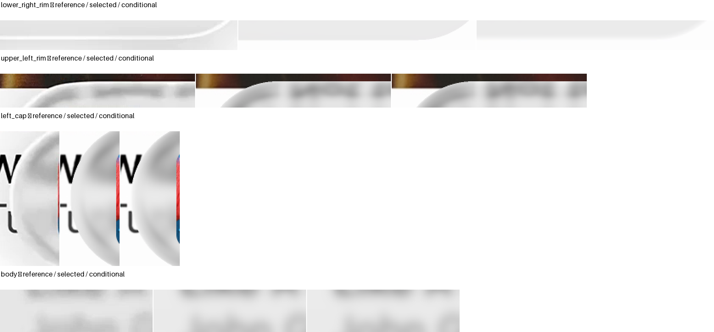

# Miniplayer outline: three physical lighting hypotheses

**Visible rim structure is now rendered, but no complete candidate passes the original guards.** A raised front moves reflection to the outer boundary. Redistributing the existing thickness improves the overall match, while local interior, foreground and boundary regressions remain. The selected model is preserved separately.

| Hypothesis | Actual surfaces | Visible result | Decision |
| --- | --- | --- | --- |
| [07: back return](../miniplayer-outline-light-07/README.md) | Flat front; selected back | Incorrect inset white ring | Rejected |
| [08: raised front](../miniplayer-curved-front-08/README.md) | Raised front; selected back | Outer highlight, disrupted refraction | Rejected |
| [09: split thickness](../miniplayer-split-surface-09/README.md) | Equal front/back shares of existing thickness | Outer highlight with smaller content disruption | Held; original guards fail |

## Exact visible question

Expanded B lacks the reference's thin bright lower/right perimeter. Expanded A retains cap and upper-rim lighting differences. Fixed original-coordinate crops compare those defects, the left cap and central content. Compact remains the exact same model shortened, including the light assumption.

| Expanded original-image crop | Bounds |
| --- | --- |
| Lower/right rim | `[1300,480,1580,515]` |
| Upper/left rim | `[315,315,545,355]` |
| Left cap | `[310,335,380,494]` |
| Central body | `[900,390,1080,440]` |

The geometry, incident blur, color response, input mosaics, registration, masks, artwork and glyph styles remain recorded. Only the explicitly declared physical surfaces and hypothetical light change. All four references use the same parameters, except major length.

## Surfaces and light

The selected spline height is positive inside the frozen rounded footprint and zero at its boundary. Every gradient and interface normal comes from that same height.

$$
\begin{array}{c|cc}
\text{Hypothesis}&z_{\mathrm{front}}&z_{\mathrm{back}}\\
07&0&-h(x,y)\\
08&\frac{h(x,y)}{2}&-h(x,y)\\
09&\frac{h(x,y)}{2}&-\frac{h(x,y)}{2}
\end{array}
$$

The hypothetical white studio emitter depends only on direction toward the scene. It surrounds the camera axis over polar angles 30–80 degrees, with ten-degree smooth shoulders. Radiances one and four are fixed tests; neither is fitted per image or location.

This is an unobserved scene assumption, not recovered Apple lighting. The emitter has no image coordinates, distance-to-outline mask, target matte or manually shifted normal.

## What the displayed radiance means

The existing encoded primary transmission is an effective calibrated baseline. Explicit sRGB decoding and encoding surround a separate, first-order reflected contribution. This hybrid does not establish physical transmission calibration or exclude overlap with the existing empirical bias.

$$
\begin{aligned}
C_{\mathrm{conditional}}
&=\mathcal{E}\!\left(\mathcal{D}(C_{\mathrm{primary}})
+P_{\mathrm{branch}}L_{\mathrm{emitter}}(\boldsymbol{\omega})\right),\\
0&\le\Delta L_{\mathrm{later}}
\le P_{\mathrm{retained}}L_{\mathrm{scene,max}}.
\end{aligned}
$$

Here the two operators are the declared encoding and decoding approximations. The first hypothesis uses the certified first back/front return; the latter two use direct front reflection. Later internal power remains unassigned and bounded, rather than silently receiving a color.

Reflection does not receive the transmission blur, gain or bias. No cosine or inverse-square factor is added to an infinite-distance environment. Saturation counts are recorded; all tested candidate samples remain unclipped.

## Joint measurements

| Version, emitter radiance four | Expanded A E | Expanded B E | Compact A E | Compact B E |
| --- | ---: | ---: | ---: | ---: |
| Selected family | 12.908 | 8.576 | 27.324 | 26.359 |
| Flat-front back return | 14.733 | 10.920 | 26.933 | 26.043 |
| Added raised front | 19.903 | 16.124 | 31.332 | 25.022 |
| Same-thickness split | 11.051 | 8.522 | 24.346 | 23.331 |

The split version improves E and SSIM on all four references at radiance four. That does not override interior, foreground or partial-boundary failures. Both fixed light strengths and every failed guard remain in the original result records.

| Split version, expanded crop RGB RMSE | Selected | Conditional | Outcome |
| --- | ---: | ---: | --- |
| A lower/right | 21.078 | 18.410 | Improves |
| A upper/left | 17.137 | 14.725 | Improves |
| B lower/right | 16.460 | 16.358 | Small improvement |
| B upper/left | 15.836 | 17.074 | Regresses |

The A original partial-boundary cohort worsens, and several foreground guards fail. Compact's frozen old 22-pixel cohort stays distinct from current four-pixel coverage diagnostics. No pixel, mask or score epoch changes.

## Inspect the actual renders

The following comparisons use the held split geometry with emitter radiance four. They are conditional experiments, not selected replacements or a completed outline solution.

## Correctness and remaining uncertainty

Changed primary paths pass whole-body and original all-guard source audits before RGB. The full finite 43-by-43 incident kernel and four bilinear texels are included. Conditional mosaic support remains different from photographic truth.

For fixed split09, independent scalar bounds also certify outgoing no-reentry and direct front-reflection escape. The earlier08 diagnostics did not certify outgoing no-reentry; their internal roots and image-plane support are not a complete escaping-path proof.

The two-graph solver uses a monotone residual with a retained bracket. Positive slope-based bounds establish front/back event order. Exact creases remain unresolved; no convex intersector is applied to the nonconcave spline.

An initial missing union-mask key stopped preflight before RGB. Its [failure and recovery](../miniplayer-curved-front-08/recovery-protocol.json) preserve the old ledger, reuse saved geometry and explicitly charge repeated preflight work. The original deadline is unchanged.

A storage threshold also interrupted setup. Working files and history were preserved; only regenerable builds and verified redundant cache locations changed. Neither event is a geometric rejection or a hidden budget reset.

## Decision and next stage

Retain the selected family. Preserve split surfaces as a held physical state for subsequent isolated material assessment, not an accepted geometry or illumination model. No fourth geometry or light setting follows this review.

The next stage must keep those surfaces fixed while assessing incident softness. It must protect the selected reconstruction as well as the held state, retain every local regression and keep compact parameter-identical. Later color, shadow, foreground and dispersion assessments remain explicit.
