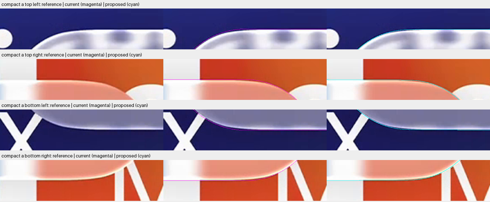
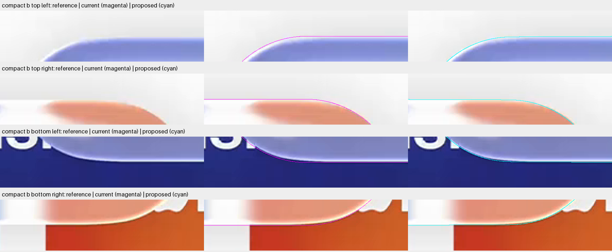
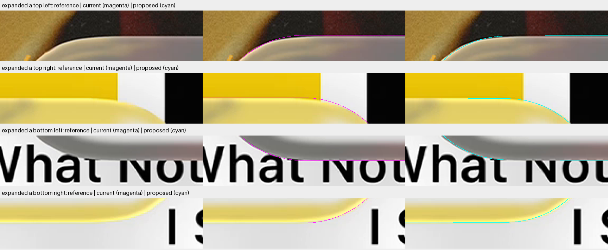
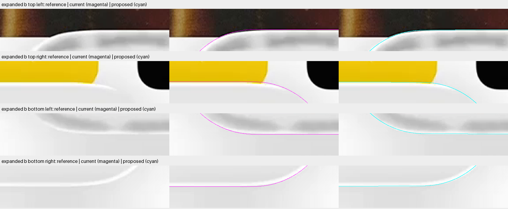

# Shape checkpoint: smooth joins without changing the outer dimensions

**One unfitted smooth contour passes its two-dimensional controls.** It preserves current overall width, height and centers while replacing the flat sides and curvature jumps with a smooth convex boundary. At the old joins, the proposed inward change is approximately 0.680 pixel for expanded and 0.665 pixel for compact.

These are exact consequences of the proposed geometry, not measurements of Apple's silhouette. No refraction image, shadow, highlight or selected model changed. This checkpoint provides the requested native cap-join comparison before actual lens geometry is replaced.

## Read the comparisons

Each row contains the same original reference three times: unmarked, current contour in magenta, and proposed contour in cyan. Native pixels are enlarged threefold with nearest-neighbor sampling. Thin colored lines are annotations only; none is a simulated bright outline. Open an image fullscreen to inspect the joins.

### Compact A

### Compact B

### Expanded A

### Expanded B

The change is subtle, as intended. The cyan curve moves inward near the old joins without shifting the top or bottom midpoint. It follows the direction suggested by compact's repeated lower transitions. Several reference regions remain ambiguous because the highlight, shadow and backing transition overlap. These annotations alone cannot establish a closer physical silhouette.

## One shared construction

The [symbolic review](../agent-miniplayer-contour-theory-58/README.md) defines the ellipse-plus-disk boundary. Existing half-extents and disk radius are reused exactly. Only major half-length differs between compact and expanded; no fitted blend, translation or size coefficient is introduced.

$$
a=A-R,\qquad b=B-R,
\qquad K=\mathcal E(a,b)\oplus\mathbb D_R.
$$

For outward normal angle, the implementation uses the exact support point:

$$
q=\sqrt{a^2\cos^2\theta+b^2\sin^2\theta},
\qquad
\boldsymbol p(\theta)=
\begin{pmatrix}\frac{a^2\cos\theta}{q}\\\frac{b^2\sin\theta}{q}\end{pmatrix}
+R\begin{pmatrix}\cos\theta\\\sin\theta\end{pmatrix}.
$$

All constants are common except major half-length. The inherited inner minor half is 0.7201120625 native pixel. Positive inner axes produce continuous positive curvature everywhere. Keeping the disk radius does not keep the old local cap curvature exactly.

## Size of this specific proposal

The table compares upper boundaries at fixed horizontal coordinates. Positive values mean the proposed boundary is inward. Lower boundaries follow by symmetry. Sections were specified before calculation; no source or target value participates in the geometric solve.

| Position | Expanded inward change | Compact inward change |
| --- | ---: | ---: |
| Middle of long side |0 px |0 px |
| Halfway from center to old join |0.09645 px |0.09641 px |
| 32 pixels before old join |0.47758 px |0.41648 px |
| 16 pixels before old join |0.54653 px |0.50156 px |
| At old join |0.67963 px |0.66491 px |
| 16 pixels into old cap |0.71754 px |0.71601 px |
| 32 pixels into old cap |0.71889 px |0.71817 px |

The [native observation](../miniplayer-join-inspection-92/README.md) found roughly one-pixel compact lower intensity-transition differences near joins. That supports investigating this scale of change, but does not identify the proposal's exact amount. A subpixel side bow is not resolved by integer-row landmark agreement.

## Geometry controls

Exact axis extrema, unit normals, ellipse membership, support consistency, mirror symmetry, physical scaling and the equal-axis circle case pass. The proposed sampled boundary remains inside the old rounded rectangle within floating-point error. Analytic inclusion and curvature arguments remain separate from these finite controls.

| Control | Expanded | Compact |
| --- | ---: | ---: |
| Axis-extrema error |0 px |0 px |
| Maximum support residual |4.55e-13 px |1.71e-13 px |
| Maximum polygon chord |0.10559 px |0.06626 px |
| Minimum curvature radius |88.88736 px |88.88792 px |
| Curvature radius at side midpoint |420969.49 px |165705.83 px |

A very large finite midpoint curvature radius means a very slight bow, not an exactly straight edge. Display polygons are fine enough for the declared annotation check; their chord bound is not a native optical quadrature certificate.

[Full controls](controls.json), [fixed sections](sections.json), [expanded boundary arrays](expanded-contour.npz) and [compact boundary arrays](compact-contour.npz) retain the numerical evidence. No geometry setting was rejected and replaced, and no parameter fit ran.

## Decision and remaining work

Recommend this one shared contour as the first actual-geometry discriminator. It expresses the requested smooth joins without changing existing extrema or adding free fitted parameters. It is not yet an adopted lens footprint or proof of Apple's construction.

Before a reconstruction, implement one consistent height coordinate and exact projected-distance interface. Re-establish gradient, boundary, ordered-path, escape, coverage and complete source-kernel checks. Original masks and all partial pixels must remain scored. Old rectangular-coordinate certificates do not automatically apply.

The exterior-only shadow and color-aware inner highlight remain subsequent isolated stages. Their models must consume the agreed contour. A brighter yellow edge should remain yellow with controlled desaturation; a shadow should alter only exterior contribution, never refracted samples. Neither material adjustment should hide a geometry mismatch.

## Clock, scope and accounting

The block started at 00:33:04.207 UTC on 26 October 2026 and ends by 00:51:04.207. The geometry and input checkpoint passed at 00:33:05.675, before target decoding and within five minutes. First and last hashes match the pinned inputs and recipe. The [result](result.json) records completion and counters.

| Work | Actual or conservative reservation |
| --- | ---: |
| Contour proposals |1 |
| Reserved boundary points |131072 |
| Distinct retained boundary points |131066 |
| Additional control points |2048 |
| Fixed-section scalar boundary evaluations |1040 |
| Current-contour annotation points |12304 |
| Original target bitmap pixels |8294400 |
| Diagnostic PNGs |4 |
| Rays, heights, filters, fits, candidate composites |0 |

All four annotation sheets were inspected. There were no startup failures, numerical retries or curve adjustments. Numerical boundary work is explicitly counted and distinct from optical transport. Selected models, cached images, original source, masks and previous records remain unchanged.
