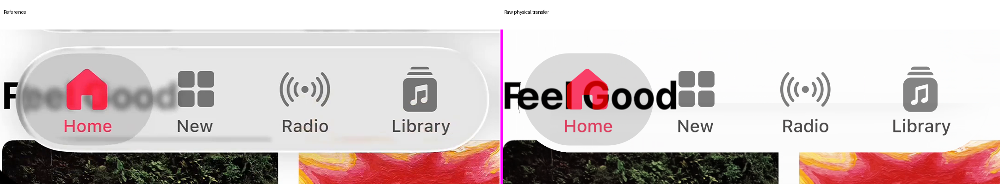
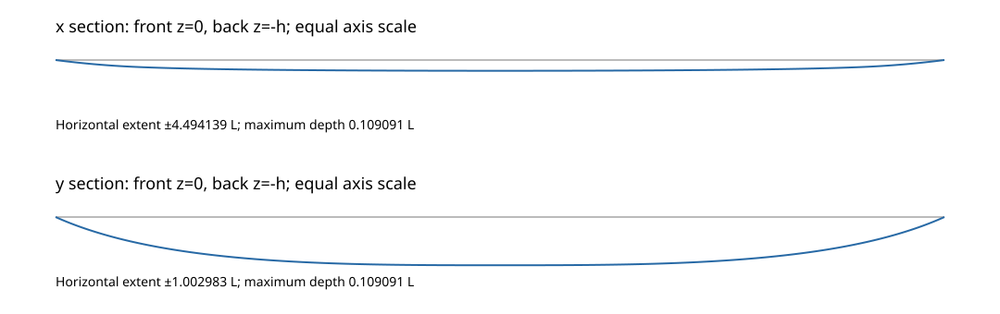
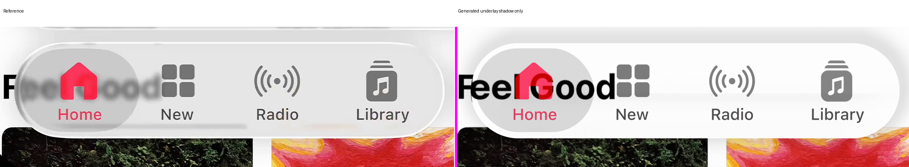

# Navigation: geometric transfer

Status: useful negative with incomplete color/outline identification. The raw geometric baseline is primary under the [current selection policy](../../decisions/primary-geometric-models.md); empirical pass03 is historical.

## Visible question

The historical reconstruction retains a dark upper/left rim. The second reference also shows compressed and softened background lettering at the left cap. Test whether a realizable shared surface explains the correspondence before studying material softness and boundary light.

Use original-frame crops: left cap [320, 535, 650, 765], upper body [650, 530, 1270, 595] and lower body [650, 690, 1270, 765]. Foreground remains present; optical measurements retain the original exclusions.

## Frozen evidence

| Item | Contract |
| --- | --- |
| References | Original Music frames at 0 and 6.033 seconds. |
| Incumbent | Navigation review-round pass03. |
| Sources | Recorded temporal mosaics and known masks; no new donor or completion. |
| Pose / footprint | Accepted center, half-extents and rounded radius. |
| Foreground | Original nine vector layers and fixed styles. |
| Scoring | Original glass, held, rim, exterior and all sixteen paired foreground guards. |
| Native integration | Original 2×2 samples; no quadrature gain. |

The mostly white source weakly constrains geometry away from recovered text. Known mosaic coverage is conditional evidence, not proof of hidden scene truth.

## First hypothesis

Transfer the harmonic-cap construction used for the expanded control to the navigation footprint. Both interfaces and normals derive from that same surface. Use depth 0.15, longitudinal depth 0.4, power 3, index 1.5 and background distance 2 in minor-half-extent units.

Begin with raw unit transmission, no added blur, light, tone or shadow. Historical graded/filtered evidence remains the accepted comparison, not a matched-nuisance baseline.

Before RGB, verify surface derivatives and boundary statuses, then every whole-body and original guard subray with all four bilinear source texels. Unknown unscored exterior stays unavailable. No source filling or target context is permitted.

## Limits

[Protocol](protocol.json) fixes the four-hour maximum and stage clocks. First proposal: at most 12,000 geometry fixture points, two source preflights and two native images. Trace counts include both preflight and renderer work.

Review after at most three substantive geometric proposals. Do not repeat the earlier unfinished crowned-footprint test or silently change the silhouette. Later stages may close without trials when source or path evidence is insufficient.

## First result

Both references pass whole-body and all original guard source support: 1,447,200 emitted subrays each, with zero incomplete or unsupported required rays. The 7,370 unsupported subrays per reference are outside the body and all guards; presentation marks them magenta as unavailable.

Coverage is bit-identical to the historical footprint. Raw paired E is 36.18531 / 28.49753; historical graded/filtered pass03 is 1.97514 / 7.42945. This nuisance difference prevents a geometric fidelity claim.

The raw comparison preserves sharp lettering where the reference is frosted. The bright rim and body tone are absent. Another geometry fit before controlling softness would confound these defects; close the first geometry question without an accepted replacement.



[Surface controls](geometry-check.json), [source proof](source-preflight.json) and [native results](raw-result.json) retain exact counts. Source/target/vector hashes are unchanged. Captured cases match the current public paired configuration semantically. Their byte hashes differ from historical pass03 receipts; original byte identity is not claimed.

## Softness proposal

Test one common source-plane Gaussian width, 6.75 native pixels, before geometric sampling. This is a declared material prior from the related frosted-control study, not a fitted Apple roughness. Certify its complete finite radius-21 kernel and bilinear support before RGB.

Keep straight exterior rays on the original unfiltered source. The shared renderer selects incident and exterior fields by actual geometric membership. A zero-filter identity and unknown-support rejection are required; no boundary-specific radius or manual displacement is introduced.

## Softness result

The source PSF improves body texture and all body metrics in both references. It fails four label guards in A and the radio-icon guard in B. Do not adopt it or combine it silently with later changes.

| Measurement | Raw A / B | Source blur A / B |
| --- | --- | --- |
| E | 36.18531 / 28.49753 | 22.79481 / 23.52179 |
| Glass RMSE | 33.73408 / 29.65931 | 22.88169 / 23.63930 |
| Exterior RMSE | 22.48595 / 22.88272 | Exact ties |


[Full guards](blur-result.json) and [finite support](blur-source-proof.json) preserve the negative result. A clear-layer dtype check initially failed; the [recovery](blur-control-recovery.json) reused the unchanged exterior-only tile without retracing or extending the original budget.

## Color precondition

The proposed cached common gain/bias fit assumed fixed-solid foreground compositing. An explicit assertion found a frozen backing-dependent foreground response before the fit ran. No color proposal was evaluated.

[Stop record](color-precondition-stop.json): future testing needs the exact pre-foreground integrated image and the original nonlinear foreground chain. Do not replace that response with a linear opacity approximation. The historical accepted reconstruction remains intact.

## Shared geometry

[Surface definition and certificate](surface.md) describe the same height, gradient and bounds used by the shared tracer. The adapter preserves the accepted footprint; it does not use a residual image warp or independent normal adjustment.



## Remaining stages

| Stage | Result |
| --- | --- |
| Outline | No observed front environment or complete secondary scene; no reflection image. |
| Shadow | Existing shared prior improves exterior, but completed-image A glass/rim regress; hold candidate. |
| Foreground | Eighteen paired vector hashes match; retain original styles, including nonlinear Home response. |
| Dispersion | Neutral error dominates; no identified spectral direction or model added. |

The shadow’s legacy material scores and all foreground scores tie. Exterior RMSE improves from 22.48595 / 22.88272 to 10.68138 / 10.08439. However, 95 original glass pixels per reference change through clear underlay; A completed-glass RMSE rises from 33.379344 to 33.379906.

Pointwise exterior error worsens at 4,609 / 8,516 of 46,436 pixels despite the aggregate improvement. These regressions remain visible in the [verification](verification.json). The false all-glass-pixels-invariant assertion is [preserved](verification-invariance-failure.json); no native control was repeated after it failed.



The [spectral identification audit](identification.json) gives ideal color-only E reduction ceilings of 0.00119% / 0.05049%, holding arithmetic neutral residual fixed. This is not a bound on all spectral transport or proof of absent dispersion.

## Verification and implications

Four 32-pixel native material strips reproduce exactly: raw and source-blurred for both references. The independent full cached shadow calculation is pixel-exact. These are bounded controls, not a full independent optical replay or performance benchmark.

The same Snell tracer, surface interface and source-support rules transfer to this control. Shape parameters preserve its footprint; material and foreground cannot be inferred from circular-play parameters. Visible fidelity does not transfer automatically.

The next discriminating experiment needs a retained pre-foreground integrated image and the original nonlinear foreground chain. It must also score completed boundary pixels, separately from historical material-only metrics. No hidden environment or painted rim is justified by this pass.

## Reproduction

Use Git LFS, Node, zstd and the reconstruction Python dependencies. The SVG compositor also requires the Cairo shared library. Restore declared inputs with:

```sh
git lfs pull
node research/experiments/navigation-geometry-01/restore-inputs.cjs
```

The scripts retain completed-study and clock limits. Reproduction of a new experiment requires a new output directory and protocol; do not erase sealed failures or reset their budgets. Verification recovery specifically charges the already completed A controls and does not rerun them.
